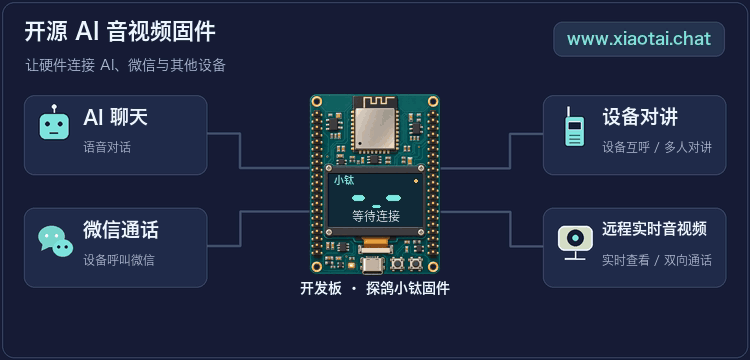
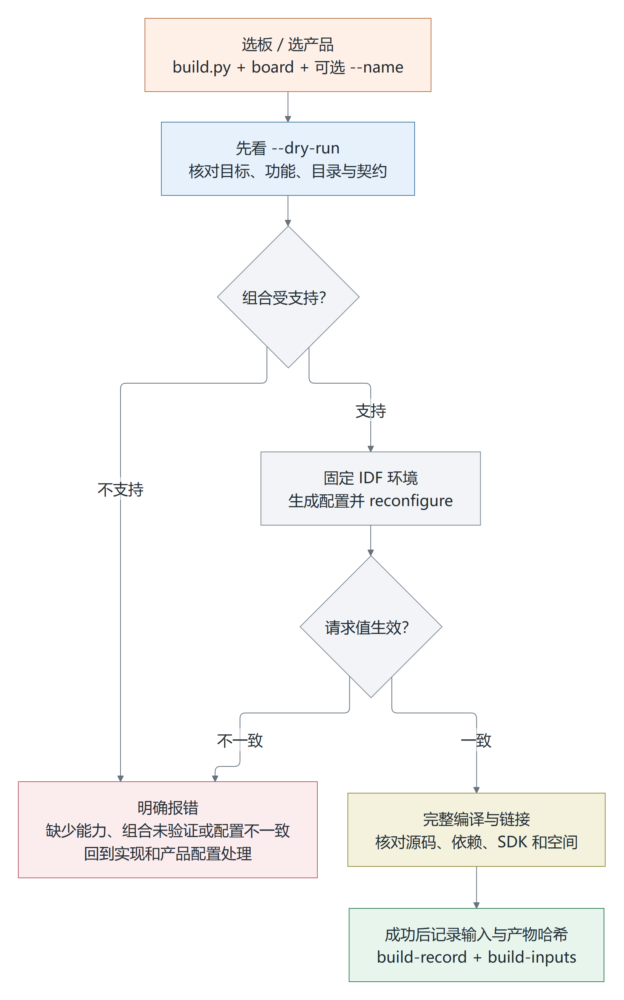

<h1 align="center">小钛 XiaoTai</h1>

<p align="center">面向 ESP32 的开源 AI 音视频固件</p>

<p align="center">
  <a href="docs/assets/home/xiaotai-overview.gif"></a>
</p>

<p align="center">
  <a href="docs/第一次使用.md">第一次使用</a> ·
  <a href="#选板">选板</a> ·
  <a href="#从源码编译">从源码编译</a> ·
  <a href="docs/架构开发指南.md">开发与适配</a>
</p>

小钛是装在 ESP32 开发板里的开源程序，也叫**固件**。它通过 TiRTC 实现实时音视频通信：可以和 AI 聊天、打微信电话，或与另一台设备对讲；部分带摄像头的板型还能在网页上查看画面。各板的默认功能见下方对照。

这里是 `codex/multi-chip-v2` 多芯片源码预览，在一套源码中维护六个产品。每块板都要分别选配置、编译和验收，固件不能通刷。独立板卡工程仍在 [main 分支](https://github.com/tangeai/xiaotai-esp32/tree/main)。

## 第一次来，从这里开始

先让一块设备完成一次对话或通话，不必一开始就读源码。

| 你的情况 | 下一步 |
| --- | --- |
| 用现成固件体验小钛 | 看[第一次使用](docs/第一次使用.md)，从认板、选包到配网和绑定一步步来 |
| 设备已经装好小钛 | 直接从[连接 Wi-Fi](docs/第一次使用.md#4-连接-wi-fi)开始；已经联网就去[绑定设备](docs/第一次使用.md#5-绑定设备) |
| 想改程序，或接自己的硬件 | 从[源码编译](#从源码编译)开始，再看[开发与适配](docs/架构开发指南.md) |

准备清单、配网时序、双向通话检查和常见问题，都在[新手指南](docs/第一次使用.md)里。已经完成的步骤可以跳过，不必重新烧录或清除配置。

公开固件另行维护，以[下载目录](https://github.com/tangeai/xiaotai/blob/main/docs/downloads.md)列出的板型和版本为准。它不是本分支六块板的通用安装包，也不能代替本分支源码的验证。

## 选板

先看手里的**完整型号**，再选固件。“S3”“P4”“C3”只是芯片名称，同一种芯片的不同板子也不能混刷。

| 本分支适配的板子 | 默认体验与选包要点 |
| --- | --- |
| 立创实战派 S3 | 彩屏；AI 聊天、看图、语音通话、网页查看。固件选立创实战派板型。 |
| M5Stack CoreS3-Lite | 彩屏；AI 聊天、语音通话，摄像头用于网页查看，默认没有 AI 看图。核对 Lite 型号和固件要求的屏幕控制器。 |
| 微雪 P4 3.5 寸 | 480 × 320 触摸界面；聊天、通话、网页查看。C6 经 SDIO 联网；3.5 寸不能用 4.3 寸包。 |
| WT99P461-S1 1V1 | 1024 × 600 门禁界面；聊天、通话、网页查看。C61 经 SPI 联网；选 1V1 板型，不与微雪 P4 混刷。 |
| Xmini-C3-V3 | 128 × 64 小屏、按键，16 MB Flash；AI 聊天和语音通话，无视频。选 C3-V3，不是 MZ28。 |
| MZ28-AI-PPD | 无屏，8 MB Flash，VB6824 音频；按键、灯光和语音提示。默认仅微信语音，不套用 Xmini 的功能和操作。 |

这里只列主要区别。设备互呼、多人对讲等完整默认功能见[功能对照](docs/架构开发指南.md#42-功能选项分别是什么)，各板的构建参数见[多芯片适配指南](docs/MULTI_CHIP.md#选板)。

<p align="center">
  <a href="docs/assets/home/lckfb-s3-device-front.webp"></a>
  <a href="docs/assets/home/waveshare-p4-device-front.webp"></a>
</p>

<p align="center"><sub>立创实战派 S3（左）与微雪 P4（右）。照片用于对照外观，不作为本分支固件的验收证明。</sub></p>

P4 还要核对芯片修订：本分支两板的默认配置最低为 **rev3.1**，不能套用到 rev1.x。板上印的 PCB 版本与芯片修订是两回事，烧录时按所选固件的适用范围确认。

## 从源码编译

编译，就是把源码生成能装进开发板的程序。只体验已有固件可以跳过这一节；修改代码或验证本分支时再做。

<details>
<summary>展开编译流程、命令与环境要求</summary>

[](docs/assets/architecture/07-build.png)

先打开本分支根目录，也就是能看到 `scripts/build.py` 的文件夹。以下命令只查看配置，不编译，也不连接开发板：

```sh
python scripts/build.py --list-boards
python scripts/build.py xmini/c3-v3 --dry-run
```

上例选择 Xmini，其他板换成[对应板卡参数](docs/MULTI_CHIP.md#选板)。先核对输出中的 `board`、`idf_environment`、`sdk_directory` 和 `build_dir`，确认板型与环境没有选错。

接着准备 ESP-IDF，也就是乐鑫的开发工具。立创 S3 固定使用 **6.0.3**，其余五板固定使用 **6.0.2**；还需匹配规定的源码版本。按[环境说明](docs/架构开发指南.md#43-环境与编译命令)激活后，再编译：

```sh
python scripts/build.py xmini/c3-v3
```

结果保存在 `build/<产品名>/firmware/`，`build-record.json` 记录所选产品和构建输入，`build-inputs.json` 保存输入清单。当前共享依赖缓存仍需串行使用，不同时启动多块板的构建。上述命令不会烧录或发布。

烧录前还要核对完整文件清单和写入地址。单独的 `xiaotai.bin` 只是应用程序，不能当完整镜像从 `0x0` 写入。配置覆盖顺序、勾选方法和产物说明见[编译章节](docs/架构开发指南.md#4-选择配置和编译)。

</details>

## 改功能、接新板

| 你要做什么 | 从这里开始 |
| --- | --- |
| 给现有产品加功能 | [模块归属、启动接入和测试](docs/架构开发指南.md#2-在开发版中加入新功能) |
| 换板卡、音频外设或交互方式 | [硬件与交互适配](docs/架构开发指南.md#3-做硬件和交互适配) · [兼容性契约](docs/新板适配与兼容性契约.md) |
| 看勾选项、改默认配置 | [产品配置与 menuconfig](docs/架构开发指南.md#4-选择配置和编译) |
| 查设备状态和诊断入口 | [本地 AT 指令](docs/本地诊断与AT指令.md)，先核对支持的板型与构建模式 |

代码按职责使用 C/C++：C++ 管理应用编排和板级抽象，成熟的 C 状态机、驱动、算法和 SDK 接口保持行为，不为统一语言而重写媒体时序或协议。

新板优先复用已有业务，只适配硬件和交互。目前部分运行代码仍与原板绑定，标为 `native-bound`，还不能只改板名就使用旧实现。功能选项也只接受各产品已登记的默认组合，暂不支持任意裁剪。

<details>
<summary>展开源码目录职责</summary>

```text
main/main.cc                     固件入口
main/boards/                     板型选择、物理资源与 C 兼容桥
main/xiaotai/application/        C++ 启动编排、C 启动服务与会话状态机
main/xiaotai/services/           设备平台、绑定、鉴权与业务请求
main/xiaotai/transport/          TiRTC 生命周期、连接代次与回调边界
main/xiaotai/platform/           NVS、配置、Wi-Fi 与配网
main/xiaotai/input/              按键与控制台输入
main/xiaotai/media/              采集、编码、播放、摄像头与唤醒
main/xiaotai/ui/                 各屏幕的现有交互与资源
components/tirtc_sdk/            分芯片 SDK、产品专用变体及 ABI 契约
components/xiaotai_lvgl/         LVGL 9 图像绘制任务适配
components/xiaotai_crypto/       IDF 6 PSA HMAC
vendor/                         保留来源和许可的板型专用依赖
config/                         公共配置与当前开发阶段
tests/                          主机回归、静态约束及 SDK 全符号链接检查
```

</details>

## 版本与验证

[版本记录](CHANGELOG.md)从 0.1.0 开发基线起记。立创 S3 使用 TiRTC 2.6.0 / ESP-IDF 6.0.3 的 PSRAM 兼容 SDK；其余五板使用各自的 SDK 和 ESP-IDF 6.0.2。彩屏使用 LVGL 9.5.0。立创 S3 的 HTTP-only 限制只作用于 TiRTC SDK 路径，不改变其他服务的 TLS 配置。

各板的构建和真机覆盖见[验证范围与已知限制](docs/VALIDATION.md)。本分支仅提供源码预览，不提供可直接烧录的固件。

使用在线功能还需要网络、设备绑定和相关服务。本仓提供设备端程序，不包含完整云端服务和微信小程序；自己编译成功，不等于这些服务已经开通。

[多芯片适配指南](docs/MULTI_CHIP.md) · [照片与配图来源](docs/assets/home/SOURCES.md) · [开源许可](LICENSE) · [第三方声明](THIRD_PARTY.md)
