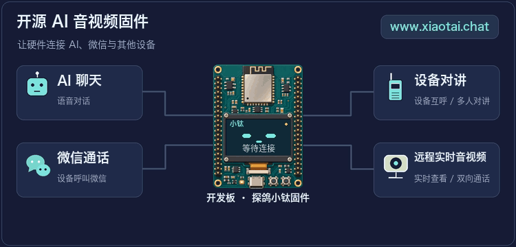
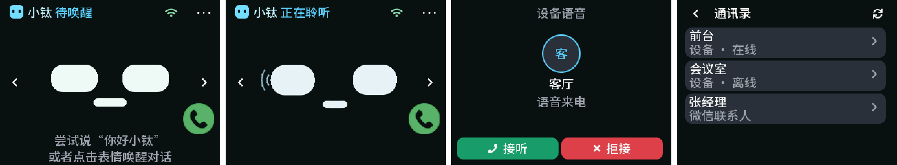
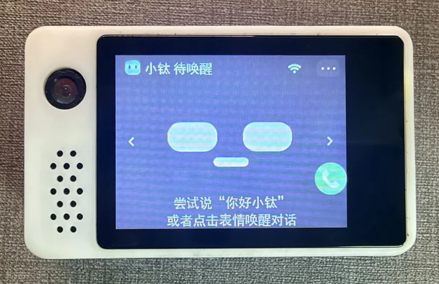
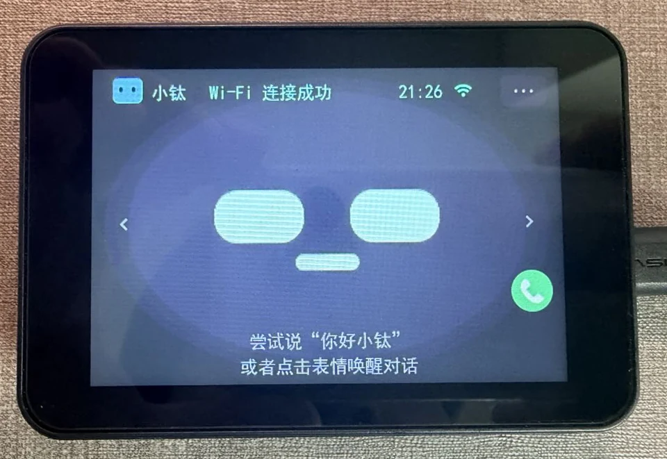
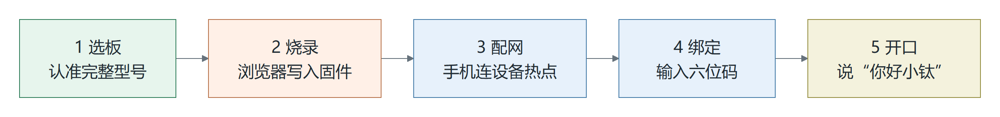

<h1 align="center">小钛 XiaoTai</h1>

<p align="center">让 ESP32 开发板能和 AI 对话、打微信电话、互相对讲、远程查看的开源固件</p>

<p align="center">
  <a href="docs/assets/home/xiaotai-overview.gif"></a>
</p>

<p align="center">
  <a href="docs/快速开始.md">快速开始</a> ·
  <a href="docs/开发板/README.md">开发板</a> ·
  <a href="docs/使用说明.md">使用说明</a> ·
  <a href="docs/第一次编译.md">第一次编译</a> ·
  <a href="docs/架构总览.md">架构总览</a> ·
  <a href="docs/README.md">全部文档</a>
</p>

小钛是装在开发板里的程序，也就是固件。用电脑把它写进（烧录）一块带屏幕的 ESP32 开发板，连上 Wi-Fi，这块板就能：

| 功能 | 怎么用 |
| --- | --- |
| AI 对话 | 说“你好小钛”或点一下屏幕上的表情，直接开口；AI 回答时可以打断 |
| 设备对讲 | 在通讯录里点另一台设备，对方接听后双向通话 |
| 微信通话 | 手机微信和设备互相呼叫，在设备屏幕上接听 |
| 多人对讲 | 几台设备进同一个房间，按住说话 |
| 实时查看 | 在手机或网页上看设备摄像头的画面，并和设备那边说话。没有摄像头的板子只有声音 |

<p align="center">
  
</p>
<p align="center"><sub>设备屏幕上的四个页面：首页、AI 正在聆听、来电、通讯录。</sub></p>

## 从哪里开始

| 你想做什么 | 从这里开始 | 需要准备 |
| --- | --- | --- |
| 拿到板子，装上小钛用起来 | [快速开始](docs/快速开始.md) | 一块[支持的开发板](#支持的开发板)、USB 数据线、电脑、手机、2.4 GHz Wi-Fi |
| 已经装好，看各项功能怎么用 | [使用说明](docs/使用说明.md) | 已经配网、绑定的设备 |
| 改代码，自己编译固件 | [第一次编译](docs/第一次编译.md) | 以上，再加 ESP-IDF（乐鑫官方的 ESP32 开发环境） |
| 把小钛接到自己的开发板上 | [新板接入](docs/新板接入.md) | 同上，以及新板的原理图 |
| 了解它是怎么设计的 | [架构总览](docs/架构总览.md) | 只需要阅读 |

## 支持的开发板

五块板都支持 AI 对话、设备对讲、微信通话、多人对讲和闹钟。差别在屏幕、实时查看和各自多出来的功能：

| 开发板 | 芯片 | 屏幕 | 实时查看 | 这块板还有 |
| --- | --- | --- | --- | --- |
| [立创实战派 ESP32-S3](docs/开发板/立创实战派-S3.md) | ESP32-S3 | 320×240 触摸 | 画面和声音 | AI 看图、声音识别 |
| [M5Stack CoreS3-Lite](docs/开发板/M5Stack-CoreS3-Lite.md) | ESP32-S3 | 320×240 触摸 | 画面和声音 | 声音识别 |
| [微雪 ESP32-P4 3.5 寸](docs/开发板/微雪-P4-3.5寸.md) | ESP32-P4 + C6 | 480×320 触摸 | 画面和声音 | 视频通话、门禁室内机 |
| [WT99P461-S1](docs/开发板/WT99P461-S1.md) | ESP32-P4 + C61 | 1024×600 触摸 | 画面和声音 | 可视门铃、门禁机 |
| [GUITION JC1060F570C](docs/开发板/GUITION-JC1060F570C.md) | ESP32-S31 | 7 寸 1024×600 触摸 | 声音 | 声音识别 |

每块板只能用自己完整型号对应的固件，不能互换：同一种芯片的不同板子，屏幕、音频芯片和接线都不一样。插哪个口、下载哪个文件，点表里的板名查看。你的板子不在表里时，可以看看[另一个固件仓库](#相关仓库)是否支持，或者按[新板接入](docs/新板接入.md)自己适配。

<p align="center">
  <a href="docs/assets/home/lckfb-s3-device-front.webp"></a>
  <a href="docs/assets/home/waveshare-p4-device-front.webp"></a>
</p>

## 体验路线



完整的步骤和每一步做对了的画面在 [快速开始](docs/快速开始.md) 里。整个过程分五步：

1. **选板**：在上表里找到你的板子，点进它的页面看接口和固件。
2. **烧录**：用浏览器把固件写进开发板，不用安装软件。
3. **配网**：手机连上设备发出的 `XiaoTai-XXXX` 热点，把家里的 2.4 GHz Wi-Fi 告诉它。
4. **绑定**：在[小钛控制台](https://xiaotai.chat/devices)或微信里的“小钛”小程序中，输入屏幕上的六位验证码。
5. **开口**：说“你好小钛”。

能对话之后，到 [使用说明](docs/使用说明.md) 看设备对讲、微信通话、多人对讲和实时查看怎么用，也可以在控制台给它[换一个 AI 角色](docs/控制台与AI角色.md)。

在线功能需要联网、绑定，并使用小钛的云端服务；AI 对话不需要自己准备大模型的密钥。这个仓库只有设备端的程序，云端服务、网页和小程序的示例在[相关仓库](#相关仓库)里。

## 给开发者

装好并激活 ESP-IDF 6.0.3 之后，一条命令编译一块板。通话库 TiRTC 是官方发布的预编译库，第一次编译时自动下载并核对 SHA-256：

```bash
python scripts/build.py --list-boards        # 列出支持的板
python scripts/build.py lckfb/szpi-esp32s3   # 编译立创实战派 S3
```

从装环境到看见启动日志的完整过程见 [第一次编译](docs/第一次编译.md)。下面几件事是这个仓库和一般固件工程不一样的地方：

| 做法 | 具体是什么 | 细节 |
| --- | --- | --- |
| 一套源码，五块板 | 硬件写在 `board.json`，功能写在 `product.json`，共享代码里没有按板名的分支。以 GUITION 7 寸屏为例，它专属的内容是 `boards/` 下的 9 个文件、`products/` 下的一份清单和 `profiles/` 下的构建档案；在 `sdk/` 和 `apps/` 里搜不到它的名字 | [架构总览](docs/架构总览.md) · [新板接入](docs/新板接入.md) |
| 不用开发板也能看界面 | 一条命令在电脑上运行真实的产品代码，把每一页画成图片。本页和文档里的屏幕截图都是这样生成的 | [测试与诊断](docs/测试与诊断.md#在电脑上预览界面) |
| 一条串口命令看全状态 | 接上 USB，打开串口终端，输入 `status`，联网、平台、通话链路、当前活动和内存一次列出 | [AT 指令](docs/AT指令.md) |
| 写给 AI 编程助手的技能 | 仓库自带十份操作手册，在 `.claude/skills/` 下。Claude Code 会自动加载，其他助手可以把它们当文档读。助手照着它们编译、接新板、加功能、定位故障 | [用 AI 助手开发](docs/用AI助手开发.md) |

### 目录

```text
boards/             板包：每块板的引脚、外设、能力和分区
products/           产品清单：每款产品选哪块板、带哪些应用和模块
apps/               应用：伴侣（对话、通话、对讲的主界面）、门禁、闹钟、语音终端
sdk/                框架、引擎、基础模块（AI 对话、通话、配网、绑定等）、芯片驱动和界面主题
components/         TiRTC 包的登记和核对规则，公共组件（字库等）
vendor/             随源码分发的乐鑫组件
partitions/         共享分区表，规定 Flash 怎么划分
scripts/            编译、下载 TiRTC、打包和检查脚本
tests/              在电脑上运行的测试和一致性检查
tools/              设备自动化测试工具（xt）和界面预览
.claude/skills/     写给 AI 编程助手的技能
```

某个功能在哪一层、对应哪个目录，见 [架构总览](docs/架构总览.md)；其他文档见 [全部文档](docs/README.md)。

## 相关仓库

| 仓库 | 内容 |
| --- | --- |
| [tangeai/xiaotai](https://github.com/tangeai/xiaotai) | 小钛的另一个固件仓库，覆盖 BK7258 和另外几块 ESP32 开发板。两个仓库支持的板型不同，按你手上的板子选 |
| [tangeai/tirtc-server-example](https://github.com/tangeai/tirtc-server-example) | 云端服务、网页控制台、小程序和电脑上的设备模拟器示例 |

各仓库支持的型号和固件下载以各自的 README 为准。

## 安全提示

- **在可信的网络里使用。** 设备在局域网里的服务发现和 HTTP 接口不加密；和云端的 MQTT 连接是否加密，由服务端下发的地址决定。
- **不要公开敏感信息。** 验证码、Wi-Fi 密码、设备密钥和没有处理过的原始日志不要发到公开场合；贴日志求助时先把这些内容遮住。

## 许可

小钛以 [MIT](LICENSE) 许可开源。第三方组件、字体与模型的来源和许可见 [THIRD_PARTY.md](THIRD_PARTY.md)，配图来源见 [SOURCES](docs/assets/home/SOURCES.md)。
