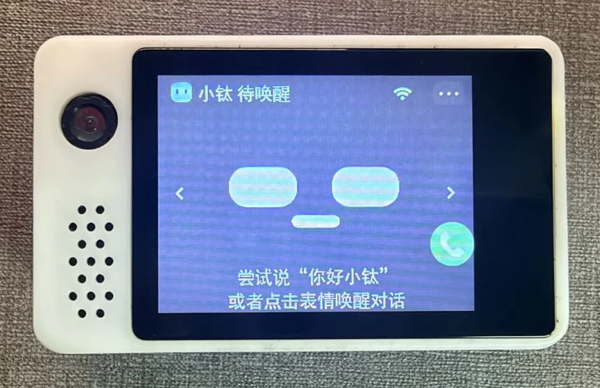
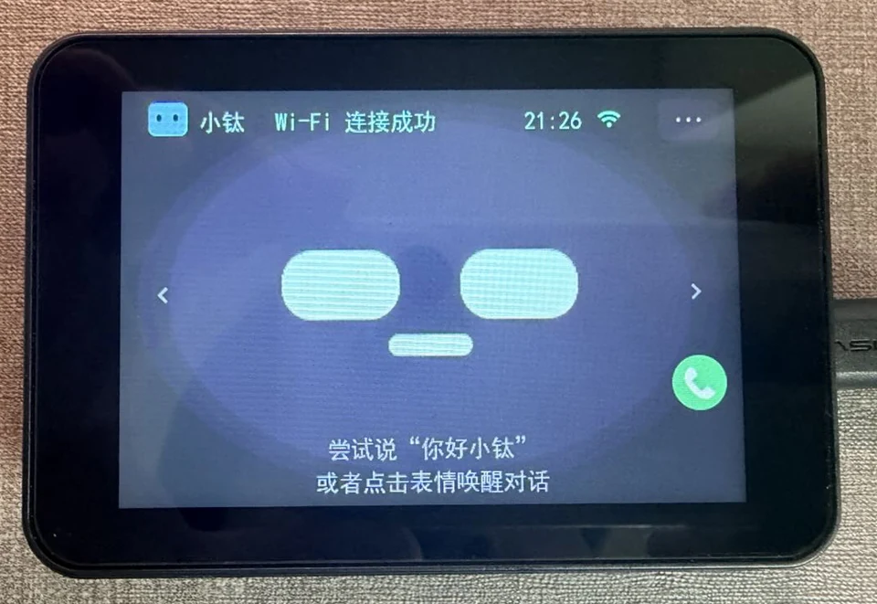
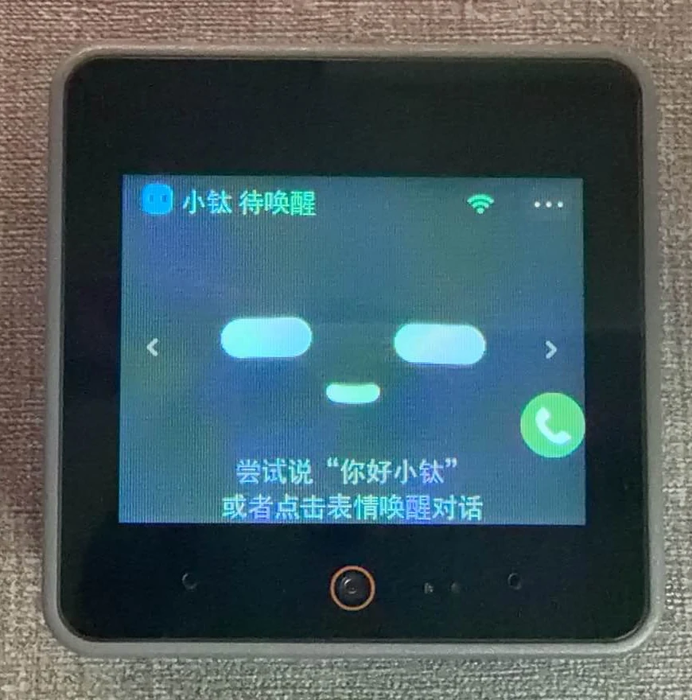

# 小钛项目入口

当前支持的开发板、固件下载与烧录说明，请访问 **[小钛项目主页](https://github.com/tangeai/xiaotai)**。

本仓库已停止提供固件 Release 和 Tag。源码历史保留作参考，不作为当前版本下载入口。

## 设备外观

| 立创 ESP32-S3 | 微雪 ESP32-P4 |
| --- | --- |
|  |  |

| M5Stack S3 | Xmini-C3 |
| --- | --- |
|  |  |

照片供外观参考，固件请按具体板型选择。
