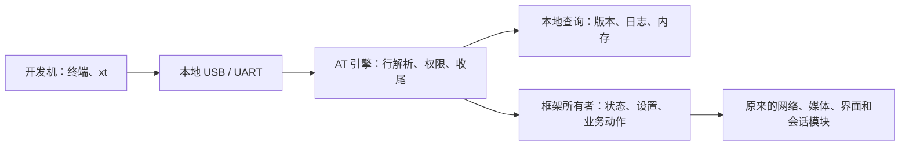

# AT 指令

[文档地图](README.md) · [开发指南](开发指南.md) · [测试与诊断](测试与诊断.md) · [测试工具 xt](../tools/xt/README.md)

**给谁看**：要通过 USB 串口查设备状态、发命令的开发者。

**读完能做到**：接上串口，看懂设备的回答，知道哪些命令只是查询、哪些会改变设备。

五款产品的默认固件都开放串口指令。串口在哪个口：

| 开发板 | 串口 |
| --- | --- |
| 立创实战派 S3、CoreS3-Lite、GUITION 7 寸屏 | 芯片的原生 USB 口 |
| 微雪 P4 3.5 寸、WT99 | UART0，115200 |

立创 S3 板上还有一路 CH340 串口，只在芯片上电时输出几行启动信息，接它看不到日志，也发不了指令。

有两套写法，作用相同：

| 写法 | 例子 | 适合 |
| --- | --- | --- |
| 通用维护命令 | `status`、`wifi-set` | 日常查状态、配网、测通话。和小钛在 BK7258 平台上的固件是同一套写法 |
| AT 指令 | `AT+STATE`、`AT+NET` | 需要某个模块的细节，或者写自动化脚本 |

## 通用维护命令

和 BK7258 固件同一套写法（见 tangeai/xiaotai 的 `docs/development/SERIAL_COMMANDS.md`），同一个网页工具、同一份说明两种板子都能用。直接输入命令，不加 `AT+`；每行一条，回车发送。参数之间用空格分开，含空格或为空的参数用英文双引号，例如 `wifi-set "Home WiFi" "your-password"`，开放网络的密码写 `""`。Wi-Fi 名称、密码、联系人名称可以直接输入中文。

每条命令在固件里换成下表右栏的 AT 指令执行，回包就是那些指令的数据行，最后一行是 `OK` 或 `ERROR: ...`，和直接发 AT 指令一样。本版固件没有的功能返回 `ERROR: NOT_SUPPORTED NOT_IN_BUILD`；`help` 只列出本版能用的命令。

| 命令 | 用途 | 对应的 AT 指令 |
| --- | --- | --- |
| `help` | 列出本版能用的通用命令 | - |
| `version` | 固件身份 | `AT+VERSION` |
| `status` | 联网、平台、通话链路、当前活动和内存 | `AT+NET`、`AT+PLATFORM`、`AT+LINK`、`AT+STATE`、`AT+MEM` |
| `call-status` | 通话类型、状态和代次 | `AT+CALL` |
| `log-level` | 查看日志级别：小钛自己的（`app`）、系统和第三方库的（`sys`）、单独定了级别的模块、已保存的级别、TiRTC 的 | `AT+LOGLEVEL` |
| `log-level app <0..4>` | 小钛日志的级别：0 关闭、1 错误、2 警告、3 信息（默认）、4 调试 | `AT+LOGLEVEL APP <n>` |
| `log-level module <模块> <0..4>` | 只给一个模块定级别，例如 `log-level module media 4`；写 `-` 恢复跟随 `app` | `AT+LOGLEVEL MODULE <模块> <n>` |
| `log-level sys <0..3>` | ESP-IDF、驱动和第三方库日志的级别，默认 2 警告 | `AT+LOGLEVEL SYS <n>` |
| `log-level save`、`log-level forget` | 保存当前的 `app` 和 `sys` 级别，重启后仍然生效；不再保存 | `AT+LOGLEVEL SAVE`、`AT+LOGLEVEL FORGET` |
| `log-level tirtc <0..17>` | TiRTC SDK 的日志级别，取值由 SDK 定义 | `AT+LOGLEVEL TIRTC <n>` |
| `wifi-change` | 打开配网热点，保留已保存的 Wi-Fi | `AT+NET PROVISION` |
| `wifi-set <SSID> <密码>` | 保存 Wi-Fi 并连接 | `AT+NET WIFI <名称十六进制> <密码十六进制>` |
| `wifi-clear`（`wificlear`） | 清除已保存的 Wi-Fi，重新进入配网 | `AT+NET PROVISION FORGET` |
| `tirtc-set <device_id> <device_secret> [client_id]` | 预置设备凭证并重启 | `AT+BIND SET` |
| `tirtc-clear` | 清除绑定凭证并重启 | `AT+BIND CLEAR` |
| `restart` | 重启，保留设置 | `AT+RESTART` |
| `ai-start`、`ai-stop` | 开始、结束 AI 对讲 | `AT+AI START`、`AT+AI STOP` |
| `wechat-call ["联系人名称"]` | 呼叫微信联系人；省略名称时呼叫第一个 | 找到联系人后 `AT+CALL INDEX <n>` |
| `device-call "联系人名称"` | 呼叫设备联系人；也可以写设备号 | 找到联系人后 `AT+CALL INDEX <n>` |
| `call-answer` | 接听当前来电 | `AT+CALL ACCEPT` |
| `wechat-answer`、`device-answer` | 只接听微信或设备来电 | 来电是这一类时 `AT+CALL ACCEPT` |
| `call-hangup` | 结束通话或取消呼叫；来电还在响时拒接 | `AT+CALL HANGUP`，响铃时 `AT+CALL REJECT` |
| `room-status`、`room-sync` | 房间状态、刷新房间分配 | `AT+ROOM`、`AT+ROOM REFRESH` |
| `room-join <6位房间号> [4位密码]` | 加入房间 | `AT+ROOM JOIN` |
| `room-talk-start`、`room-talk-stop` | 开始、停止发言 | `AT+ROOM PTT 1`、`AT+ROOM PTT 0` |
| `room-leave` | 退出房间 | `AT+ROOM LEAVE` |
| `ep-show`、`ep-set <地址>`、`ep-reset` | 服务发现地址 | `AT+EP`、`AT+EP SET`、`AT+EP RESET` |
| `task-diag` | 任务和栈余量 | `AT+STATUS tasks` |
| `voice-config <50..990>` | 唤醒阈值 | `AT+WAKE THRESHOLD` |
| `voice-diag [5..30]` | 观察唤醒用的音频电平 | `AT+WAKE WATCH` |
| `voice-test self-test` | 唤醒自检 | `AT+WAKE SELFTEST` |

和 BK7258 固件的不同：

- `wifi-set` 保存后直接连接，不重启。
- `ntp-show`、`ntp-set`、`ntp-reset` 本版还没有。
- 联系人名称要和通讯录里的显示名一字不差；设备联系人也可以直接写设备号。

`wifi-clear`、`tirtc-set`、`tirtc-clear` 和 BK7258 固件一样在正式固件里也能用：能接上串口的人就能清掉 Wi-Fi、换掉设备凭证，设备要放在别人碰不到串口的地方。`tirtc-set` 的密钥会留在终端记录里，用完清掉记录。

日志：默认级别下，串口日志是设备在做什么的一条主线，一步一行：固件身份、联网、平台上线、每次对讲和通话的开始与结束、出错的原因，例如 `I (4010) net: connected ip=192.168.1.23 channel=11 gen=1`、`I (262321) ai_talk: ended gen=15: stopped here after 24 s`、`W (26981) ai_talk: start refused: the microphone is muted: unmute it first (error 0x103)`。调试人员用 `log-level app 4` 打开调试日志（状态迁移、耗时、内存水位、音视频统计），或用 `log-level module <模块> 4` 只开一个模块；ESP-IDF 和第三方库自己的日志默认只出警告和错误，`log-level sys 3` 打开它们的信息级。级别默认不保存，重启后回到 `app 3`、`sys 2`；`log-level save` 把这两个级别存下来，用来看开机过程的调试日志，查完用 `log-level forget` 取消。`log-level tirtc` 设成大于 0 时，TiRTC 自己的日志也会打出来（标签 `tirtc`），其中可能有密钥或令牌，分享前要删掉；设回 `0` 或重启后不再输出。各级别给谁看、一行日志怎么写，见[日志规范](日志规范.md)。

## 第一次连板

1. 核对串口对应的设备，打开**主控制台**。常用速率是 115200，以板卡的实际配置为准。USB 若只接日志口，能看日志也不代表能发指令。
2. 一次发一条，各条以回车结束。先发 `AT`，看到单独一行 `OK` 再发下一条。`AT+VERSION` 的 `+VERSION:` 是板型、固件版本和平台，`+BUILD:` 是 ELF SHA-256；别拿芯片名称或镜像文件的哈希替代它。
3. 用 `AT+HELP` 查当前可用的指令。没有 AT 回包不能判断启动失败，先核对接的是不是主控制台。看到 `CLI_DISABLED` 先核对测试配置，不要让脚本自行解锁。
4. 要查状态，先用 `AT+STATE`、`AT+NET`，再按需要查 `AT+STATUS` 的某个段。动作返回 `OK` 一般只表示已受理。例如拨号后继续看 `AT+CALL` 或通话事件，不凭 `OK` 判断已经接通。



指令在本机串口执行，没有网络 AT 入口。字节源接在端口层；命令和诊断由功能单元登记，新板只换硬件适配时不用重写命令。无屏、无相机或没选某个模块的产品，只使用对应能力支持的命令。

## 常用检查

| 想知道什么 | 从这里开始 | 看哪里 |
| --- | --- | --- |
| 板型、固件、当前活动 | `AT+VERSION`、`AT+STATE` | `board=`、`elf_sha256=`、`activity=`；`none` 表示当前无前台活动 |
| Wi-Fi 已连，服务也在线了吗？ | `AT+NET`、`AT+PLATFORM` | 前者看 `connected=`，后者看 `online=`，两者不能互相替代 |
| 绑定流程是否正常？ | `AT+BIND` | `phase=`、`verification=`、`left=` 和 `device=`；不要发公开日志中的验证码和设备号 |
| 通话有没有开始、接通或结束？ | `AT+CALL`、`AT+LOG` | 看当前状态和同一 `gen=` 的 `outgoing`、`incoming`、`connected`、`ended`；计数从启动累计时取前后差值 |
| 相机是否出帧？ | `AT+VIDEO`、`AT+VIDEO PROBE` | 先查业务的采集和发送计数；空闲时再做本地探针。`OK` 只表示受理，在异步的 `+VIDEO-PROBE:` 看到 `result=passed frames=3 error=NONE` 才算探针通过 |
| 内存或栈见底了吗？ | `AT+MEM`、`AT+LINK`、`AT+STATUS tasks` | 堆的 `min_free=`、`min_largest=`；传输任务看 `worker_stack_free=`；任务表可用时，所有者看 `name=xiaotai` 的 `stack_min_free=` |
| P4 的联网协处理器是哪一版？ | `AT+COMPANION` | 查当前缓存身份；需要重新读取时看 HELP 是否提供 `LIVE`。微雪为 C6，WT99 为 C61，各自的身份不是 P4 主固件身份 |
| 界面目前呈现什么？ | `AT+UI`、`AT+SCREEN` | 页面以 `view=` 为准；截图不证明物理 LCD 或触摸正常 |

排查黑屏时，`AT+VIDEO` 的 `+VIDEO:` 概览用 `up_y_state`、`up_y_mean`、`up_y_n` 报告上行相机打开后首个有效原始帧的亮度；降分辨率重开或重新打开相机会重新统计。空闲执行 `AT+VIDEO PROBE`，可在原最终结果前看到 `+VIDEO-PROBE-LUMA:` 的 `state`、`y_mean`、`samples`。状态为 `valid` 时，均值来自可见区域最多 64 个网格点的原始 Y 分量（0 到 255，未归一化，不计填充行）。均值接近黑电平但采集、发送计数在走，意味着有帧但画面暗，不能单凭这个值判断镜头是否被挡。`no_frame`、`invalid` 和 `unavailable` 分别表示未拿到帧、帧布局无效和格式没有可直接采样的 Y 分量；这些状态的均值为 `-1`、样本数为 `0`，不会改变探针或上行原有结果。

回包的终行是独立的 `OK` 或 `ERROR: ...`；裸日志中的词不算终行。脚本遇到超时把本次记为未完成。若发的是动作，先读状态确认没有执行，再决定是否重试。长截图或追踪看输出有没有持续推进，不按整次传输设置一个短倒计时。

任务表依赖构建提供的 FreeRTOS 任务追踪。`AT+STATUS tasks` 返回 `supported=0` 表示这版不提供全任务读数，不代表任务数或栈余量为零。`AT+LINK` 的读数只覆盖传输工作任务，不能代替所有任务的栈检查。

在支持 RTC 快速内存的芯片上，`AT+MEM RTC` 单独读取这块堆的当前空闲、最大连续块和开机以来最低空闲，单位是字节。读到全零是有效结果；芯片不支持时返回 `ERROR: NOT_SUPPORTED`。原 `AT+MEM` 和 `AT+STATUS mem` 的回包不变。

`AT+PLATFORM` 和 `AT+STATUS platform` 先给一行 `+PLATFORM:`，再给同一快照的四行 `+PLATFORM-STATS:`，依次是连接生命周期、请求与传输、信令与绑定、档案与工作任务。每行不超过 512 个字符，当前 38 个计数键按原顺序各出现一次。SDK 串口工具在收到 `OK` 后按键合并校验，仍按原文显示和保存回包；缺行、重复键或 `ERROR` 都不能作为完整快照。

`AT+VIDEO` 的 `+VIDEO-UP-RECOVERY:` 记录业务会话中首帧超时后的相机恢复。`reopens` 是重开次数，`recovered` 是重开后拿到原始帧的次数，`exhausted` 是重开后仍失败的次数。每次首帧等待最多尝试一次，保留失败原因；拿到原始帧也要继续看 `sent=` 和对端画面。产品可以用 `parameters.video.disable_first_frame_recovery` 关闭。这个机制不改变本地探针的通过条件。

选择了伴侣应用的产品可用 `AT+STATUS app.companion` 查应用是否在前台、当前页和交互状态，以及是否停在失败结果页（`error_held=`）。`page=-` 表示应用没在呈现页面，例如它在后台，或产品没有屏幕。要查显示是否就绪、屏幕是否点亮，仍读 `AT+UI`。退出结果页继续用已登记的 `AT+CALL DISMISS`；已有通话不会因此挂断。

立创 S3 和 CoreS3-Lite 响铃时，用 `AT+CALL REJECT` 拒接设备或微信来电。此时发送 `AT+CALL HANGUP` 会返回 `ERROR: INVALID_STATE`，来电仍保留。外呼、连接中和通话中继续用 `AT+CALL HANGUP`。

立创 S3 和 CoreS3-Lite 的 `AT+CALL DEVICE <device-id>` 在最近一次有效名单的前 8 个有效联系人中查找，必须恰好有一个同 ID 的在线设备。没有匹配返回 `ERROR: NOT_FOUND`，重复匹配返回 `ERROR: INVALID_STATE`；名单不可用时也不拨号。`AT+CALL INDEX <n>` 不受前 8 项的限制，但要先用 `AT+CONTACTS` 核对当前序号。序号格式错误或不存在会返回 `ERROR: INVALID_ARG`；名单刷新后请重新核对。

`AT+CALL ACCEPT`、`REJECT`、`HANGUP` 或 `MUTE` 没有可操作的通话时，返回 `ERROR: INVALID_STATE NO_OWNER`。拨号返回 `OK` 后继续读 `AT+CALL`。会话结果看 `+CALL:` 的 `error=`，与发命令时的终行分开。

两款 S3 处理声音识别时，语音结果下载遇到请求队列满，报告 `TIMEOUT`（`263`）；内存申请失败仍报告 `NO_MEM`（`257`）。上传的应答正文收到一部分后中断时，报告 `INVALID_RESPONSE`（`264`），保留待核验任务，不自动重新上传。对已经受理的识别操作，用 `AT+RECOGNITION` 读 `+RECOGNITION-STATE:` 的 `error=`，不要把操作命令的 `OK` 当成完成。

回声门调试只在开启 `MEDIA_TEST_COMMANDS`、且 HELP 列出命令的构建中使用。`AT+AUDIO ECHO 0` 临时关闭，`AT+AUDIO ECHO 1` 恢复；从下一采集块生效，不重开会话、不保存到设置。用 `AT+STATUS media` 查 `+ECHO: enabled=`。产品未配置回声门时，返回 `ERROR: NOT_SUPPORTED`。

`AT+STATUS media` 的 `+MEDIA-LEVELS:` 给出采集各路电平（RMS 和峰值，满量程 32768）：`mic`、`ref`、`monitor` 是按声道角色在处理器之前量的原始输入，`processed` 是处理器（回声消除等）的输出、还没经过增益和门，`clean` 是经过增益和门之后、送去编码的声音。产品开了 `parameters.media.diagnostics.capture_window` 时 `window=1`，数值是最近一个诊断窗口（32 个采集块）的平均 RMS 和窗口内峰值；否则 `window=0`，数值只是最近一块。看回声消除效果时，在只有设备喇叭出声、近处没人说话的时候比较 `mic` 和 `processed`，并扣掉处理器自带的固定增益；`mic_peak` 到 32767 或 32768 说明麦克风已经削顶。

## 怎样编译

SDK 的物理控制台由产品配置决定，命令以该次固件的 `AT+HELP` 为准。微雪 P4 的普通固件不开放 `AT+SCREEN`。立创 S3 需要截屏、改设置这类调试指令时，用独立的诊断变体构建：

```sh
python scripts/build.py lckfb/szpi-esp32s3 --entry sdk --variant diagnostics
```

产物在 `build/xiaotai-szpi-s3/sdk-firmware--diagnostics/`，不会覆盖默认镜像。显式开启物理 AT 的变体用主 USB Serial/JTAG 或 UART；只有 USB CDC 日志或次级输出时，构建会报错。

## 词表与权限

自动化测试要使用和设备上的固件对应的 `commands.json`。已有构建目录就用那一份；只想离线检查选型时，可以单独生成立创 S3 的诊断词表：

```sh
python scripts/sdk_selection.py --product products/xiaotai-szpi-s3/product.json --variant diagnostics --out-dir build/at-szpi-diagnostics
```

这条命令只生成选择文件，不编译或烧录固件。词表记录产品选择和每种写法的权限，在线发送还须核对设备 `AT+HELP`。表里有、HELP 里没有，先查固件身份、变体、编译开关和运行条件，不要照表硬发。

如果工具提示 `commands.json` 与当前仓库的产品清单不同，回到生成板上固件的源码版本，用它的串口工具和构建目录里的词表。即使是同一产品，新增一条只读指令也会让两版词表不同；在新版本重做词表不会更新板上的固件。

- `read`：查询或导出。少数查询需要服务已在线，例如声音识别配置，不能拿来验证设备完全离线时可用。
- `action`：执行动作，可能占用会话、麦克风或扬声器。只在自己的测试设备和测试账号上用。
- `guarded`：逐项允许，例如换网、切换测试环境、重启、写设置、更新协处理器。`AT+SET [<name>]` 和写入用的 `AT+SET <name> <value>` 是不同写法，许可不互通。框架仍会检查范围、忙闲、注册权限和产品允许名单。

用测试脚本发动作前，除了词表和实时 HELP，还要提供确切的 `--allow` 和目标 ELF SHA-256；命令行示例见 [xt 工具说明](../tools/xt/README.md#统一-sdk从读状态开始)。

Wi-Fi 凭据等文本按各命令的十六进制语法发送。十六进制是编码，不能保护密码；不要把真密码、令牌、绑定信息或原始日志放进 Git。

切换测试环境只用本地串口。先用 `AT+EP` 查 `active`、`saved` 和 `next`；获准后用 `AT+EP SET <base>` 或 `AT+EP RESET`。`OK` 只表示受理，保存成功会发 `+EP: result=saved` 并自动重启，随后再查环境和平台上线。等待期间可用 `AT+EP CANCEL`，以 `+EP: result=cancelled` 确认完成；正在保存时不能撤回。不改网站链接，也不顺带改 MQTT 协议。

| 本次请求未受理 | 串口结果 |
| --- | --- |
| AT 命令队列已满（包括切换和取消） | `ERROR: NO_MEM`；本次请求未执行，也不改变已有的切换状态 |
| 已有环境切换，或配网验证正占用网络 | `ERROR: INVALID_STATE` |
| 地址无效 | `ERROR: INVALID_ARG` |
| 正在通话等前台活动占用设备 | `ERROR: BUSY`；切换请求不会主动结束原会话 |

WT99 处于网络维护期间、尚未进入待重启状态时，仍允许用 `AT+COMPANION SEND INFO` 读取 C61 信息；这不放行 `LIVE`、更新、回退或其他直发命令。已受理的更新如果完整下载后摘要不符，会报告 `+COMPANION-UPDATE: stage=failed percent=0 error=265`（`INVALID_CRC`），不会写入镜像。

### 截图与离线解码

用 `AT+SCREEN` 单独抓一帧，保留原始回包，包括 `+SCREEN:`、连续的 `+SCREEN-DATA:`、`+SCREEN-END:` 和最后的 `OK`。日志留在仓库外，再离线解码：

```sh
python scripts/decode_screen.py <截图日志> <输出.png> --sdk-only
```

块序号、尺寸、字节数或者 FNV 校验不匹配时，先重查日志，别拿残帧当屏幕故障。

## 统一词表

这张表汇总仓库当前产品与变体选中的单元清单。它包含候选写法，**不是任何一台设备的实时清单**。例如 `AT+PORT PROBE` 只有端口提供探针时才登记；支持截图的构建还要有对应显示能力。使用时以该台设备的 HELP 和返回码为准。

<!-- GENERATED: sdk AT vocabulary -->

| 写法 | 权限 | 登记单元 | 相关构建选项 |
| --- | --- | --- | --- |
| `AT` | `read` | `at` | - |
| `AT+AI` | `read` | `ai_talk` | - |
| `AT+AI INTERRUPT` | `action` | `ai_talk` | - |
| `AT+AI START` | `action` | `ai_talk` | - |
| `AT+AI STOP` | `action` | `ai_talk` | - |
| `AT+AI SUBMIT` | `action` | `ai_talk` | - |
| `AT+ALARM` | `read` | `app.alarm` | - |
| `AT+AUDIO` | `read` | `media` | - |
| `AT+AUDIO DUMP` | `read` | `media` | `XIAOTAI_MEDIA_TEST_COMMANDS` |
| `AT+AUDIO ECHO <0\|1>` | `action` | `media` | `XIAOTAI_MEDIA_TEST_COMMANDS` |
| `AT+AUDIO PLAY` | `action` | `media` | `XIAOTAI_MEDIA_TEST_COMMANDS` |
| `AT+AUDIO RECORD` | `action` | `media` | `XIAOTAI_MEDIA_TEST_COMMANDS` |
| `AT+AUDIO SENDTONE` | `action` | `media` | `XIAOTAI_MEDIA_TEST_COMMANDS` |
| `AT+AUDIO STOP` | `action` | `media` | `XIAOTAI_MEDIA_TEST_COMMANDS` |
| `AT+AUDIO TONE` | `action` | `media` | `XIAOTAI_MEDIA_TEST_COMMANDS` |
| `AT+AUDIOTRACE?` | `read` | `media` | `XIAOTAI_MEDIA_TRACE_ARRIVALS` |
| `AT+BIND` | `read` | `binding` | - |
| `AT+BIND CLEAR` | `guarded` | `binding` | `XIAOTAI_BINDING_DEV_COMMANDS` |
| `AT+BIND REPLAY` | `action` | `binding` | - |
| `AT+BIND RETRY` | `action` | `binding` | - |
| `AT+BIND SET <device-id> <key-hex> [<client-id>]` | `guarded` | `binding` | `XIAOTAI_BINDING_DEV_COMMANDS` |
| `AT+CALL` | `read` | `call`、`video_call`、`wechat` | - |
| `AT+CALL ACCEPT` | `action` | `call`、`wechat` | - |
| `AT+CALL CAMERA 0\|1` | `action` | `video_call` | - |
| `AT+CALL DEVICE <device-id>` | `action` | `call` | - |
| `AT+CALL DISMISS` | `action` | `app.companion` | - |
| `AT+CALL HANGUP` | `action` | `call`、`wechat` | - |
| `AT+CALL INDEX <n>` | `action` | `call`、`wechat` | - |
| `AT+CALL MUTE 0\|1` | `action` | `call`、`wechat` | - |
| `AT+CALL REJECT` | `action` | `call`、`wechat` | - |
| `AT+CALL VIDEO <n>` | `action` | `video_call` | - |
| `AT+CALL WX <contact-id>` | `action` | `wechat` | - |
| `AT+CLI` | `read` | `at` | - |
| `AT+CLI OFF` | `action` | `at` | - |
| `AT+CLI ON` | `action` | `at` | - |
| `AT+CLOCK` | `read` | `clock` | - |
| `AT+CLOCK ALARM <hh:mm> <0..127> [<label-hex>]` | `guarded` | `clock` | - |
| `AT+CLOCK COUNTDOWN <seconds> [<label-hex>]` | `action` | `clock` | - |
| `AT+CLOCK ENABLE <id> <0\|1>` | `guarded` | `clock` | - |
| `AT+CLOCK REMOVE <id>` | `guarded` | `clock` | - |
| `AT+COMPANION` | `read` | `net` | - |
| `AT+COMPANION LIVE` | `read` | `net` | - |
| `AT+COMPANION RETRY` | `action` | `net` | - |
| `AT+COMPANION ROLLBACK` | `guarded` | `net` | - |
| `AT+COMPANION SEND <word>` | `action` | `net` | - |
| `AT+COMPANION UPDATE <url> <sha256-hex>` | `guarded` | `net` | - |
| `AT+CONSOLE` | `read` | `at` | - |
| `AT+CONTACT ACCEPT <id>` | `action` | `contacts` | - |
| `AT+CONTACT DELETE <id>` | `action` | `contacts` | - |
| `AT+CONTACT REJECT <id>` | `action` | `contacts` | - |
| `AT+CONTACT REMARK <id> <hex\|->` | `action` | `contacts` | - |
| `AT+CONTACT REQUEST <id>` | `action` | `contacts` | - |
| `AT+CONTACTS` | `read` | `contacts` | - |
| `AT+CONTACTS PAGE <ALL\|kind> [<page>]` | `action` | `contacts` | - |
| `AT+CONTACTS PENDING [<page>]` | `action` | `contacts` | - |
| `AT+CONTACTS REFRESH` | `action` | `contacts` | - |
| `AT+DOOR` | `read` | `app.door` | - |
| `AT+DOOR BACK` | `action` | `app.door` | - |
| `AT+DOOR DEVICES` | `action` | `app.door` | - |
| `AT+DOOR HOME` | `action` | `app.door` | - |
| `AT+DOOR NEXT` | `action` | `app.door` | - |
| `AT+DOOR PREVIOUS` | `action` | `app.door` | - |
| `AT+DOOR SENDER` | `guarded` | `app.door` | - |
| `AT+DOOR VIEWER` | `guarded` | `app.door` | - |
| `AT+EP` | `read` | `environment` | - |
| `AT+EP CANCEL` | `action` | `environment` | - |
| `AT+EP RESET` | `guarded` | `environment` | - |
| `AT+EP SET <base>` | `guarded` | `environment` | - |
| `AT+FEEDBACK` | `read` | `feedback` | - |
| `AT+FEEDBACK CANCEL` | `action` | `feedback` | - |
| `AT+FEEDBACK FIRE <effect> [FORCE]` | `action` | `feedback` | - |
| `AT+FEEDBACK GROUP <n> 0\|1` | `action` | `feedback` | - |
| `AT+FEEDBACK SET <state> 0\|1` | `action` | `feedback` | - |
| `AT+FEEDBACK STATES` | `read` | `feedback` | - |
| `AT+HELP` | `read` | `at` | - |
| `AT+INTENT <intent> [<value> [<text-hex>]]` | `guarded` | `at` | `XIAOTAI_AT_INTENT_COMMAND` |
| `AT+KEY` | `read` | `interaction` | - |
| `AT+KEY CLICK [<role>]` | `action` | `interaction` | - |
| `AT+KEY DOUBLE [<role>]` | `action` | `interaction` | - |
| `AT+KEY HOLD [<role>]` | `action` | `interaction` | - |
| `AT+LINK` | `read` | `transport` | - |
| `AT+LINK TRACE` | `read` | `transport` | - |
| `AT+LOG [<after>]` | `read` | `at` | - |
| `AT+LOG FOLLOW 0\|1` | `action` | `at` | - |
| `AT+LOG STATS` | `read` | `at` | - |
| `AT+LOG TOPICS` | `read` | `at` | - |
| `AT+LOGLEVEL` | `read` | `at`、`transport` | - |
| `AT+LOGLEVEL APP <0..4>` | `action` | `at` | - |
| `AT+LOGLEVEL FORGET` | `action` | `at` | - |
| `AT+LOGLEVEL MODULE <module> <0..4\|->` | `action` | `at` | - |
| `AT+LOGLEVEL SAVE` | `action` | `at` | - |
| `AT+LOGLEVEL SYS <0..3>` | `action` | `at` | - |
| `AT+LOGLEVEL TIRTC <0..17>` | `action` | `transport` | - |
| `AT+MEM` | `read` | `at` | - |
| `AT+MEM RTC` | `read` | `at` | - |
| `AT+MEMTRACE` | `read` | `transport` | `XIAOTAI_TRANSPORT_MEMTRACE` |
| `AT+NET` | `read` | `net` | - |
| `AT+NET CANCEL` | `action` | `provisioning` | - |
| `AT+NET DIAG` | `read` | `net` | - |
| `AT+NET DISCONNECT` | `action` | `net` | - |
| `AT+NET FORGET` | `guarded` | `net` | `XIAOTAI_NET_CONSOLE_FORGET` |
| `AT+NET LIST` | `read` | `net` | - |
| `AT+NET PROBE` | `action` | `net` | - |
| `AT+NET PROBE2 <peer-ipv4> <peer-port> <flow> <seed> <count> <bytes>` | `action` | `net` | `XIAOTAI_NET_PATTERN_PROBE` |
| `AT+NET PROVISION FORGET [FORCE]` | `guarded` | `provisioning` | `XIAOTAI_NET_CONSOLE_FORGET` |
| `AT+NET PROVISION [FORCE]` | `action` | `provisioning` | - |
| `AT+NET RETRY` | `action` | `net` | - |
| `AT+NET SCAN` | `action` | `net` | - |
| `AT+NET STORE <ssid-hex> <password-hex\|->` | `guarded` | `net` | - |
| `AT+NET TRACE [START\|STOP]` | `action` | `net` | `XIAOTAI_NET_PATH_TRACE` |
| `AT+NET WIFI <ssid-hex> <password-hex\|->` | `guarded` | `net` | - |
| `AT+PLATFORM` | `read` | `platform` | - |
| `AT+PLATFORM RECONNECT [<1..50>]` | `guarded` | `platform` | `XIAOTAI_PLATFORM_RECONNECT_COMMAND` |
| `AT+PORT PROBE [<name>]` | `guarded` | `at` | - |
| `AT+RECOGNITION` | `read` | `recognition` | - |
| `AT+RECOGNITION ARCHIVE <request-id> <revision>` | `action` | `recognition` | - |
| `AT+RECOGNITION CANCEL` | `action` | `recognition` | - |
| `AT+RECOGNITION CONFIG` | `read` | `recognition_config` | - |
| `AT+RECOGNITION DISMISS <request-id> <item-id>` | `action` | `recognition` | - |
| `AT+RECOGNITION QUERY` | `action` | `recognition` | - |
| `AT+RECOGNITION RECORD <seconds:1..60>` | `action` | `recognition` | - |
| `AT+RECOGNITION RESUME <request-id>` | `action` | `recognition` | - |
| `AT+RESTART` | `guarded` | `at` | `XIAOTAI_AT_RESTART_COMMAND` |
| `AT+RESTART FORCE` | `guarded` | `at` | `XIAOTAI_AT_RESTART_FORCE` |
| `AT+ROOM` | `read` | `room` | - |
| `AT+ROOM CLOSE` | `action` | `room` | - |
| `AT+ROOM CONNECT` | `action` | `room` | - |
| `AT+ROOM CREATE [<4-digit-password>]` | `action` | `room` | - |
| `AT+ROOM DISCONNECT` | `action` | `room` | - |
| `AT+ROOM JOIN <6-digit-code> [<4-digit-password>]` | `action` | `room` | - |
| `AT+ROOM LEAVE` | `action` | `room` | - |
| `AT+ROOM OPEN` | `action` | `room` | - |
| `AT+ROOM PTT 0\|1` | `action` | `room` | - |
| `AT+ROOM REFRESH` | `action` | `room` | - |
| `AT+SCREEN [<display>]` | `read` | `ui` | `XIAOTAI_UI_CAPTURE` |
| `AT+SET <name> <value>` | `guarded` | `at` | `XIAOTAI_AT_SETTING_WRITE` |
| `AT+SET [<name>]` | `read` | `at` | - |
| `AT+SOUND` | `read` | `media` | `XIAOTAI_MEDIA_SOUND_COMMANDS` |
| `AT+SOUND PLAY <name> [<6 digits>]` | `action` | `media` | `XIAOTAI_MEDIA_SOUND_COMMANDS` |
| `AT+SOUND STOP` | `action` | `media` | `XIAOTAI_MEDIA_SOUND_COMMANDS` |
| `AT+STATE` | `read` | `at` | - |
| `AT+STATUS [<section>]` | `read` | `at` | - |
| `AT+TRACE ARM [<50..limit>]` | `action` | `media` | `XIAOTAI_MEDIA_TRACE` |
| `AT+TRACE DUMP` | `read` | `media` | `XIAOTAI_MEDIA_TRACE` |
| `AT+TRACE OFF` | `action` | `media` | `XIAOTAI_MEDIA_TRACE` |
| `AT+UI` | `read` | `ui` | - |
| `AT+UI ACTIONS` | `read` | `ui` | - |
| `AT+UI PERF` | `read` | `ui` | - |
| `AT+UI POINTER <x> <y> <0\|1>` | `action` | `ui` | - |
| `AT+UI REDRAW` | `action` | `ui` | - |
| `AT+UI SLEEP` | `guarded` | `ui` | - |
| `AT+UI SWIPE <x> <y> <x2> <y2> <ms>` | `action` | `ui` | - |
| `AT+UI TAP <x> <y>` | `action` | `ui` | - |
| `AT+VERSION` | `read` | `at` | - |
| `AT+VIDEO` | `read` | `video` | - |
| `AT+VIDEO CAPTURE START\|STOP\|STATUS\|CLEAR\|DUMP` | `action` | `video` | - |
| `AT+VIDEO PROBE` | `action` | `video` | - |
| `AT+WAKE` | `read` | `wake_engine` | - |
| `AT+WAKE SELFTEST` | `read` | `wake` | - |
| `AT+WAKE TEST <phrase-hex>` | `action` | `wake` | - |
| `AT+WAKE THRESHOLD <50..990>` | `action` | `wake_engine` | - |
| `AT+WAKE WATCH [<5..30>]` | `read` | `wake_engine` | - |

<!-- END GENERATED: sdk AT vocabulary -->

维护指令时改所属组件的 `commands` 清单和实际登记，再运行 `python scripts/generate_at_reference.py --write`。`--check` 只核对是否漏更新，不写文件。
