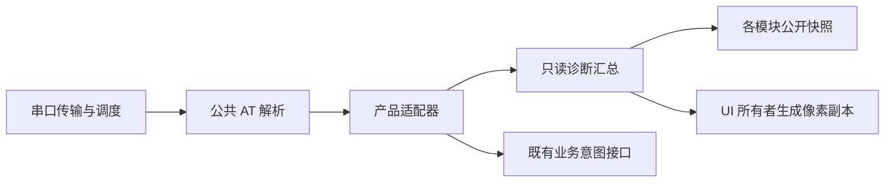

# S3 诊断迁移与回归

日期：2026-11-05。目标是立创实战派 S3，源码为本仓 `xiaotai-next`。原六个开发工程、同机另一块板、Git 索引与远端均未修改。本次没有发布。

## 迁移范围

旧立创工程的 `AT`、版本、状态、AI 启停、唤醒诊断、文本意图自检和旧命令别名已接回新仓。新增 `AT+UI`、`AT+SCREEN`，可以从开发机查询 UI 并导出实际 LVGL 活动页面。

分层原则：AT 不包含驱动和业务状态；诊断不读出设备密钥；UI 自己处理 LVGL 锁和渲染内存；AI 仍由原 runtime 仲裁。开发控制台默认关闭，诊断构建单独输出，不修改普通产品配置。详见 [指令和构建说明](本地诊断与AT指令.md)。

公共解析器覆盖缺失能力、无屏后端、失败返回和参数错误，但目前只有立创 S3 接入这套新增适配器。CoreS3、P4、WT、Xmini、MZ28 保留各自原生入口，尚未完成六板统一 AT 协议验收。不能给无屏板套用 LVGL 截图实现，也不能把未知能力返回为成功。

## 发现与处理

### IDF 6 HTTP 请求准备

首次启动中，Wi-Fi、时间同步、存储身份及 TiRTC 启动正常，平台请求却在发包前返回 `ESP_ERR_NOT_FOUND`。固定 IDF 源码表明，`esp_http_client_set_post_field()` 在非空 POST 路径会先查询 `Content-Type`；原调用顺序把设置请求头放在后面。

修正在拥有 HTTP 请求的 platform client 层：先设置 JSON 请求头，再设置 POST body，原错误处理与清理路径保留。立创与 CoreS3 的对应函数同步调整，并用固定 IDF 行为的测试桩验证非空/空 POST 和 GET。旧代码在该桩下失败，修改后通过；立创实机随后完成平台 API、MQTT 和 AI 建连。没有清除绑定或改服务协议。

### 截图内存与任务归属

初版画面捕获需要 153600 字节，超过原 64 KiB LVGL 固定池，先返回了内存不足。改用独立 PSRAM 缓冲后，又暴露出在 4 KiB REPL 栈上执行渲染会栈溢出。

最终把渲染请求交给现有 UI 任务，控制台只等待并传输独立副本。队列容量 1、等待上限 2 秒；请求有引用计数，超时与迟到完成都能回收，不引用调用方栈。没有扩大 LVGL 池或控制台栈。主机覆盖分配失败、排队失败、超时竞争、1000 次回收等路径。

### 大块串口输出调度

渲染成功后，原连续 1200 块输出曾导致 CPU 1 空闲任务超过看门狗期限。回溯落在 AFE 运算中，仅凭当时 PC 不能认定 AFE 死循环。同一镜像的 125 秒无截图对照没有该告警；连续截图发送是已观察到的触发条件。

REPL 默认优先级 2，大块输出没有后台优先级约束。固定 IDF 的 USB REPL 已使用中断驱动，不能把它误诊成未安装驱动的忙等。修正放在 `input/console`：仅执行截图时降到空闲优先级，由现有时间片调度分享 CPU，结束或报错后恢复原优先级。音频任务、UI 任务、看门狗及业务状态机均不变，没有添加延时或吞掉告警。

修改后，同板连续三次在线截图和一次离线截图均收到完整 1200 块并通过校验，未再出现栈溢出或看门狗。在线三次捕获后的 PSRAM 都回到 1174968 字节；UI 最低栈余量为 8732 字节。旧的看门狗污染传输被严格解码器拒绝，没有从损坏日志拼出验收图。这一结果只覆盖本次重复条件，不等于任意负载或长稳验收。

## 构建与烧录身份

固定环境为 IDF 6.0.2（`7101770dc6db2667b3c477cc31365dd1acd6db4e`）、GCC 15.2.0（`esp-15.2.0_20251204`）、LVGL 9.5.0。S3 TiRTC 静态库 SHA-256 为 `8e822c9346e1362a8086b42315687b2ce6ea3ae8ffe096a610038795ceabefea`，本轮未替换 SDK。

诊断镜像 `0.1.0-dev`：

| 项目 | 值 |
| --- | --- |
| APP SHA-256 | `dce3cd961c0873d8d1637118ee3656e8aff2161338e863b94becc61984f1ccea` |
| ELF SHA-256 | `5ed9936fc22a37a5ba7145e6e66ea7455a11c229f8d26f8184444b132d71ce14` |
| MAP SHA-256 | `b9a09535857cbc0af43d53aa682e3a07f34b676aea07092ff2e314e47b2e6c79` |
| APP / 分区 | `0x4f02d0` / `0x500000`，剩余 64816 字节 |
| 构建输入 | 6735 项，保存在对应 `build-inputs.json` |

已先备份完整 16 MiB Flash；后续迭代只写 APP `0x10000`，每次保留写前的 NVS/PHY，并独立用 ROM 核验 APP 和这段存储。运行期间 NVS 可能正常更新，因此“烧录没有覆盖”不等于不同启动间所有 NVS 字节都不变。

最终诊断镜像写入校验和独立 ROM 校验均通过，运行中的 `AT+VERSION` 返回完整 ELF SHA，与上表一致。构建完成后复核 6735 项输入，变化为 0。

普通 S3 配置也完成构建，未烧录：APP 为 `7c83d551ce8537cbe5bfdca74a07b94803abfa2524fddee7fc2e28525c8ff635`，ELF 为 `357a5c0796ba7b171b0cb7b25f02977894cfe68f3359d20b8bd5b0f3cfc43b40`，大小 `0x4e7120`。本次后台传输改动没有改变默认关闭控制台的普通 APP。CoreS3 的 HTTP 修正已整机构建，未烧录；其 APP 为 `a2117c39b914e256aa15ec8a1e675e34904638ebbd2b577acbfc2070f4b19d23`。其余四板本轮没有重新构建或操作设备。

## 验证记录

主机完整程序 44/44 通过，包括公共 AT、UI 请求所有权、后台优先级恢复、画面完整性及原业务回归。C 测试启用 ASan/UBSan。一次执行因 PATH 缺 Ninja 未通过，修正测试环境后完整重跑；没有跳过该程序。CoreS3 MQTT 使用其锁定的 1.0.0 原始缓存，保留源码 SHA 校验，不误用立创构建切换后的 1.1.0 缓存。

| 层级 | 本次结果 | 边界 |
| --- | --- | --- |
| 静态检查 / 主机 / 构建 | 静态通过，44/44 主机程序通过；S3 普通与诊断、CoreS3 构建通过 | 不是六板真机结果 |
| 烧录与身份 | APP 与写前 NVS/PHY 的 ROM 校验通过，设备 ELF 身份匹配 | 未整片擦除；没有清配网或绑定 |
| 启动与上线 | 启动后 Wi-Fi、平台 API、MQTT、TiRTC 上线 | 后续测试末尾断网，不能写成持续在线通过 |
| UI 与截图 | 三次待唤醒首页、一次离线配网页均完整解码；UI tick 推进 | 不是物理 LCD 回读，不证明触摸 |
| AT 失败语义 | AI 活跃时截图返回 `ERROR: ESP_ERR_INVALID_STATE`，之后指令继续可用 | 没有用空白图冒充成功 |
| AI 数字音频 | 两轮分别发送/接收 2085/294、2121/405 帧，接收帧均有解码/播放计数 | AFE 有错误，不判完整音频通过 |
| 会话退出 | 第一轮由远端 idle/end_session 结束；第二轮用 AT STOP 退出，回到 waiting、connection=0、media inactive | 第一轮不算主动停止验收；两轮不是长稳证明 |
| AI 图像 | 第二轮已发首 JPEG，采样末 captured=40、sent=34、stale=6 | 第一轮摄像头失败，图像项未通过 |
| 离线诊断 | 断网后 AT 状态、UI 查询、截图仍可用，设备进入配网页 | 未清配置，未验证网络恢复 |

在线首页三帧 FNV 为 `2cd1add1`、`757bc745`、`af431eec`，分别有 144、173、152 种 RGB 颜色；离线配网页为 `b8d8a905`，27 种颜色。都为 320×240。实际图像已检查，首页显示“小钛 待唤醒”，离线图显示配网入口；图像和原始日志只保存在私有目录。

两轮退出后的 PSRAM 均为 1158580 字节，比首次会话前低 16388 字节，未见第二轮继续下降；这仍不足以证明没有泄漏。后续断网会启动 SoftAP/连接重试，内部堆随之变化，不能把该阶段与在线空闲堆直接比较。

## 仍需验证

- 最终镜像两轮 AI 的 AEC 错误计数分别为 2、10，有 `AFE in-ovf=1` 日志；第二轮 feed-budget-miss 到 270。根因未证实。媒体 `dropped=0` 不包含这些前端错误，不能据收发计数宣称音频或声学质量通过。
- 第一轮摄像头检测到 GC2145 并进入 ready，随后 `close failed rc=ESP_ERR_TIMEOUT` 和 `camera failed mode=2 gen=1`；第二轮可以出 JPEG。首发错误与关闭失败的因果链仍未闭环，第二轮成功不算修复。应先补齐 camera owner 的首发阶段、关闭各步骤及资源等待证据，再决定修改位置，不延长超时或自动重开掩盖问题。
- 两轮会话结束后，Wi-Fi 先报 reason=200（固定 IDF 定义为 beacon timeout），随后连续 reason=201（no AP found），进入既有配网流程。根因未证实，不能仅据此判断是热点关闭或固件问题。当前最后观测为离线配网页；保留原凭据，没有重新配网，也未验证恢复联网。
- 启动时仍有 I2S 尚未启用就调用 disable 的告警，尚需完整确认驱动初始化因果链；本轮未屏蔽。
- 原生 USB 大块读 Flash 两次中止于相同进度，UART 备份成功。USB 中止根因未证实。
- 物理 LCD、触摸、真实声音与回声、微信/设备/群组/H5、并发截图与会话启动、弱网和长时间运行未完成验收。
- S3 诊断 APP 剩余空间约 1%，继续加功能前需处理分区或体积预算，不可静默删功能。
- 新板只改硬件即可运行所需的通用 runtime 端口、交互意图/快照及媒体格式契约仍待完成。项目整体 `preparation_complete=false` 保持不变，单板调试不替代六板收口。

所有原始串口日志、失败尝试、Flash/NVS 备份和构建记录位于仓外私有验证目录 `20261105-s3-new-repo-regression`。其中可能含网络和身份信息，不放入 Git，不随文档公开。
