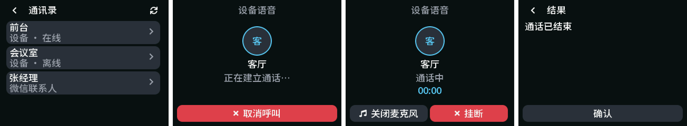
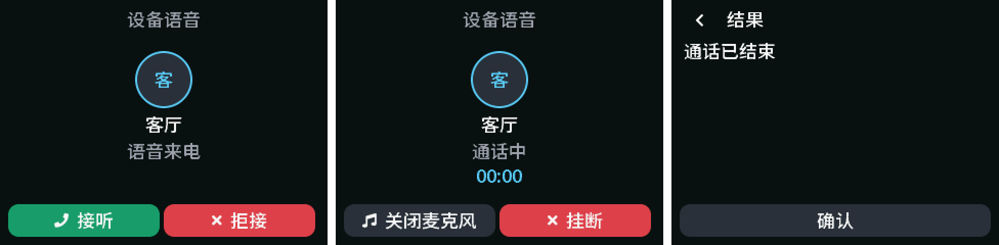

# 使用说明

[文档地图](README.md) · [快速开始](快速开始.md) · [常见问题](常见问题.md)

**给谁看**：设备已经装好小钛、配好网、绑定好的人。还没做到这一步，先看[快速开始](快速开始.md)。

**读完能做到**：会用设备上的每一项功能。

截图来自立创实战派 S3（320×240）。其他板子的页面内容相同，屏幕更大时排版更宽松。只有 WT99P461-S1 开机先进门铃首页，在那一页左右滑动可以翻到这里说的表情首页。各板有哪些功能见[开发板列表](开发板/README.md#每块板能做什么)。

## 首页

| 位置 | 是什么 |
| --- | --- |
| 左上角 | 小钛的状态。「待唤醒」表示可以开始对话，「正在聆听」表示它在听你说 |
| 右上角的 Wi-Fi 图标 | 格数是信号强弱，变灰表示没有联网 |
| 右上角的「···」 | 菜单：通讯录、声音识别、多人对讲、设置 |
| 中间的表情 | 点一下开始 AI 对话 |
| 右下的绿色电话 | 直接打开通讯录 |
| 两侧的箭头 | 翻到时钟页；带闹钟或门禁的板子上，还能翻到闹钟页或门禁页 |

## AI 对话

| 想做的事 | 怎么做 |
| --- | --- |
| 开始 | 说“你好小钛”，后面直接接着说你的话；或者点一下表情，等左上角变成「正在聆听」再说 |
| 说话 | 表情旁出现声波时它在听，正常说话就行，不用按住。可以一句接一句地聊 |
| 打断 | AI 说话时直接开口，它会停下来听你说 |
| 结束 | 再点一下表情。对话结束后左上角回到「待唤醒」 |

AI 的性格、声音和能力可以在控制台里换，见[控制台与 AI 角色](控制台与AI角色.md)。

在「设置」里关掉麦克风后，唤醒词不再起作用，首页会提示「麦克风已关闭」。

### 对着小钛说

设备的 AI 角色配了设备插件以后（在控制台里配，见 [AI 对讲里的设备功能](功能/AI设备功能.md)），对话时可以直接让它做事：

| 想做的事 | 可以这样说 |
| --- | --- |
| 调音量 | 「声音大一点」「音量调到一半」「静音」「取消静音」 |
| 调屏幕亮度（背光可调的板子） | 「屏幕暗一点」「亮度调到三十」「调到最亮」 |
| 问时间 | 「现在几点」「今天星期几」 |
| 闹钟 | 「明早七点叫我」「工作日每天八点的闹钟」「我有哪些闹钟」「把七点的闹钟取消」 |
| 倒计时 | 「十分钟后提醒我关火」「倒计时还剩多久」「取消倒计时」 |

说「静音」后设备不再出声，AI 的回答也听不到；再说「取消静音」或「声音大一点」就恢复。

## 打电话

### 呼叫另一台设备

两台设备要绑定在同一个账号下，才会出现在彼此的通讯录里。

1. 点首页的绿色电话，或「菜单 → 通讯录」。每个名字下面写着它是设备还是微信联系人、在不在线。没看到要找的设备时，点右上角的刷新按钮。
2. 点一个在线的联系人。不在线的打不通。
3. 点「语音呼叫」，屏幕显示「正在建立通话」。
4. 对方接听后开始计时，两边就可以说话了。

### 接听来电

| 页面 | 按钮 |
| --- | --- |
| 来电 | 绿色「接听」接通；红色「拒接」挂掉，对方会知道被拒接 |
| 通话中 | 「关闭麦克风」让对方暂时听不到你，再点一次恢复；红色「挂断」结束通话 |
| 结束 | 显示这次通话的结果，点「确认」回首页 |

### 微信通话

1. 设备还叫“未命名设备”的话，先在[控制台](控制台与AI角色.md#设备列表)里给它起个名字。
2. 在微信的“小钛”小程序里找到这台设备，按提示给它授权微信通话。
3. 授权之后，手机微信可以呼叫设备，设备也可以在通讯录里呼叫微信联系人。设备上的接听方式和上面一样。

## 多人对讲

1. 打开「菜单 → 多人对讲」。页面上方提示「连接失败，请刷新」时，点右上角的刷新按钮。
2. 建一个房间，或者进别人的房间：
   - 点「创建房间」，屏幕上会出现一个六位房间号，把它告诉其他人。
   - 点「加入房间」，输入别人给的六位房间号；房间设了密码的，再输入四位密码。
3. 进房间后，按住屏幕上的「按住讲话」说话，松开就停，房间里的其他人都能听到。
4. 不用了点「退出房间」。退出后想再进，要重新加入。

## 实时查看

打开[小钛控制台](https://xiaotai.chat/devices)或“小钛”小程序，找到设备，点「实时」。

| 能做什么 | 说明 |
| --- | --- |
| 看画面、听声音 | 显示设备摄像头的画面，播放设备那边的声音。没有摄像头的板子只有声音 |
| 对设备说话 | 在页面上按住说话，设备那边能听到 |

有人在看的时候，设备首页会显示「远程查看中」或「远程对讲中」，设备旁边的人能知道。

## 声音识别

立创实战派 S3、CoreS3-Lite 和 GUITION 7 寸屏可以录一段声音，交给云端识别，例如判断这段声音里有没有异常的响动。

1. 打开「菜单 → 声音识别」。
2. 点「录音」，选好录音时长，确认提交。屏幕显示「正在录音」和已经录了几秒，到时间自动停止。
3. 结果回来后显示在这一页。「完整结果」看详细内容，「上一条」「下一条」翻看。
4. 看完后在「任务操作」里点「归档任务」。归档之后才能开始下一次录音，这次的结果不会留在设备上。

录音会上传到识别服务，可能消耗账户里的识别额度，页面上会提示。

## 设置

「菜单 → 设置」里有：

| 项目 | 说明 |
| --- | --- |
| 音量 | 点「−」「+」调节 |
| 扬声器 | 关掉后设备不出声 |
| 麦克风 | 关掉后唤醒词和通话里的说话都不起作用 |
| 语音引导 | 开机、配网等时候的语音提示 |
| 网络信息 | 当前的 Wi-Fi、信号和设备号；「断开当前连接」可以重新配网，绑定会保留 |

## 闹钟

五块板都带闹钟。在首页点右侧的箭头或向左滑，翻到时钟页：大字时间、日期和下一个闹钟。微雪 P4 和 WT99 的下一页是门禁，要再翻一页。

| 想做的事 | 怎么做 |
| --- | --- |
| 新建闹钟 | 点「闹钟」→「添加闹钟」，用「−」「+」调时和分，选重复方式，点「保存」 |
| 修改、关闭、删除 | 点「闹钟」进列表，点要改的那一行 |
| 倒计时 | 点「倒计时」，选分钟数，点「开始」；时钟页会显示还剩多久 |
| 响铃时长、稍后提醒、时区 | 在时钟页点底部的「设置」。这是闹钟自己的设置，不是菜单里的那个 |
| 响铃时 | 点「停止」，或点「稍后提醒」过几分钟再响；不点的话到了响铃时长自动停 |

正在通话或对讲时到点，不会打断当前的通话，结束后马上补响；超过一小时就不补了。参数和串口指令见[闹钟](功能/闹钟.md)。

闹钟和倒计时也可以在 AI 对话里说出来，见[对着小钛说](#对着小钛说)。

## 可视门铃和门禁

WT99P461-S1 默认是一台门铃的室内机，首页是时钟、门口那台设备的名称和两个按钮。微雪 P4 也有这一页：在表情首页点右侧的箭头或向左滑。

| 按钮 | 作用 |
| --- | --- |
| 查看门口 | 打开门口那台设备的实时画面 |
| 开门 | 确认后给门口的设备发开门指令 |
| 右上角的名称 | 进入「选择门外机」，换一台门口设备。还没选时首页提示「尚未选择门外机」 |

门口有人按铃时会弹出来电。接听后可以通话，点「开门」并确认：

### 放在门口当门禁机

WT99P461-S1 也可以放在公司门口，让访客呼叫前台或要找的人。切换要用串口指令，也就是用 USB 接上电脑后发给设备的文本命令（怎么发见 [AT 指令](AT指令.md)）：`AT+DOOR SENDER` 切到门禁机，`AT+DOOR VIEWER` 切回室内机。切换后的角色会保存下来，重启后仍然有效。

| 按钮 | 作用 |
| --- | --- |
| 呼叫前台 | 视频呼叫设好的前台设备。前台接听后可以在通话里点「开门」，门禁机屏幕显示「门已打开」 |
| 通讯录 | 列出员工（微信）和设备，点「呼叫」就呼出；员工在微信小程序里接听 |
| 右上角的名称 | 进入「设置前台设备」，选哪台设备当前台 |

完整流程见[门禁](功能/门禁.md)。

## 遇到问题

常见的情况和处理办法在[常见问题](常见问题.md)里。
