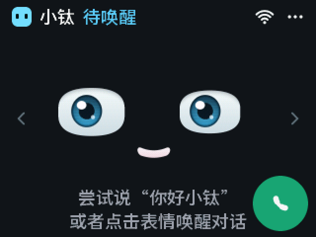
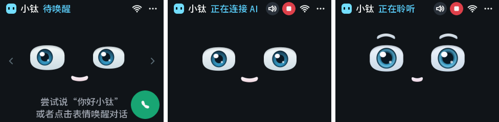
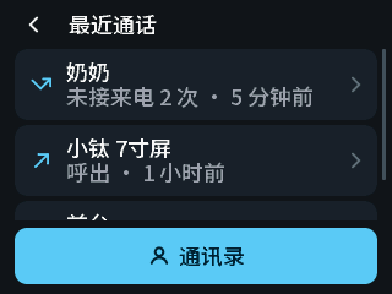
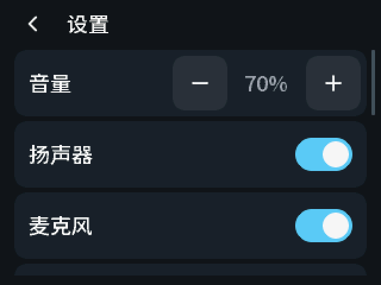
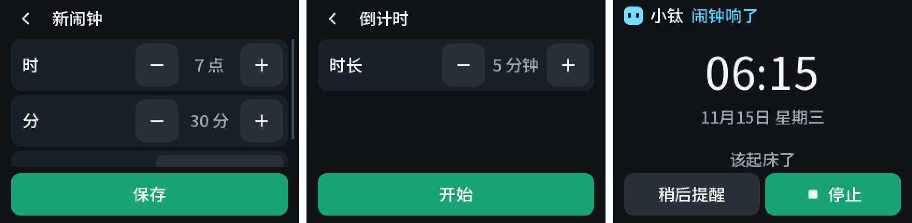
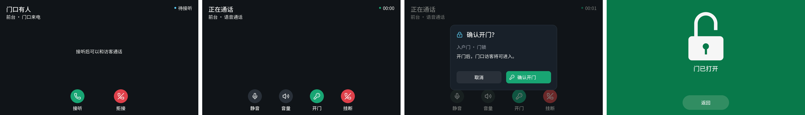
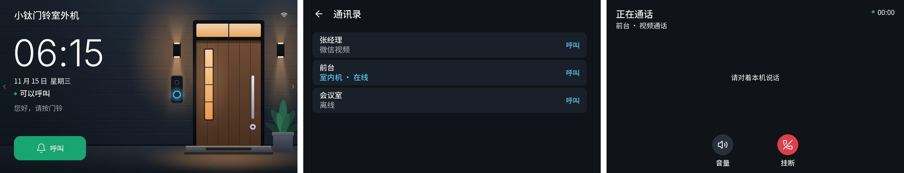
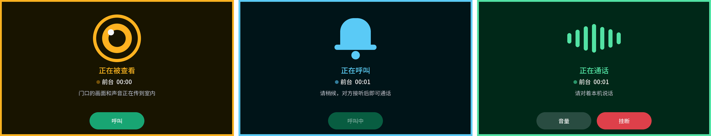
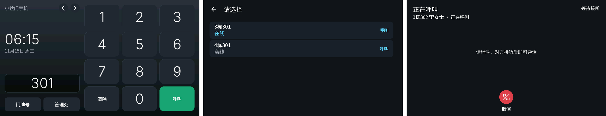

# 使用说明

[文档地图](README.md) · [快速开始](快速开始.md) · [常见问题](常见问题.md)

**给谁看**：设备已经装好小钛、配好网、绑定好的人。还没做到这一步，先看[快速开始](快速开始.md)。

**读完能做到**：会用设备上的每一项功能。

截图来自立创实战派 S3（320×240）。其他板子的页面内容相同，屏幕更大时排版更宽松。只有 WT99P461-S1 开机先进门禁首页，在那一页左右滑动可以翻到这里说的表情首页。各板有哪些功能见[开发板列表](开发板/README.md#每块板能做什么)。

## 首页

| 位置 | 是什么 |
| --- | --- |
| 左上角 | 小钛的状态。「待唤醒」表示可以开始对话，「正在聆听」表示它在听你说 |
| 右上角的 Wi-Fi 图标 | 格数是信号强弱，变灰表示没有联网 |
| 右上角的「···」 | 菜单：通讯录、微信联系人、最近通话、声音识别、多人对讲、设置、表情、网络信息、运行状态 |
| 中间的表情 | 点一下开始 AI 对话；戳一戳、按住抚摸它会有反应 |
| 右下的绿色电话 | 给微信好友打电话。还没有微信联系人，显示添加用的小程序码；只有一位，直接呼叫；有几位，打开「微信联系人」 |
| 两侧的箭头 | 翻到时钟页；带闹钟或门禁的板子上，还能翻到闹钟页或门禁页 |

## AI 对话

| 想做的事 | 怎么做 |
| --- | --- |
| 开始 | 说“你好小钛”，后面直接接着说你的话；或者点一下表情，等左上角变成「正在聆听」再说 |
| 说话 | 左上角是「正在聆听」就能说。表情这时睁大眼睛，眼里亮起一圈光，跟着你的声音变亮。正常说话就行，不用按住，可以一句接一句地聊 |
| 打断 | AI 说话时直接开口，它会停下来听你说 |
| 调音量 | 点右上角的小喇叭 |
| 让它看或不看画面 | 立创实战派 S3、微雪 P4、WT99：对话时 AI 每秒看一张画面，右上角多一个相机键，点一下就关（相机带一道斜线），再点打开 |
| 结束 | 点右上角红色的圆键，或按一下机身键。对话结束后左上角回到「待唤醒」 |

AI 的性格、声音和能力可以在控制台里换，见[控制台与 AI 角色](控制台与AI角色.md)。

在「设置」里关掉麦克风后，唤醒词不再起作用，首页会提示「麦克风已关闭」。

### 对着小钛说

设备的 AI 角色配了设备插件以后（在控制台里配，见 [AI 对讲里的设备功能](功能/AI设备功能.md)），对话时可以直接让它做事：

| 想做的事 | 可以这样说 |
| --- | --- |
| 调音量 | 「声音大一点」「音量调到一半」「静音」「取消静音」 |
| 调屏幕亮度（背光可调的板子） | 「屏幕暗一点」「亮度调到三十」「调到最亮」 |
| 问时间 | 「现在几点」「今天星期几」 |
| 闹钟 | 「明早七点叫我」「工作日每天八点的闹钟」「我有哪些闹钟」「把七点的闹钟取消」 |
| 倒计时 | 「十分钟后提醒我关火」「倒计时还剩多久」「取消倒计时」 |

说「静音」后设备不再出声，AI 的回答也听不到；再说「取消静音」或「声音大一点」就恢复。

## 打电话

来电和通讯录里显示的是名字：你给联系人设了备注就显示备注，没有备注显示对方设备的名字；设备没有名字的，显示「设备」和设备号的后四位。

### 呼叫另一台设备

两台设备要绑定在同一个账号下，才会出现在彼此的通讯录里。

1. 点「菜单 → 通讯录」。每个名字下面写着它是设备还是微信联系人、在不在线。没看到要找的设备时，点右上角的刷新按钮。打过的、没接到的电话在「菜单 → 最近通话」里。
   

2. 点一个在线的联系人。不在线的多半打不通。
3. 点「语音呼叫」，屏幕显示「正在建立通话」。
4. 对方接听后开始计时，两边就可以说话了。

### 接听来电

| 页面 | 按钮 |
| --- | --- |
| 来电 | 绿色「接听」接通；红色「拒接」挂掉，对方会知道被拒接。也可以用机身键：按一下接听，长按拒接。对方打来视频而这台设备没有视频时，按语音接听 |
| 通话中 | 「静音」让对方暂时听不到你，再点一次恢复；「音量」调大小；红色「挂断」结束通话，机身键按一下也是挂断 |
| 结束 | 显示这次通话的结果和下一步，能再拨的有「再拨一次」；点「确认」回首页 |

没接到的来电，首页左上角会写「有未接来电」，在「菜单 → 最近通话」里能看到是谁、回拨。

### 微信通话

1. 设备还叫“未命名设备”的话，先在[控制台](控制台与AI角色.md#设备列表)里给它起个名字。
2. 在微信的“小钛”小程序里找到这台设备，按提示给它授权微信通话。
3. 授权之后，手机微信可以呼叫设备，设备也可以呼叫微信联系人：点首页的绿色电话（只有一位微信联系人时直接呼出，有几位时在「微信联系人」里选），或在「菜单 → 微信联系人」里选。设备上的接听方式和上面一样。

还没有微信联系人时，点绿色电话会显示小程序码：用微信扫它进入“小钛”小程序，按上面两步授权。

设备提示「微信授权失效」时，让对方在“小钛”小程序里给这台设备重新授权。

## 多人对讲

1. 打开「菜单 → 多人对讲」。页面上方提示「连接失败，请刷新」时，点右上角的刷新按钮。
2. 建一个房间，或者进别人的房间：
   - 点「创建房间」，屏幕上会出现一个六位房间号，把它告诉其他人。
   - 点「加入房间」，输入别人给的六位房间号；房间设了密码的，再输入四位密码。
3. 进房间后，按住屏幕上的「按住讲话」说话，松开就停，房间里的其他人都能听到。
4. 不用了点「退出房间」。退出后想再进，要重新加入。

## 实时查看

打开[小钛控制台](https://xiaotai.chat/devices)或“小钛”小程序，找到设备，点「实时」。

| 能做什么 | 说明 |
| --- | --- |
| 看画面、听声音 | 显示设备摄像头的画面，播放设备那边的声音。没有摄像头的板子只有声音 |
| 对设备说话 | 在页面上按住说话，设备那边能听到 |

有人在看的时候，设备首页会显示「远程查看中」或「远程对讲中」，设备旁边的人能知道。

## 声音识别

五块板都可以录一小段身边的声音，让云端听听有没有要留意的，比如孩子在哭、有人吵架或呼救。

第一次用要先在 [xiaotai.chat](https://xiaotai.chat) 打开它：设备列表里找到这台设备，点「AI识别」，打开「开启AI识别」，再「添加音频类型」（目前有婴儿哭声检测、吵架异常声音检测），保存。每录一次，每个音频类型计一次，上限写在同一个页面。识别结果仅供参考。

1. 打开「菜单 → 声音识别」。页面上写着这个月用了几次、录一次用几次；不能用的时候写明为什么、怎么办。
2. 点「开始录音」，把设备靠近要听的声音。屏幕显示还有几秒，声音太小会提醒；点「取消」不会上传，也不消耗次数。点「时长」可以改成 5 到 60 秒。
3. 录完自动上传，然后等云端分析。可以先离开，有结果时首页左上角会写「声音识别有结果了」。
4. 结果先给结论，再是内容。「详细」看全部，「听一遍」播放云端的语音，播放时可以停。
5. 看完点「完成」。完成之后才能录新的，这次的结果不再保留在设备上。

每一步屏上显示什么、失败了怎么办，见[声音识别](功能/声音识别.md#一次完整的使用)。

## 设置

「菜单 → 设置」里有：

| 项目 | 说明 |
| --- | --- |
| 音量 | 点「−」「+」调节 |
| 扬声器 | 关掉后设备不出声 |
| 麦克风 | 关掉后唤醒词和通话里的说话都不起作用 |
| 语音引导 | 开机、配网等时候的语音提示 |
| 语音唤醒、回应声 | 唤醒词开关；被唤醒时用女声还是男声回应 |
| 屏幕亮度、自动息屏 | 背光可调的板子才有亮度；多久不碰就熄屏 |
| AI 看图 | 立创实战派 S3、微雪 P4、WT99：对话时让不让 AI 看摄像头画面 |
| 网络信息 | 当前的 Wi-Fi、信号和设备号；「断开当前连接」可以重新配网，绑定会保留 |

## 闹钟

五块板都带闹钟。在首页点右侧的箭头或向左滑，翻到时钟页：大字时间、日期和下一个闹钟。再翻一页是门禁。WT99 开机先显示门禁，首页和时钟在它后面。

| 想做的事 | 怎么做 |
| --- | --- |
| 新建闹钟 | 点「闹钟」→「添加闹钟」，用「−」「+」调时和分，选重复方式，点「保存」 |
| 修改、关闭、删除 | 点「闹钟」进列表，点要改的那一行 |
| 倒计时 | 点「倒计时」，选分钟数，点「开始」；时钟页会显示还剩多久 |
| 响铃时长、稍后提醒、时区 | 在时钟页点底部的「设置」。这是闹钟自己的设置，不是菜单里的那个 |
| 响铃时 | 闹钟是「叮铃铃」的铃声，倒计时是四声短促的提示音，和来电铃声不同。点「停止」，或点「稍后提醒」过几分钟再响；不点的话到了响铃时长自动停 |

在时钟页也能和小钛说话：说“你好小钛”，时间还在原处，下面有一排小条跟着声音动，说完恢复原样。

正在通话或对讲时到点，不会打断当前的通话，结束后马上补响；超过一小时就不补了。响铃时来了电话，铃声先停，挂断后再响一次。参数和串口指令见[闹钟](功能/闹钟.md)。

闹钟和倒计时也可以在 AI 对话里说出来，见[对着小钛说](#对着小钛说)。

## 可视门铃和门禁

门口对讲分两套，一台设备当其中一端：

- **可视门铃**（一户人家）：家里放「可视门铃」，门口放「门铃室外机」。门口按铃，家里响铃、接听，平时也能看看门口。门铃室外机通常是没有屏幕的设备，带屏的设备也能当；
- **门禁**（单元楼、公司）：家里或前台放「门禁室内机」，大门口放「门禁机」。访客在门禁机上拨房号找住户；门禁室内机能看门口、对讲、开门。

WT99P461-S1 开机就停在门禁，其他板在首页左右翻页就到。立创实战派 S3 和 CoreS3-Lite 的画面只给对方看，适合放门口；GUITION 7 寸屏适合放室内看门口。

四种模式各是一页，从首页向右滑：首页（表情或人物）→ 可视门铃 → 门铃室外机 → 门禁室内机 → 门禁机 → 闹钟。在一页停两秒，或点了这一页上的按钮，它就按这一页的模式接来电，换到别的页面也一样；只是翻过去不算。每一页配对的设备各存各的。

翻到要用的那一页，到小程序里让两台设备互为联系人，再在这一页上点「添加室外机」「添加门铃」或「添加室内机」选对方。门禁机不用选住户，把房号写在住户联系人的备注里就行，例如“3栋301 王先生”。

### 门禁室内机

| 按钮 | 作用 |
| --- | --- |
| 查看门口 | 看门口的画面、听门口的声音。这时门口听不到你，点「对讲」才出声 |
| 来访记录 | 最近谁按过铃。有没接到的，按钮会变成红色的「未接」 |
| 右上角的名称 | 换一台室外机，或再添加一台，最多四台 |
| 右上角的设置 | 移除设备。换模式就左右翻页 |

门口有人按铃时会弹出来电。接听后可以通话，点「开门」并确认：

### 可视门铃

放在家里，配一台门铃室外机。首页只有「查看门口」和「设置」：门口按铃时弹出来电，接听、挂断；平时点「查看门口」看（听）门口，点「接听」才说话。没有开门、切换和来访记录。

### 门铃室外机

| 按钮 | 作用 |
| --- | --- |
| 呼叫 | 呼叫选定的室内机；有几台时一台没接就换下一台。室内接听后可以开门，屏幕变绿显示「门已打开，请进」，响一声提示音 |
| 长按左上角的标题 | 进门禁设置：改模式、添加或移除室内机、系统菜单 |

停在首页时，同一账号的设备点「查看门口」都直接看到，不用有人接听；不在首页时只有选定的室内机能直接看。查看时整个屏幕换成琥珀色，写着「正在被查看」和谁在看；对讲时变成绿色「正在通话」。开门只认选定的室内机。

### 门禁机

| 按钮 | 作用 |
| --- | --- |
| 数字和「呼叫」 | 输入房号呼叫住户，例如 301；几栋楼都有 301 时，直接输 3301（3栋301），或在弹出的列表里选 |
| 门牌号 | 列出各户门牌，点一下就呼出；最上面的「通讯录」里是员工（微信）和设备，员工在微信小程序里接听 |
| 管理处 | 呼叫选定的室内机。没有选定时不显示 |
| 长按左上角的标题 | 进门禁设置 |

房号写在联系人的备注里，住户用设备接听或在微信里接听。要让住户的设备也能开门，在那台设备的门禁设置里把门禁机加为室外机。

完整流程、几台设备怎么配合，见[门禁](功能/门禁.md)。

## 遇到问题

常见的情况和处理办法在[常见问题](常见问题.md)里。
