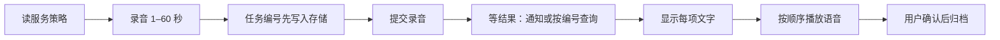

# 声音识别

[返回首页](../../README.md) · [开发指南](../开发指南.md) · [AT 指令](../AT指令.md)

声音识别把一段完整录音交给云端识别，与实时 AI 对讲分开。设备录几秒干净的麦克风音频，用自己生成的任务编号提交；结果回来后显示每一项的文字，服务同时生成了语音的，设备按顺序播一次。

模块是 `sdk/modules/xiaotai_mod_recognition/`，接口在 [`xiaotai/modules/recognition.h`](../../sdk/modules/xiaotai_mod_recognition/include/xiaotai/modules/recognition.h)。立创实战派 S3 和 CoreS3-Lite 选用了它，界面在「菜单 → 声音识别」。

## 一次识别的过程



- **一次只有一个任务。** 任务编号在提交之前写进持久存储，直到归档才删除。重启或上传结果不确定时，按这个编号问服务，绝不重新录一次。有未归档的任务时不接受新的录音，也不能切换服务环境。
- **前台活动。** 读策略、录音、提交、下载语音和播放占用前台活动 `recognition`；查询和刷新策略在后台进行，设备有前台活动时让路。
- **语音只播一次。** 已经开始播放的语音不会再播第二次；被打断的那一项文字仍在，语音不再补播。
- **绑定隔离。** 回包和通知带绑定代次，绑定变了就丢弃；存储里的任务记录也带绑定作用域，旧绑定的记录不会被查询、显示或覆盖。

## 接口

所有发起动作的函数都只做参数检查并把请求交给模块的所有者任务，返回 `XIAOTAI_OK` 表示受理，不表示完成。结果看状态里的回执（`decision_*`）和事件。

| 函数 | 作用 |
| --- | --- |
| `xiaotai_recognition_configure()` | 产品胶水层在模块初始化前调用，选择自动播放、忽略后是否继续播放等策略 |
| `xiaotai_recognition_status()` | 读状态快照：阶段、录音进度、错误、任务编号、结果版本、策略、播放状态、上次请求的回执 |
| `xiaotai_recognition_policy()`、`xiaotai_recognition_policy_refresh()` | 读或刷新服务给本设备的策略：是否开启、月度额度、方案数、文件和时长上限 |
| `xiaotai_recognition_record(seconds)` | 录音并提交；设备空闲、在线、已绑定、麦克风开着、没有未完成任务、策略允许、内存够时才受理 |
| `xiaotai_recognition_cancel(token)` | 取消正在进行的操作；可能已经送到服务的提交不会撤回，转入按编号恢复 |
| `xiaotai_recognition_query()` | 按存储的编号向服务查询 |
| `xiaotai_recognition_resume(request_id)` | 播放该任务的语音，并解除暂停 |
| `xiaotai_recognition_dismiss(request_id, item_id)` | 某一项的语音不播了 |
| `xiaotai_recognition_archive(request_id, revision)` | 用户看过结果后归档，之后才能录新的 |
| `xiaotai_recognition_result_acquire()` 等 | 只读查看当前结果：每项的状态、摘要和详情分页；只用于显示 |

事件：`recognition.state`（阶段变化）、`recognition.progress`（录音秒数）、`recognition.result`（拿到更新的结果）、`recognition.policy`（策略已读或有更新）、`recognition.decision`（一个请求处理完）、`recognition.speech`（某项语音开始或结束）。

意图：`recognition.record`、`recognition.cancel`、`recognition.query`、`recognition.resume`、`recognition.dismiss`，界面按钮直接投递这些意图。

## 产品配置

| 键 | 作用 |
| --- | --- |
| `parameters.recognition.legacy_four_http_slots` | 申报四个 HTTP 请求位置，可同时排四个待下载的语音 |
| `parameters.recognition.query_legacy_http` | 查询总时限 25 秒，单次网络交换 20 秒 |

两款 S3 都开启了这两项，见[产品选项](../产品选项.md#房间与声音识别)。服务地址来自服务发现返回的 `recognition-srv`。

## 串口调试

开放物理 AT 的固件（例如立创 S3 的 `diagnostics` 变体、CoreS3-Lite 的默认固件）支持：

| 指令 | 作用 |
| --- | --- |
| `AT+RECOGNITION` | 阶段、操作代次、采样数、错误、任务编号和播放状态 |
| `AT+RECOGNITION RECORD <1..60>` | 录音并提交；会用真实麦克风并消耗识别额度 |
| `AT+RECOGNITION CANCEL` | 取消当前操作 |
| `AT+RECOGNITION QUERY` | 按存储的编号查询 |
| `AT+RECOGNITION RESUME <request-id>` | 播放语音 |
| `AT+RECOGNITION DISMISS <request-id> <item-id>` | 跳过某项语音 |
| `AT+RECOGNITION ARCHIVE <request-id> <revision>` | 归档 |

发指令前先按 [AT 指令的词表与权限](../AT指令.md#词表与权限)核对本次固件。`OK` 只表示受理，结果再用 `AT+RECOGNITION` 查。

## 测试

```bash
python3 tests/sdk/run.py xiaotai_mod_recognition                       # 模块的主机测试
python3 tests/sdk/product/run.py --product xiaotai-szpi-s3             # 含识别查询、上传和录音饱和场景
```

产品级场景用真实的解析器、服务回调和 AT 分发，网络和任务队列用本地夹具，覆盖各种服务应答、上传中断、队列满、超时和取消。
