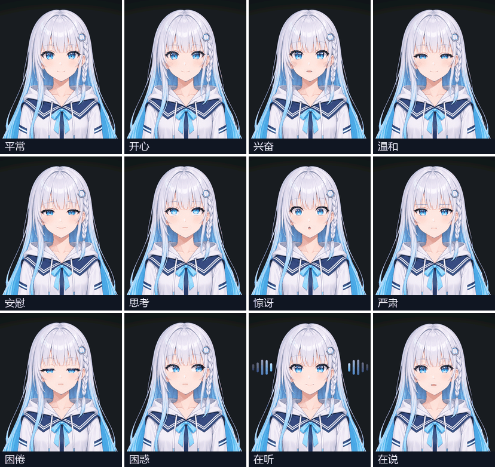
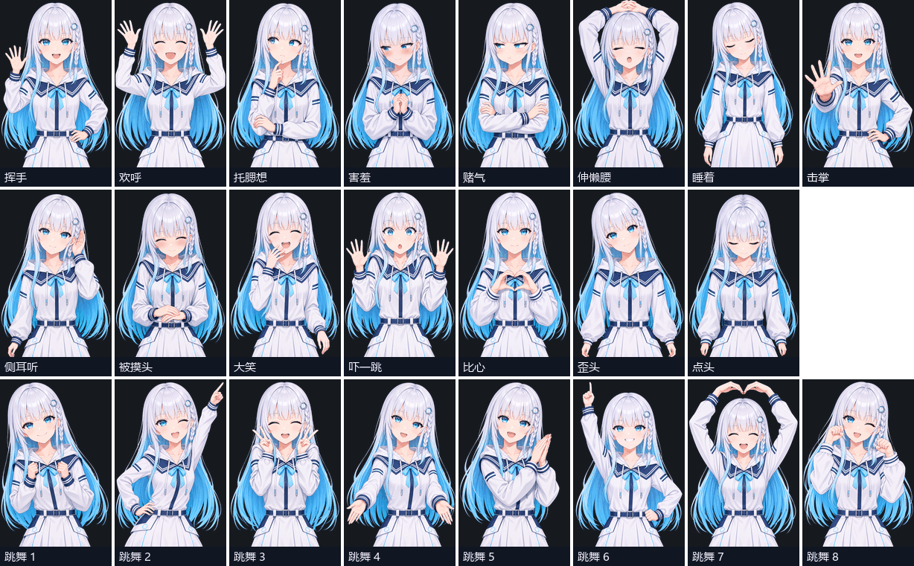

# 屏幕人物

大屏产品的待机页和 AI 对讲页上可以站一个人物，代替彩屏主题自带的小表情。现在这位叫小钛：银发渐变到天蓝的长发、水蓝色眼睛、白色水手领连帽裙。她会听、会说，对设备上发生的事和触摸有反应，没人理的时候自己也有事做。

她是一位端庄的大小姐：人克制、眼神稳、变化柔，看着你，不左右瞟、不忽然睁大眼，不跳；华丽的是身边的特效，只跟着事情出现一两秒。

她头边的标记（在想的光点、联网中的信号弧、断网的问号、困了的 z、惊讶的“!”、哼歌的音符）都在画面上她头的左上方，特效也都不高过她的头顶：页面的标题栏在上面，右上角有“⋯”，右边有通话按钮。



这篇文档按读者分段，可以只看自己要的那部分：

| 你想做什么 | 看哪一节 |
| --- | --- |
| 知道她会什么、怎么和她互动 | [她会什么](#她会什么)、[触摸](#触摸) |
| 给自己的大屏产品开启 | [给另一个大屏产品启用](#给另一个大屏产品启用) |
| 在台架上逐项查看、量性能 | [在台架上看](#在台架上看)、[性能](#性能) |
| 让 AI 的回答带上表情 | [对讲里的表情](#对讲里的表情) |
| 加表情、加反应、接新的设备事件 | [怎么加一个表情或反应](#怎么加一个表情或反应) |
| 换一个人物 | [换一个人物](#换一个人物) |

她是一个独立的单元 `theme_character`（`sdk/themes/xiaotai_theme_character`）。选了它的产品才会编进去；没选的产品不受影响，照旧用小表情。

## 她会什么

任何时刻她的样子由几层叠出来，前面的压过后面的：

- 脸：触摸 > 一次性反应 > 设备情况（闹钟 > 来电 > 通话 > 断网 > 联网中，后两样只在没有对讲时）> 对讲阶段 > 心情 > 呼吸眨眼。麦克风关闭的小叉另外画在嘴边，对讲里、断网时也有；闹钟、来电、通话和摆整身姿势时不画。
- 整身姿势：一次性反应 > 触摸 > 闹钟 > 对讲阶段 > 心情。

| 场合 | 表现 |
| --- | --- |
| 待机 | 呼吸、眨眼（3 到 6 秒一次），看着你；隔一阵做一件小事：哼歌（笑眼、飘音符）、双手轻握在身前站一会儿、困了打哈欠；精神好又和你亲近时偶尔跳两句小舞（约 10 秒） |
| 被叫到 | 叫她的那一刻放下自己手里的小事，看着你；接通时眼睛一亮，冒几颗星；没连上就难过一下，3 秒回到平常 |
| 在听 | 看着你，眉毛抬起来一点，眼睛不睁大，头两侧的音柱随麦克风音量起伏，没人说话时是一排小点；等了 6 秒没听到声音，才双手轻握在身前等你 |
| 在想 | 一进“在想”就垂下眼看向一侧（总是同一侧），头的左上方三颗金色光点依次亮；想满 3 秒才托着下巴；回答的第一声听到时就慢眨一次眼放下，不管托了多久（还在想时，托了至少停 1 秒）；扬声器关着、什么都听不到时，进入“在说”后 1.5 秒内放下；回答的第一句已经到了就不再托 |
| 在说 | 只用脸：嘴跟着喇叭里正在响的声音开合，停顿时合上；一句话开头眉毛抬一下 |
| 被打断 | 话说到一半被你的声音打断：抬眉、小圆嘴 |
| 对讲结束 | 把最后一句说完，半秒后笑着轻抬手掌道别；说完 2 秒回到对讲之前的样子：在“表情”页选过的那个，没选过就是她自己当时的心情。来电、闹钟或者新的对讲不等她说完，也不道别；断网的样子等她说完再出现，不道别。结束时她不在屏幕上（正开着设置页，或者是在门禁、时钟页上叫的她），就没有告别，之后回到首页也不补 |
| 开机 | 第一次露面时轻抬手掌问好、半开的笑眼，身后一圈光晕，头两侧金色、天蓝的闪光依次亮，几片花瓣从两侧飘落；第一次连上服务算在里面，不另外欢呼。睡醒、屏幕亮起来伸懒腰时也是这样 |
| 联网中 / 断网 | 联网中垂眼看向一侧，颜色淡一些，旁边有信号弧；断网时变灰、垂眼，偶尔冒一个发光的问号；这两样露着的时候不按心情冒标记。恢复时指尖轻拍、笑眼，彩带和花瓣从上方飘落。对讲里只动脸，断了又连上都不做动作，说完也不补。没有网络也没有会话时，小钛应用用“连接 Wi-Fi”页盖住首页，所以看不到她断网的样子；开机时还有“设备初始化”页挡到连上服务，第一次看到她就是挥手，以后断了再连上、回到首页时她先是联网中的样子，连上服务后欢呼 |
| 来电 / 通话 | 来电时抬眉；通话中听着，头两侧是绿色音柱 |
| 闹钟响 | 指尖轻拍、笑眼，两侧有震动弧；关掉后点两下头 |
| 音量变化 | 嘴边按音量亮起一到三格，音量为 0 时是叉号；没有对讲时嘴也跟着张开一点 |
| 出错 | 音频硬件没收下设置，或者按键没有受理：皱眉、抖一下，冒一滴汗 |
| 麦克风关闭 | 嘴边一个小叉；关着的时候有人说话，她和首页都不当成声音 |
| 情绪名 | 主题接受的 23 个情绪名都有对应的表情（见 `xiaotai/theme_lcd.h`）。害羞、生气、疑惑、在想这四类在待机时先用整个身体表现两三秒（害羞捧手、抱臂赌气、歪头、托腮），大笑、喜欢、感动这三类表现两秒左右（手背掩嘴笑、手按胸口；喜欢、感动时胸前两侧升起爱心），再回到脸上。惊讶只在脸上：抬眉、小圆嘴 0.6 秒、慢眨一次眼，头的左边弹出一个金色“!”。对讲带来的情绪只在脸上 |

她在待机页、AI 对讲页、声音识别从确认额度到等结果的几个画面、表情预览页上，离开这些页、被对话框盖住（她先收起来）、屏幕休眠时就停下：不走动画、不画、不读图（她占的外部内存留着）。门禁页、时钟页、闹钟和倒计时响铃、来电、通话各有自己的整页，那些页上没有她，在时钟页上叫她说话也是，画面还是时钟，通话页照旧是对方的圆形头像：设备的状态她照样收到（`AT+CHARACTER` 看得到），但上表“来电 / 通话”“闹钟响”两行的样子只有页面把她留在屏幕上的产品才看得见，现在的产品里看得到的是回到待机页之后的反应（停掉闹钟后点两下头）。来电没接、挂断都不挥手，她本来就不在那一页上。远程对讲、远程查看进行时，待机页上的她照旧。表情预览页只显示那个表情，不叠上断网、联网中这些样子；低落的表情在那里也是 20 秒后回到平常。

### 离开再回来

- 离开屏幕超过 1 秒再回来，她按那一刻页面的样子站好：之前没做完的反应、姿势、触摸和没说完的话都算过去了，不补告别，也不补“被打断”。页面给的情绪直接就是那张脸，不补刚换上时的整身动作和标记（困倦的 Z、待机的音符这类一直冒的，过一秒半照旧）；表情预览页例外，照样演一遍。睡着的接着睡。
- 她不在时发生的事只记最近一件，5 秒内回来还做，过了就不补。例外是开机的挥手，一直留到她第一次露面。
- 屏幕黑了 3 秒以上再亮：她伸个懒腰，醒着（首页也当作有人来了，不再停在困倦）。在暗屏里叫她也是先伸懒腰，接通时眼睛一亮。同时有别的反应，就做那一个；亮起来的是别的页面，过了 3 秒才轮到她，就不伸了。



### 她怎么动

现在这位是一张完整的画，不拆开、不扭曲。一张 550 像素高的画整个晃起来很显眼，所以她动得很小，只有两类动法：

- **整个人一起动**：左右挪、上下挪，以及以脚下为定点变高变矮。一直在动的只有呼吸：4.2 秒一次，高矮各 2 像素。其余的都有上限：左右 2 像素（跳舞 3 像素），上下 6 像素，高矮 8 像素；到位就停，不来回弹。
- **换一张画**：问好、欢呼这些姿势各是一张整身图，跳舞的八张也是。换图既不硬切也不叠化（两张图叠在一起会出现两张脸），也不下蹲：她自然地慢眨一次眼，眼睛 0.09 秒闭上，闭着的时候换图；回到底图时眼睛 0.14 秒从闭着睁开。一个姿势至少停 2 秒；对讲里一轮（你说一次、她答一次）最多进一个姿势。有三种换法：

  | 换法 | 怎么换 | 用在哪 |
  | --- | --- | --- |
  | 弹 | 闭眼 0.12 秒换图 | 进入和离开大多数姿势 |
  | 轻 | 闭眼 0.16 秒换图 | 赌气、睡着这类慢的 |
  | 拍 | 矮 1.8%，再像松开的弹簧一样回稳，离地 3 像素 | 别的人物跳舞，每拍一次；小钛的小舞不用 |

  正在离开一个姿势又被叫回来，就地转身回去，不经过底图；跳舞（和别的超过两张图的循环）收尾时最后一张至少露 0.25 秒。

  小舞：八张 `s1`–`s8`（合手左倾、合手右倾、轻挥手、胸前合掌、指尖轻拍、把发丝别到耳后、手背在身后微微前倾、手按胸口侧身），每分钟 96 拍，每拍直接切一张，两句一循环：`s1 s2 s1 s2 s4 s5 s3 s8`、`s1 s2 s1 s2 s6 s7 s4 s5`。每拍身体往下 1 像素再回来，`s1`、`s2` 时向那一侧 3 像素；每拍身边升起一颗光点（天蓝、粉、金、淡紫轮换），每 4 拍一个音符，乐句开头几颗闪光。

  一个姿势也可以由几张图连着播（片段）：进入的几张播一遍，循环的几张反复播，离开前把收尾的几张播完。进入的几张没播完她不会走，所以点头一定点完两下。

  托腮、害羞、伸懒腰、点头、歪头这五个姿势，进入和离开都先过一张过渡图（手抬到一半、闭着眼，停约 0.09 秒），所以看不到手突然出现。过渡图后面那张读不到，或者等了 1.2 秒还没来，就原路退回底图，这一次不再去。问好、欢呼、掩嘴笑、手按胸口、双手轻握、轻抬手掌（击掌）是单张图，慢眨一次就换。

  赌气、睡着各有第二张图，和第一张只差一只手或一双眼睛，两张来回切：赌气时偷看一眼、睡着时一呼一吸。第二张只存和第一张不同的部分。

眼睛、嘴、眉毛是贴在脸上的小图，跟着整个人一起动。她看着你：不左右瞟，不往上翻眼（下眼白会露出来），也不睁大眼；视线只有看着你、垂眼（害羞、思考、安慰）和闭眼。脸是一处一处变的：

- 眼皮在“开、半、闭”之间一档一档走，不跳档，每档至少 0.06 秒；眨眼就是开、半、闭、半、开。不在对讲里时，笑的时候是开、半开的笑眼（`smile_soft`），全闭的弯眼只在掩嘴笑那张图里有。
- 对讲里（在听、在想、在说）眼睛只用睁开的几张：平常的、柔和的、亮的、看向一侧的、含泪的，除了眨眼不半闭、不闭眼。半开的笑眼、垂眼换成柔和的眼神，严肃的眼神换成平常的眼睛，眉和嘴照旧跟着表情；酷、放松、亲亲、调皮在对讲里眼睛睁着，眨眼、搞怪只在表情来时闭一下一只眼（约 0.6 秒）；只有字幕或 `show_expression` 明确给“困倦”时眼睛半闭。
- 眼、眉、嘴各自从旧的小图 0.16 秒淡变到新的（小图和底图逐像素对齐，淡变看起来就是慢慢变）：眼和眉先变，嘴晚 0.12 秒；脸红 0.4 秒浮上、0.8 秒退去。换表情不再眨眼盖住。说话时嘴跟着声音直接开合。
- 一个心情来了先“轻”，停满 1.5 秒还是它才“满”（开心：先是平常的眼睛，满了是柔和的眼神；安慰：先是柔和的眼神，满了眼里含泪）；换走时满的先退到轻，0.3 秒后才换。
- 嘴最大到中号；笑出声是小到中号的开口笑，不露舌头。生气是垂眼加嘟嘴、一点脸红（大小姐的小脾气），难过、委屈是垂眼、眉头微蹙、嘴角微微往下，大哭是含泪的眼睛加嘴角往下，不流泪。害羞是垂眼、脸红；得意（自信）是柔和的眼神、一边嘴角稍高的浅笑；感动（新的情绪名 `moved`）是含泪的眼睛和微笑。

### 嘴怎么动

嘴跟的是**正在响的声音**。音频任务写进喇叭驱动的那一刻，声音还没响出来（驱动里压着几十毫秒），所以媒体引擎把每一块的响度记在“预计听到的时刻”上，她读的是到点的那一块。混进对讲里的提示音不算，只看收到的话音；Opus 收不到包时外推出来的尾音（最长 40 毫秒）也不算，句子中间丢包补上的算。

- 一次对讲没结束就一直看响度，不看阶段：服务端说“这一轮结束了”的时候，本地通常还有三四百毫秒没播完，嘴要动到播完为止。服务端说“对讲结束”之后也一样：告别语还在收、还在播的这段时间（`ai_talk.state` 的 ENDING，加上还听得到声音的时候），她接着说完。设备通话里对方的声音不动她的嘴。
- 大小是相对的：和最近几秒里最响的比。低于它的 8%，或者几乎没有声音，就算停顿。说话时在小、中两档之间，再大的只给大笑；每一档至少停 60 毫秒，合上也算一档。有声音的时候口型优先：惊讶的小圆嘴这类表情里的嘴只在没出声时露着。
- 停顿满 90 毫秒合嘴：经过最小的一档只停一帧，不像张嘴时每档至少停 60 毫秒，两帧内合上（从响度归零算起；最后一块后面什么都没有时，响度多留 40 毫秒，防下一块只是晚到）；两个音节之间的空隙不合。再出声时马上张开。喇叭里已经排着的那一小段（通常 30–100 毫秒）是知道的：从那里看到停顿要来、且有 90 毫秒长，就在声音停的时候开始合，不等它停满。驱动压得少、排着的不到她往前看的 0.1 秒时，那一刻算“不知道”，不当成停顿，照停满 90 毫秒合。
- 没有响度来源的产品（没编媒体引擎）嘴按“在说”自己动。

### 对讲里的表情

AI 的回答可以带情绪词：角色开启情绪识别后，每一句的最后一条字幕带一个（见 [AI 对讲事件文档](https://docs.tange.ai/products/ai-chat/api-reference/events.html#caption)）。`AT+AI` 的 `emotion=` 是最近收到的原词，`emotions=` 是收到过几次；一直是 `emotion=- emotions=0` 说明服务端没有下发，她就保持平常的样子，不会自己编。

| 词 | 她的样子 | 没有专门表情的主题画成 |
| --- | --- | --- |
| 中性 | 平常的微笑 | neutral |
| 开心 | 微笑、一点脸红，过一会儿眼神变柔和 | happy |
| 兴奋 | 眼睛亮起来、抬眉、小到中号的开口笑、脸红 | laughing |
| 温和 | 眼神柔和、浅笑、一点脸红 | relaxed |
| 安慰 | 眼神柔和、眉头微抬、嘴轻抿；停久了眼里含泪 | loving |
| 思考 | 垂眼看一侧，嘴平 | thinking |
| 惊讶 | 抬眉、小圆嘴 0.6 秒后合上，慢眨一次眼 | surprised |
| 严肃 | 平视，眉压平，嘴平 | confident |
| 困倦 | 眼睛半闭 | sleepy |
| 困惑 | 垂眼看向一侧、抬眉，嘴平 | confused |

逐个看这十张脸：`AT+CHARACTER SHOW <名字> 3 0 10`，名字依次是 `neutral` `happy` `excited` `gentle` `comfort` `thinking` `surprised` `serious` `sleepy` `confused`（3 是“在说”，会配一段假的话音）。

服务端下发表情列表里的其他中文名（大笑、难过、害羞等，一共 25 个，见 [AI 对讲里的设备功能](AI设备功能.md#show_expression)）也认，按同名表情画。用户说“做个害羞的表情”时，AI 调用设备动作 `show_expression`，她换成那个表情几秒，再回到字幕情绪给的样子。表情在效的这几秒里每句都是这个表情，也按听到的时刻算：表情开始前字幕已到、还没听到的那句，听到时也是这个表情；表情结束时换回正在说的那句自己的词，之后的句子各按自己的词。

都只动脸：对讲带来的情绪不换整身姿势，也不放大的特效，只在每句话开头配一点小的：开心两颗小爱心，兴奋三个金色闪光，温和、安慰两个粉色光点。怎么换：

- 按听到的时刻换，不按字幕到的时刻：一句话的字幕是平台开始发这句时到的，声音要过一会儿才放出来（实测早 0.05–0.46 秒）。这句听到的时刻 = 这段回答的第一声 + 平台给的 `begin_time_ms`；没给的，第一句按回答的第一声，后面的按字幕到了以后停顿后的第一声，字幕到了半秒还没有这样的出声（话连着说），就按字幕到后 0.5 秒。一段回答前面没有“在想”（AI 接着又说一段），第一句也等这段自己的第一声，不按上一段的算。脸和句首的小特效在这句听到前约 0.1 秒换（喇叭里排着的那段让她能提前看到声音要来，看不到时就在出声那一刻）。到了时间却没声音要来（平台把句前的停顿算在里面），就等它出声，最多 0.4 秒；字幕晚到、这句已经在放了，只换脸、不放句首特效。小钛应用每句发一个 `companion.sentence`（这句的词给的脸和它从哪儿开始；表情开始、结束各发一个），人物按它排。
- 扬声器关着（或回答的声音没放出来）：第一句字幕到了 1 秒还什么都听不到，就当回答从那句字幕开始，之后每句到了时间换脸，不放句首特效；句子之间保持这张脸，她不说了（离开“在说”）2 秒后回平常。之后 2 秒内真有声音来，就从那一声重新算。
- 被对话框盖住、去了别的页或屏幕休眠再回来：不在屏幕上的时间照算。这期间该听到的句子已经过去：她还在说，就只换上最后那句的脸（不放句首特效），不一句一句翻过去，后面的句子按时换；回答在她离开时已经说完，那时的脸不再换上。对讲结束时还没取走的句子作废。
- 不眨眼：眼和眉先淡变过去，嘴晚 0.12 秒，脸红 0.4 秒浮上；先轻后满，换走时满的先退到轻 0.3 秒（见上面“她怎么动”）。
- 眼睛只用睁开的几张，不眯眼：半开的笑眼、垂眼在对讲里是柔和的眼神；只有“困倦”半闭。
- 同一轮回答里，下一句的词没到之前保持上一句的；你开口或对讲结束才清掉。回答中途来的“中性”（平台对不上别的词时给它）不顶掉前面更强的表情：严肃、安慰这些留到有新的词，或者你开口；下一段回答从头算。最后一句的词来得晚、还没换上对讲就结束了，也会换上。
- 没有词或者是“中性”时是平常的微笑，精神再低也不在对讲里犯困。
- 按最后一声听到的时刻（什么都听不到时，按她不说了的时刻）再过 2 秒回到平常，不看平台说的“这一轮结束”；还有排着没听到的句子时不回。在听时你一开口（回声消除后的麦克风电平 ≥ 400、持续 50 毫秒，而且她自己的声音停了 0.15 秒以上，不会被她的回声触发）就立刻回到平常，不等识别出的字。下一轮还是同一个词时会再换上。

### 前面的事会影响后面

她有两个慢慢变的量，不存盘，开机时回到初值：

| 量 | 什么让它升 | 什么让它降 | 影响 |
| --- | --- | --- | --- |
| 精神 | 有人和她说话、碰她、点亮屏幕 | 没人理：约一小时从很精神降到犯困 | 精神足时小动作多、会找你；一般时多是张望、哼歌；低了就打哈欠、打瞌睡 |
| 亲近 | 摸头、聊天、牵手、击掌 | 被连戳到晕、被戳到赌气；没人理时慢慢回到中间 | 高了更爱笑、小动作更勤；低了安静一些，不会冷脸 |

- **首页的困倦先来**：没人碰、没人说话 45 秒，首页给“待机”，她旁边飘音符；3 分钟给“困倦”，她半闭眼、飘 Z。这两样按首页安静的时间算，和她的精神无关。
- **没人理的时候**：精神还足、页面没让她困倦、网络和服务都在的时间累计满十分钟（她在做小事的时间不算），其间没人碰她、没人叫她、屏幕也没黑过，她会探头看你、挥一下手；最多三次，之后自己玩。小钛首页安静 3 分钟就困倦，平时看不到；屋里不时有人说话，或者正在远程查看、远程对讲时会看到。
- **太久没人理**：露着脸大约三刻钟（中间屏幕没有黑过）后她站着睡着了，头顶飘 Z。碰她一下、叫她或者点亮屏幕，她先伸个懒腰。叫醒她的那一下不算戳。精神只在她露着的时候往下走。
- **低落的情绪不久留**：难过、生气、哭、疑惑、害羞最多保持 20 秒就回到平常，选作待机表情也一样（“表情”页上仍是选中的；安静 45 秒以后再碰她一下，会再有 20 秒）。

## 触摸

只做动作，不出声。

| 动作 | 反应 |
| --- | --- |
| 手指放在屏幕任何地方 | 她看着你（眼睛不跟着手指转） |
| 点一下脸或身体 | 缩一下、嘟嘴，手指处一圈天蓝光环扩散开，几点闪光飞开；点在眉毛以下、身体中间那一条（约 126 像素宽），同时触发页面上“点表情”的动作（待机页是开始对讲），点头顶、肩膀和手臂不会 |
| 连点三下（每两下之间不到 1.8 秒） | 晕：两只眼一眯一睁、身子晃 |
| 连点六下 | 抱臂扭头赌气，这期间再点没反应；摸摸头就好 |
| 在头顶来回划 | 摸头：换成被摸头的样子，手边一闪，胸前两侧升起爱心和粉色光点，之后隔一会儿冒一颗 |
| 按住脸不放 | 被按扁：整个人矮一点、眯起眼、嘟嘴；松手恢复 |
| 点一下她的手臂 | 伸出一只手等你 |
| 她伸着手时点她的手（或再点手臂） | 击掌：轻抬手掌，手掌处一圈金色放射光和光环，彩带飞散再飘落 |
| 按住她的手臂不放 | 牵手：捧手害羞、脸红，手边慢慢冒爱心；松手后点头笑 |
| 点她旁边的空处 | 抬眉看一下 |
| 横划 / 上划 / 下划 | 跟着晃一下 / 指尖轻拍笑 / 往下缩一点 |

摸头、按住、牵手会把这次触摸收走，手指下面的控件不会被触发，也不会翻页。所以从她头上开始的横划算摸头，不翻页；要翻页从别处划，或者点两侧的箭头。

人物带兽耳或尾巴时（现在这位没有）还有两样：捏住耳朵拖，耳朵跟着手指走；点尾巴，吓一跳。

## 给另一个大屏产品启用

1. 在产品的 `product.json` 的 `modules` 里加上 `"theme_character"`（彩屏主题照旧保留）。
2. 板子要有外部内存（`board.json` 的 `memory.external_ram`），构建会检查。素材包约 4.3 MB，占应用分区的空间，不占外部内存；她自己要用约 1.1 MB 外部内存（常驻的图约 0.42 MB，姿势图的四个位置约 0.7 MB）和 8 KB 内部内存，都在开机时分配。
3. 显示屏要求：横屏、RGB565、宽不小于 800、高 560 到 720 像素。不满足时这个单元照样编进去，但运行时不会被选中，页面上还是小表情。

做对了会看到：开机后待机页中间是她，轻抬手掌问好；`AT+UI PERF` 的回答里多一行 `+UI-THEME: actor=character …`。

不需要改应用：人物读的是页面已有的情绪、对讲阶段和音量级别，加上设备事件。素材是按 600 像素高的页面烘的，别的高度要重新烘一份，见[换一个人物](#换一个人物)。

## 她听哪些输入

| 来源 | 内容 |
| --- | --- |
| 页面（`xiaotai/view.h`） | `emotion`、`phase`、`level`，和小表情一样 |
| 媒体引擎 | `xiaotai_media_loudness()`：最近一帧麦克风的有效值，和喇叭里正在响的那一块话音的峰值。产品没有媒体引擎时，嘴按对讲阶段自己动 |
| 事件（按名字订阅，哪个单元在就听哪个） | `system.started`、`net.up`、`net.down`、`platform.online`、`platform.offline`、`call.incoming`、`call.connected`、`call.ended`、`alarm.ringing`、`ai_talk.state`、`settings.changed`（`audio.volume`、`audio.mic_muted`）、`settings.refused`、`input.rejected`、`media.output_error` |
| 触摸 | 每一步读两次屏幕的指针（走这一步之前和之后） |

微信通话用的是另一组事件，她不听。事件是按名字订阅的，发事件的单元不是她的依赖。名字对不对由集成测试 `theme_character_events` 逐个和发布它的头文件核对，改了事件名这个测试会失败。

## 在台架上看

```text
AT+CHARACTER                              当前的设备状态位，和还没取走的反应（过了 5 秒的也列着，她回来时丢掉）
AT+CHARACTER CUE <名字> [<值>]             播放一个反应，例如 CUE greet、CUE volume 80；她不在屏幕上时只留最后一个、留 5 秒（greet 一直留着，而且盖过别的）；对讲里不做 cheer、shiver
AT+CHARACTER SHOW <情绪> [<阶段> [<状态位> [<秒>]]]   固定显示一个情绪、对讲阶段（0 待机 1 听 2 想 3 说，3 会配一段假的话音让嘴动）和状态位，默认 8 秒
AT+CHARACTER SHARE <0|1>                  关掉或打开“第二个核分担绘制”，对比用
AT+UI ACCEL <0|1>                         打开或关掉像素加速器，默认关着。只在台架上做实验：打开后画面可能错位，重启恢复
AT+UI PERF                                四行：界面、触摸（+UI-TOUCH）、人物（+UI-THEME）、加速器（+UI-ACCEL）
```

反应的名字：`greet` `wake` `startle` `bye` `volume` `error` `nod` `stretch` `cheer` `shiver` `poke` `dizzy` `pout` `flick` `tail` `sway` `jump` `duck` `look` `hop` `hum` `yawn` `ears` `wag` `twitch` `offer` `highfive` `wave` `glance` `nodoff` `dance`。

状态位：1 断网、2 联网中、4 来电、8 通话中、16 闹钟响、32 麦克风关闭、64 对讲在收尾（告别语还没播完）、128 对讲正在接通。

`+UI-THEME` 一行的字段都是开机以来的累计值，读两次相减得到速率：

| 字段 | 含义 |
| --- | --- |
| `frames` / `quiet` / `late` | 走了多少步；其中画面没有变化的步数；间隔超过 80 ms 的步数 |
| `paints` / `shared` / `helped` | 画了多少次；其中多少次分给了第二个核；第二个核一共画了多少条带 |
| `paint_ms` | 画人物累计用的毫秒数 |
| `step_max_us` / `paint_max_us` / `pixels` | 最慢的一步、最慢的一次绘制、最近一次绘制写的像素数 |
| `mouth` / `hear` | 嘴和“听”的张开程度，0 到 100 |
| `shut_ms` | 响度归零后多久嘴合上：最近一次 / 最久一次，毫秒 |
| `wait_ms` | 最久一次：等姿势的第一张图 / 片段里后面的图超过该换的时间多久，毫秒 |
| `moved` | 上次读到现在，她离自己的位置最远多少像素：左右、脚的上下、头顶的上下，各是“最小:最大” |
| `loads` / `load_failed` / `load_max_ms` | 读了多少张姿势图；读失败或校验不过的次数；最慢一张用的毫秒数 |

## 性能

在 GUITION JC1060F570C（ESP32-S31，1024×600，屏幕刷新约 36.5 Hz）上实测，像素加速器不用（默认）。画面只在有东西变的时候重画：

| 场景 | 画面更新 |
| --- | --- |
| 待机（呼吸、眨眼、张望） | 每秒 3 到 12 次；哼歌、发呆时旁边的音符在动，约 36 帧/秒 |
| 在听 | 有人说话时音柱在动，每秒最多画 17 次；没人说话时不因它重画 |
| 说话 | 每秒约 11 次：嘴换一档、眨眼、呼吸动一个像素时才画 |
| 大笑（两张图来回切，一秒多以后只剩脸） | 每秒约 4 次 |
| 跳舞（每半秒换一张图，一直在挤压） | 15.7 帧/秒 |
| 打招呼（挥手两张图来回切） | 27 帧/秒 |

她离自己的位置（各量一到两分钟，`AT+UI PERF` 的 `moved`）：待机左右 1 像素、脚不动、头顶上下 2 像素；说话和在听左右 0、脚不动、头顶上下 2 像素。声音停了以后嘴合上用的时间：多数 96 到 112 ms，从大张合上 160 到 176 ms。

画一次人物平均 3 到 6 ms（只画脸）或 14 到 21 ms（整个人）。整个人连续动的时候（跳舞）到不了屏幕的刷新率：画一帧连背景要四五十毫秒，比一个刷新周期（27 ms）长。

在听、说话、跳舞是 10 分钟长跑里各 6 到 9 次测量的中位数。姿势图从 Flash 读进来：开机以来读了 293 张，失败 0 张，最慢一张 124 ms。进姿势前要等第一张图，最久 151 ms；过渡图只停 0.09 秒，后面那张每次都赶上了（晚到 0 ms）；同一段里有几次对讲，采集溢出 0、播放欠载 0。更早的一版跑过 31 分钟（读 693 张）和边读图边写 Flash（240 次保存设置，一半在对讲中），失败、溢出、欠载也都是 0。

用上的硬件：

- **第二个核**：要重画的区域按 16 行一条切开，界面任务和另一个核上的帮手各自取下一条来画。另一个核上常驻着唤醒词和音频处理，它们优先，所以帮手大约画四分之一的条带。
- **像素加速器（PPA）默认不用。** 这块屏由芯片从外部内存取数扫描，加速器也从外部内存读写，两样同时进行会影响屏的取数，所以绘制都由处理器完成。`AT+UI ACCEL 1` 在台架上打开它做实验（页面背景的填充、整幅背景图、两块帧缓冲之间的同步拷贝），打开后画面可能错位，重启恢复。

## 不用板子看效果

```bash
python3 tools/character_preview.py --out build/character-preview --size 1024x600
```

在 Linux 或 WSL 上运行，需要一个 C 编译器。它把设备上跑的同一份代码编出来逐帧执行，输出每个情绪和状态的 PNG、每个反应和触摸的动图（APNG，浏览器直接播放），以及一个总览页 `index.html`。

## 怎么加一个表情或反应

代码都在 `sdk/themes/xiaotai_theme_character/src/`：

| 文件 | 管什么 |
| --- | --- |
| `chr_mind.c` | 姿态：每个情绪要什么样、对讲阶段和设备状态怎么改它、每个反应怎么演、手势、触摸怎么判、精神和亲近、空闲时做什么 |
| `chr_draw.c` | 把姿态变成画面：选哪张眼睛、哪张嘴、哪张姿势图，各自怎么动；爱心、汗滴、音柱这些标记 |
| `chr_raster.c` | 画图形和贴图的底层，读素材包 |
| `chr_shelf.c` | 素材包在 Flash 里时，把要用的姿势图读进外部内存 |
| `chr_actor.c` | 接到彩屏主题的页面上，把绘制分给第二个核 |
| `chr_director.c` | 设备事件和 `AT+CHARACTER` |

姿态是一组数（`chr.h` 里的 `P_*`：眼睛开合、眉毛、嘴型、头的高低和倾斜、视线、脸红、变灰，以及手臂、转头、耳朵、尾巴）。每一帧先算出目标姿态，再用弹簧让当前姿态追过去；只能一步变的：换一张整身图在闭着眼的那一刻换；平图的眼、眉、嘴各自淡变到新的小图，眼皮一档一档走；分层人偶换一个情绪的眼睛仍在闭着眼时换。姿态永远带着全部通道；人物没有的部件，对应的通道只是不画。

手势（`chr_gesture_t`：挥手、欢呼、托腮想、害羞、赌气、伸懒腰、睡着、击掌、摊手、跳舞、大笑、点头、歪头、侧耳听、吓一跳、比心、被摸头）是“她的手和整个身体在说什么”。同一个手势，平图人物换成那张姿势图或播那个片段，分层人偶用手臂和转头来做，没有对应做法的手势只用脸表现；包里没有跳舞的图时，她用左右摇、踩着拍子起落来跳；没有摊手的图就歪头。

- **加一个情绪**：在 `chr_mind.c` 的 `moods` 表里加一行，填这组数。情绪名要和主题约定的名字一致。
- **加一个反应**：在 `chr.h` 的 `chr_cue_t` **末尾**加一项（前面的编号不要动；末尾的这些赌气时不做），在 `cues` 表里填名字和时长，在 `react()` 里写它怎么改目标姿态，需要起跳之类的冲量就在 `chr_cue()` 里给速度；要配手势就在 `gesture_wanted()` 里加一行。
- **让设备事件触发它**：在 `chr_director.c` 的 `events` 表里加事件名，在 `chr_director_handle()` 里写它置哪个状态位或排哪个反应，在 `theme.json` 的 `registrations.subscribers` 里把数量加一，并在 `tests/sdk/integration/character_events_test.c` 的表里加上发布它的宏。
- 改完跑 `python3 -B tests/sdk/run.py xiaotai_theme_character`，再用预览工具看一眼。测试在三套人物上各跑一遍（出货的、带兽耳尾巴的、带手臂和转头的），后两套是测试里现造的方块人，所以新行为不能依赖某个角色的尺寸。

## 换一个人物

“她是谁”全在素材包 `assets/character.pack` 里：画面、各部位的位置、有哪些部件和姿势图。固件代码不写任何一个角色的尺寸，开机时从包里认出她有什么。换包就是换人，不用改代码。

### 素材包在哪

包接在应用镜像后面、同一个应用文件里（`scripts/image_trailer.py`，从下一个 64 KB 边界开始），分区表不用改，烧录还是写一个文件。固件从自己镜像的头算出镜像有多长，到那后面找包，核对魔数、版本、长度和校验；找不到或者不对，就用主题自带的小表情。开机时这一步约 70 ms。

这么做是因为 S31 的代码和只读数据都在外部内存里跑，包要是编进只读数据，4.3 MB 就从外部内存里少掉。现在底图和脸部贴片开机读进外部内存，一直在；姿势图要用时由一个小任务（栈在内部内存）读进四个固定大小的位置，读完核对校验和。她只换到已经读好的图：没读好就在当前这张里等，读三次都不对就不去那个姿势（过渡图后面那张也算）。界面任务和音频任务不碰 Flash。

包是读出来的，不是映射的：在这颗芯片上，只要还有一页 Flash 映射着，每次写 Flash 都要关缓存、停住另一个核。

烘焙工具 `tools/character/bake.py` 按一份配方出包，配方有两种：

| 种类 | 素材 | 平常怎么动 | 大动作 |
| --- | --- | --- | --- |
| 平图（现在用的，配方 `recipes/xiaotai.json`） | 一张整身底图；从它改出来的眼、嘴、眉差分图；整身姿势图。纯绿底，或者已经抠好、带透明通道 | 整个人以脚下为定点变高变矮、平移，画面不扭曲 | 换整张姿势图或播一个片段，换图时慢眨一次眼，不下蹲 |
| 分层人偶（例子 `recipes/aka-midori.json`） | Inochi2D 人偶文件 | 头是单独的几层，可以倾斜；人偶有转头参数就烘三个朝向 | 手臂是单独的层，四档 |

```bash
# 平图：原图目录下按配方放 anchor/、parts/、gen5/、norm/、fx/
python tools/character/bake.py --pictures <原图目录>

# 分层人偶
python tools/character/bake.py --recipe tools/character/recipes/aka-midori.json --puppet head=Aka.inx --puppet body=Midori.inx
```

需要 numpy 和 Pillow。固件构建不需要原图、人偶和这个工具，包在仓库里。

一个姿势要用几张图连着播时，在配方的 `clips` 里写（名字和 `poses` 里的一样，两处都写时以片段为准）：

```json
"clips": {
  "dance": {
    "enter": [["poses/dance-in.png", 120]],
    "loop":  [["poses/dance-1.png", 200], ["poses/dance-2.png", 200], ["poses/dance-3.png", 200], ["poses/dance-4.png", 200]],
    "leave": [["poses/dance-out.png", 120]],
    "style": "beat"
  },
  "nod": {"enter": [["@pose", 300], ["@base", 300], ["@pose", 300]], "style": "soft"}
}
```

每一项是“文件，停留的毫秒数”，0 是一直停着。`enter` 播一遍，`loop` 在这个姿势持续期间反复播（不写就停在 `enter` 的最后一张），`leave` 在离开前播一遍。`style` 是换法：`pop`（弹，默认）、`soft`（轻）、`beat`（拍）；片段里图和图之间，`pop` 直接切，另两种每张都按那种换法换。`@base` 是底图，`@pose` 是 `poses` 里这个姿势的那张图；同一个文件写几次只烘一份。姿势图各有各的脸，不眨眼、不对口型。

一张图只是 `@pose` 那张换了一只手或闭了眼时，写成三项 `["norm/wave_b.png", 220, "@pose"]`：烘焙时逐像素和 `@pose` 那张比，只存每一行里不同的那一段（这一段整个替换下面那张图，所以手挪开的地方会露出背景），通常只占一张整图的一两成。两张图要对齐到像素；这样的两张之间总是直接切。

配方里另外三项：`palette` 为真时整身图各用自己的 256 色调色板存（一个像素一个字节，体积减半，烘焙时做抖动）；`sink` 是让她往屏幕下沿外多沉几个像素，往上弹的时候不露出图的下边；`body` 可以另指一张抠得更干净的底图，贴片仍然和 `base` 比。

出平图素材时要守住三条：每张差分都从底图改、只改一处；背景保持纯绿；人物身上不要有绿色。眼和嘴的方框、眼睛和下巴这些标记点写在配方里（画布上的像素坐标），烘焙时换算成显示尺寸存进包。

别的页面高度：把配方里的 `height` 改成“页面高度减 40 左右”，再把 `chr_actor.c` 里显示屏的匹配条件放宽到那个高度。

## 素材来源

小钛是项目自己做的原创形象，用图像生成模型出图，不含第三方美术素材。素材包里各类图的清单和重新生成的办法见[素材说明](../../sdk/themes/xiaotai_theme_character/assets/README.md)，登记在 [THIRD_PARTY.md](../../THIRD_PARTY.md)。分层人偶的例子配方用的是两个 CC BY 4.0 的示例人偶，它的包没有随固件发布。
