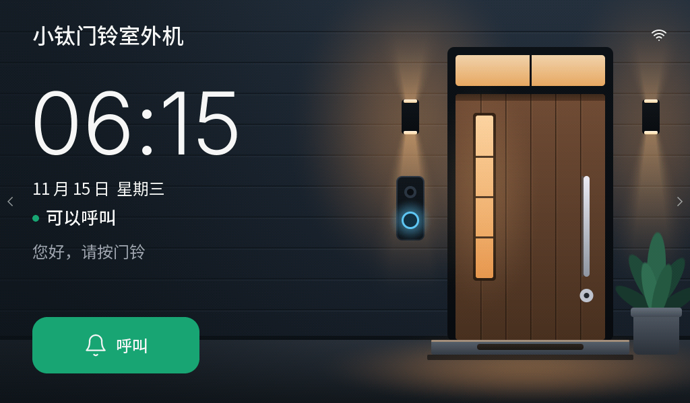
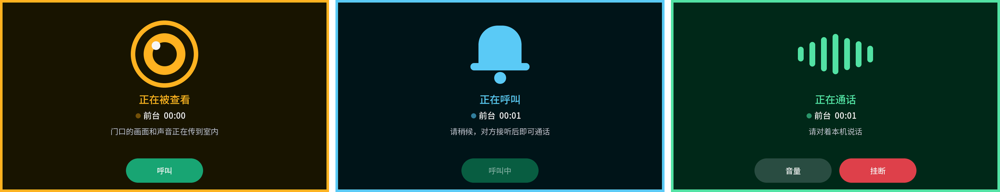
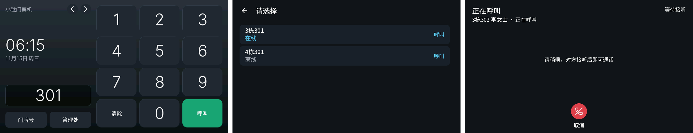
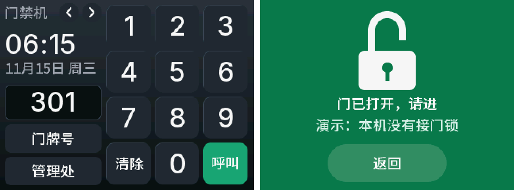

# 门禁

`door` 应用把设备做成门口对讲的一端。分两套：**可视门铃**是一户人家用的，室内机放家里，门口的室外机通常是没有屏幕的设备，按键就是门铃；**门禁**是单元楼或公司用的，两头都有屏幕，门口是拨号的门禁机。一台设备只当一端，四种模式的首页、按钮和设置各自独立：

| 模式 | 放在哪 | 做什么 |
| --- | --- | --- |
| 可视门铃 | 住户家里 | 门口按铃时响铃，接听、挂断；平时能看（听）门口。比门禁室内机简单：没有开门、来访记录，只配一台门铃 |
| 门铃室外机 | 一户的门口 | 访客按铃，呼叫这一户选定的室内机；选定的室内机可以随时查看这里。带屏的设备也能当 |
| 门禁室内机 | 住户家里、公司前台 | 随时查看门口，接听门口来电，对讲，开门，在几台室外机之间切换 |
| 门禁机 | 单元楼、公司大门 | 访客拨房号或从门牌号里找住户，或呼叫管理处；管理处可以随时查看这里 |

标题各写各的：「小钛可视门铃」「小钛门铃室外机」「小钛门禁室内机」「小钛门禁机」（320×240 的屏不带“小钛”）。从 0.4 升上来的设备照原来的角色进首页：原来的“室内机”是门禁室内机，原来的“可视门铃”是门铃室外机。

门铃室外机和门禁机都装在门外，下文合称**室外机**；可视门铃和门禁室内机合称**室内机**；没有特别说明的地方都一样。

五块板都带 `door` 应用。WT99 的首页就是它，其他板的首页仍是表情或人物，翻页就到。

| 板 | 当室内机 | 当室外机 |
| --- | --- | --- |
| 微雪 P4、WT99 | 看得到画面 | 有画面 |
| GUITION 7 寸屏 | 看得到画面 | 只有声音 |
| 立创实战派 S3、CoreS3-Lite | 只有声音 | 有画面 |

这张表由硬件能力决定，不按板名写：有没有摄像头、芯片能编什么、解什么、有没有屏。

## 选模式

没用过门禁的设备先显示「这台设备放在哪里？」，点「可视门铃」「门铃室外机」「门禁室内机」或「门禁机」。没有摄像头、或摄像头画面不能用在设备视频通话里的设备也能当室外机，**只有声音**：访客按铃、对讲、开门都一样，室内机查看门口时只能听。

立创实战派 S3 和 CoreS3-Lite 没有 H.264 编码器，画面用 JPEG 发（240×176，每秒最多 8 帧，网络或处理器跟不上时先降画质、再缩到 160×120；更大的画面会让回声消除来不及处理）；P4 系列的设备和 GUITION 7 寸屏能直接显示。它们没有视频解码器，所以看不到对方的画面，适合放在门口。室内机的固件要是这一版或更新的，旧固件只有声音。

以前用过的设备不会再问：角色是室外机的、已经选过对方设备的，升级后照原来的角色进首页（原来的室外机就是门铃室外机）。

以后要改：

- 室内机：首页右上角的设置图标 → 「工作模式」；
- 室外机：**长按左上角的标题** → 「工作模式」。访客看到的首页上没有设置入口。

修改前会再问一次。通话、查看、AI 对讲进行中不能改。

### 每种模式一页

产品参数 `parameters.door.mode_pages` 打开时（五款彩屏都打开了），不用选模式：四种模式各是一页，跟着翻页走。从前一个应用往后翻，依次是门禁机、门禁室内机、门铃室外机、可视门铃，再往后是下一个应用；往回翻顺序相反。从首页（表情；7 寸屏是人物）向右滑：首页 → 可视门铃 → 门铃室外机 → 门禁室内机 → 门禁机 → 闹钟，再回到首页。

- 在一页停两秒，或用了这一页（点进查看、呼叫、设置、设备列表，或这时来了电话），它的模式就存下来。之后在表情、闹钟或别的页面，来电和被查看都按这个模式处理，重启后也从这一页开始；
- 只是翻过去的页不算，存下的模式不变。从别的入口进门禁（来电、串口指令）显示存下的那一页；
- 每一页有自己配对的设备，互不影响。四份一起存在 `xt_door` 空间的 `pages` 里。第一次带这个参数启动时，原来的 `door.peer` 系列归到原来的模式那一页，之后不再读写它们；
- 设置页里没有「工作模式」一行。`AT+DOOR DOORBELL`、`VIEWER`、`SENDER`、`ACCESS` 照样能切，页面跟着换。

## 配对

两边都从设备联系人里选对方，各存最多 4 台：

- 室内机选室外机：第一台是首页「查看门口」看的那台，点其他的就换到第一台，原来的仍保留；
- 可视门铃选门铃：只有一台，再选一台就换掉原来的；
- 门铃室外机选室内机：第一台最先被呼叫；
- 门禁机选管理处：访客点「管理处」时呼叫，也只有它们能查看这里。住户不用在这里选，按[房号](#门禁机的房号)找。

移除在「门禁设置」里，移除前再问一次。两台设备先要在小程序里互为设备联系人。

**选一边就够，另一边第一次联系时自己配上：**

- 只在室内机上选了室外机：查看一次门口，还没选过室内机的门铃室外机就把这台室内机记下，访客按铃时呼叫它，它也能开门。已经选过室内机的门铃室外机和门禁机不会自动加，要在它的设置里选；
- 只在室外机上选了室内机：室外机呼叫它，第一次按普通来电响铃；接听后室外机在这通电话里说明自己是门口（消息 `HELLO`），室内机把它加进自己的室外机（列表没满时；可视门铃只在还没配门铃时）。下一次起就是门口来电：门禁自己的页面、有「开门」。加上以后在下一个门禁页面上提示一句。

## 门铃室外机

| 页面 | 内容 |
| --- | --- |
| 首页 | 标题、大字时间、日期、能不能呼叫、给访客的一句话；只有「呼叫」一个按钮（门铃只呼这一户）。还没选室内机时按钮是「添加室内机」。320×240 的屏画成一块门铃面板：左边时间、门的名字和能不能呼叫，右边是带镜头的面板和一个大圆按铃键 |
| 正在呼叫 | 被叫的名字、等待接听、「取消」；有几台室内机时写明第几台 |
| 通话中 | 对方开了摄像头时全屏显示对方画面；通话时长、「音量」「挂断」 |
| 正在被查看 | 整页琥珀色，四周一圈框、大镜头：哪台室内机在看、看了多久；按钮「呼叫」。访客按了呼叫变成蓝色「正在呼叫」，室内机开始对讲变成绿色「正在通话」。查看期间一直显示，结束时提示「查看结束」，回到原来的页面 |
| 门已打开，请进 | 室内机开门后整页变绿，锁头弹开，响一声提示音，通话照常；5 秒后回到原来的页面。没打开时整页变红「门没有打开」，写明原因 |

通讯录、设置、添加设备、来访记录页 60 秒没人碰就回首页。

**室外机的首页没有锁**：访客可以左右划到这台设备的其他首页（AI 对讲、时钟），长按标题能进门禁设置。装在门口、不想让人碰这些的，产品清单里只选 `door` 一个应用。

有机身键的设备（例如立创实战派 S3）：在首页按一下机身键就是按铃；有人在查看门口时，按一下请对方接听；来电时按一下接听、长按拒绝；通话中按一下挂断。门禁机的首页上按一下是呼叫管理处，没选管理处会提示。

### 没有屏幕的门铃室外机

只有一个按键、一个摄像头的小板也能当门铃室外机，用应用 `doorbell`（产品清单 `applications` 里只写它）。室内机那边什么都不用改：它像对普通门铃室外机一样响铃、查看、对讲、开门。

| 操作 | 结果 |
| --- | --- |
| 按一下按键 | 依次呼叫这户的室内机，每台 30 秒；有喇叭的板先说“正在呼叫”，再响回铃音 |
| 呼叫中再按一下 | 不呼了 |
| 通话中按一下 | 挂断 |
| 有室内机在查看时按一下 | 请它接听（`RING 1`），30 秒没接就告诉它不等了（`RING 0`） |

呼叫哪几台：查看过或接听过它的室内机（最多 4 台，重启后还在）。一台都没有时，按通讯录的顺序呼叫在线的设备。所以第一次用时，在室内机上加这台设备、查看一次门口就配好了。同一账号的设备来查看都直接应答；不在通讯录里的来电一律拒接。只有正在接听或查看它的室内机能开门；`parameters.doorbell.open_on_word` 为 `true` 时开门算成功（板上没有接门锁，用来演示），否则回答不支持。它呼叫的设备接听后，它也在这通电话里说明自己是门口（`HELLO`）：没把它加为室外机的室内机自动加上，下一次按铃就是门口来电。

没有屏幕，绑定用的验证码是读出来的：出现时读一遍，之后 30 秒读一次，绑好就停。板上没有喇叭时，用串口 `AT+BIND` 读验证码。

**当一种模式用**：`doorbell` 也能和别的应用放在同一个产品里，比如一台平时 AI 对话、有时放门口的小音箱。产品清单的 `applications` 把 `doorbell` 排在首页应用前面；按键款的伴侣应用首页列表会多一项「门铃」，选它进门铃模式。屏上一页：「门铃」、现在的状态和按键做什么。在门铃模式里按键归门铃，长按回首页（正在呼叫或通话时不回），断电重启后仍在门铃模式；它接管这台设备所有的设备通话：通讯录里的设备打来当查看直接应答，其他来电拒接。回到首页后一切照旧，来电照常响铃。配网和绑定照首页应用的做法，门铃不另外读验证码。

## 门禁机

| 页面 | 内容 |
| --- | --- |
| 首页 | 深色金属面板。左边是时间、日期和房号，右边是数字键盘：0 到 9、「清除」「呼叫」；下面是「门牌号」「管理处」（没选管理处时不显示）。按键有短提示音，15 秒没人按，输入自动清空 |
| 请选择 | 输入的数字对上两户以上时，列出门牌让访客选 |
| 门牌号 | 第一行是「通讯录」，下面每户一行，写门牌（备注里房号以前的部分，例如「3栋2单元301」，不写人名），按房号排 |
| 通讯录 | 门牌号的下一级：有名字的联系人一人一行（设备在前，微信在后），点一下只呼叫这一位。备注里没有房号的人（例如「前台」）只在这里 |
| 正在呼叫 | 写着门牌和第几台，例如「3栋301 · 正在呼叫（1/2）」 |
| 通话、被查看、门已打开 | 和可视门铃相同 |

小屏的排法：320×240 的键每个约 56×51 像素，按得准。

### 门禁机的房号

房号写在联系人的备注里（没有备注用名字），按里面的数字认：

| 备注 | 认成 | 访客可以拨 |
| --- | --- | --- |
| `301`、`301 王先生`、`A301` | 301 | 301 |
| `3栋2单元301 王先生` | 3-2-301 | 301、32301 |
| `1-301` | 1-301 | 301、1301 |

- 拨的数字等于最后一组，或者等于所有组连起来，就算对上；每组前面的 0 不管（`0301` 也能找到 301）。
- 连续超过 6 位的数字当电话号码，不算房号；全角数字也认。
- 同一个完整房号的几个联系人算一户。拨通时依次呼叫：在线的设备先，再微信；离线的设备只在没有别的可呼时才呼。一台 30 秒没接换下一台，都没接提示「3栋301 暂时无人应答」（门牌照备注写）；只有一台可呼时，正忙和拒接分别提示「3栋301 正忙，请稍后再试」「3栋301 现在不方便接听」。
- 对上两户以上时弹出列表让访客选；一户也没有时提示「没有这个房号」。
- 只认设备已经取到的联系人：带外部内存的板子默认留 64 个，产品参数 `parameters.contacts.capacity` 最多 256。

**住户那一台**：在它的门禁设置里把门禁机加为室外机，来电就按门口来电弹出并有「开门」。没加的第一次按普通来电响铃，能接听，没有「开门」；接听过一次以后它自动把门禁机加为室外机，之后就是门口来电。微信接听的不支持开门。

## 可视门铃（门铃的室内机）

放在家里，配一台门铃室外机（通常是没有屏幕的设备，按键就是门铃；没有摄像头时只有声音）。

| 页面 | 内容 |
| --- | --- |
| 首页 | 大字时间、日期、门铃在线情况；按钮「查看门口」「设置」。还没选门铃时按钮是「添加门铃」 |
| 查看门口 | 门口的画面或声音；「对讲」「音量」「结束」 |
| 门口来电 | 和门禁室内机一样：停在门禁首页时直接显示门口（有画面时），在别的页面弹出来电页；接通后静音、音量、挂断 |

没有开门、来访记录和切换室外机；要这些用门禁室内机。

## 门禁室内机

| 页面 | 内容 |
| --- | --- |
| 首页 | 大字时间、日期、室外机在线情况；按钮「查看门口」「来访记录」（有未接时变成红色的「未接 N」），本机接了门锁时还有「开门」；右上角是室外机名称和设置 |
| 查看门口 | 门口的画面和声音；「对讲」「音量」「开门」「切换」「结束」 |
| 门口来电 | 停在门禁首页时：直接显示门口画面，写「门口有人按铃」，按钮「接听」「忽略」「开门」「结束」；在别的页面（AI 对讲、时钟、设置）时：弹出来电页，「接听」「拒接」，接通后静音、音量、开门、挂断 |
| 来访记录 | 最近 12 条：未接、已接听、已拒绝、已开门，各是多久以前。只在内存里，重启后清空 |

**查看门口时，本机的麦克风是静音的，摄像头是关的**，门口听不到也看不到室内。点「对讲」才出声，门口屏幕随之变成「正在通话」。接听门口来电时能说话，摄像头同样不开。没有在对讲的查看两分钟后自动结束，可以点「重新查看」。

**来电是直接看还是弹接听，看首页在显示什么**：室内机停在门禁首页时，像楼宇对讲的室内机一样，门口来电直接显示门口的画面——本机自动接通、麦克风静音、摄像头关，门口听不到室内，室外机仍然显示「正在呼叫，对方正在看门口」并继续响铃。点「接听」才通话；「忽略」或「结束」挂断，室外机接着呼叫下一台。30 秒没人接听，室外机也接着呼下一台。室内机在别的页面上、或者来电没有画面（室外机没有摄像头）时，按普通设备的样子弹出来电页响铃。机身键：按一下接听，长按忽略。

## 谁可以查看门口

室外机（门铃室外机和门禁机）对这两种来电自动应答，不用有人在门口接听：

1. 室外机闲着停在首页时，任何一台设备联系人打来（室内机点「查看门口」就是这样打来的）。首页指门禁自己的首页，也指同一台设备上别的应用的首页（表情、人物）：角色是室外机的设备停在表情页上，一样直接应答，屏幕换成「正在被查看」，结束后回到表情页；
2. 在别的页面上时（设置页、设备列表、正在 AI 对讲），只有它选定的室内机打来，而且对方仍是设备联系人。

室外机没有摄像头时，查看就是听门口的声音。查看的设备只能看和听，点「对讲」才出声；开门仍然只认选定的室内机和门禁机按房号呼出的那一户。

其他设备来电（不在首页时别的设备、刚被移除的室内机）在门禁自己的来电页上响铃，要有人在门口点「接听」，不会自动接通。**角色是室外机的设备，设备来电都由门禁的页面显示**，不会出现表情的通话页。微信来电照旧。查看期间室外机屏幕一直写着谁在看。

## 开门

室内机点「开门」先确认，确认后：

- 本机选了 `lock` 模块并接了门锁：直接开本机的锁；
- 否则，在和室外机的通话或查看里把开门请求发给室外机，显示「正在开门…」，收到结果后显示「门已打开」或原因；4 秒内没有回音显示「室外机没有回应，请重试」，可以点「不等了」先关掉。之后才到的结果照样提示并记进来访记录；等结果时通话断了，提示没有收到开门结果。

只有选定的室内机能让室外机开门，其他设备的请求会被拒绝，对方显示「室外机没有把本机选为室内机」，室外机显示「门没有打开」。门禁机还认它自己按房号呼出去的那台设备：在那一通电话里可以开门，不用选进管理处；那台设备反过来打给门禁机时不算。

室外机收到请求后：选了 `lock` 模块就开锁；没有门锁时看产品参数 `parameters.door.open_on_screen`，打开时在屏幕上显示「门已打开，请进」并注明本机没有接门锁（演示用），不驱动任何输出；关闭时回复不支持。五款产品的清单都打开了这一项。

## 设备之间怎么配合

一台设备同时只有一路通话，下面的行为都从这一点来。

| 情形 | 室外机 | 室内机 |
| --- | --- | --- |
| 访客按「呼叫」，只有一台室内机 | 呼叫它，显示等待接听 | 停在门禁首页：直接显示门口画面并响铃；在别的页面：弹出门口来电并响铃 |
| 有几台室内机 | **依次呼叫**，不是同时：在线的先呼；一台 20 秒没接，约 10 秒后换下一台，忙、拒绝或连不上立即换；有在线的就不呼离线的 | 轮到自己时响铃；呼叫已转给下一台时停响，记一条未接 |
| 刚取消就再按「呼叫」 | 等上一次呼叫完全结束（最多 10 秒）再拨，屏幕显示「请稍候」，可以取消 | — |
| 一台接听 | 停止依次呼叫 | 接听的进入通话，其他的不会再响 |
| 都没接 | 提示原因，回首页 | 各记一条未接，首页显示「未接 N」 |
| 访客取消 | 停止依次呼叫，回首页 | 停响，记一条未接 |
| 室内机主动查看 | 自动应答，屏幕显示谁在看 | 显示门口画面，本机静音、不送画面 |
| 查看中访客按「呼叫」 | 不另外拨号，在这通连接里通知室内机；30 秒没人应答就结束查看，依次呼叫其他室内机，没有别的可呼才提示无人应答 | 同一页响铃，「接听」「忽略」，响铃期间不算查看的两分钟。没理会记一条未接 |
| 换下一台的空隙里，另一台室内机来查看 | 自动应答，这台立即响铃 | 显示「门口有人按铃」 |
| 换下一台的空隙里闹钟响、唤醒了 AI | 照常呼下一台，门禁回到屏幕上 | — |
| 室内机从联系人里打给室外机（不是点「查看门口」） | 自动应答，显示「正在通话」 | 普通通话，两边都能说话 |
| 查看中对方挂断或断网，访客正在呼叫 | 断网：改成普通呼叫接着呼；对方结束：提示不方便接听 | — |
| 查看中，另一台室外机来电 | 那台室外机收到「忙」，呼叫它的下一台室内机 | 查看不受影响 |
| 室外机正在和别人通话（含微信） | 回「忙」，通话不受影响 | 提示「室外机正忙，请稍后再试」 |
| 两边同时互相呼叫 | 收到「忙」后 1.5 秒再呼一次 | 提示正忙，随后接到来电 |
| 室内机正在 AI 对讲、多人对讲或被远程查看 | — | 门口来电优先，中断它们并响铃 |
| 室内机正在通话（含微信） | 收到「忙」，换下一台 | 当前通话不受影响 |
| 室内机正在声音识别（五款彩屏都是） | 收到「忙」，换下一台 | 识别不受影响，结束后恢复 |
| 室内机闹钟正在响 | — | 门口来电优先，停闹钟并响铃 |
| 室外机正在 AI 对讲时被查看 | AI 对讲中断，显示「正在被查看」 | 正常查看 |
| 切换另一台室外机 | 前一台回到原来的页面 | 挂断后约半秒接通下一台 |
| 对方离线或连不上 | 提示「呼叫没有接通」或换下一台 | 提示「室外机暂时连不上」，可以重新查看 |
| 中途断网 | 回到原来的页面 | 显示「网络中断，请重新查看」；网络恢复后点「重新查看」 |
| 其中一台重启 | 对方重启：按断网处理；自己重启：回首页，选定的设备都还在 | 同左；来访记录清空 |
| 对方的固件没有视频通话 | 视频呼叫被它自动拒绝（拒接信令里写明不支持），立即改用语音再呼一次；人按的拒接和忙不会再呼同一台 | 同左；接通后写明「没有画面，可以听和对讲」 |
| 对方没有摄像头，或发的画面本机解不了 | 照常应答 | 接通 8 秒还没有画面，写明「没有画面，可以听和对讲」；之后来了画面照常显示 |
| 门禁机按房号呼叫 | 这一户的设备、微信依次呼，写（1/2） | 加了门禁机的那台弹门口来电；没加的按普通来电 |
| 室外机停在首页时，没被选定的设备联系人来查看 | 自动应答，屏幕显示谁在看；对方开不了门 | 显示门口画面 |
| 室外机不在首页时，被移除的、没被选定的设备来电 | 不自动应答，在门禁的来电页上响铃，「接听」「拒接」 | 查看页显示「正在接通」，对方接听后照常 |
| 室外机呼叫一台没把它加为室外机的室内机 | 照常呼叫；接通时说明自己是门口 | 这一次按普通来电显示，接听后自动把它加为室外机；下一次起是门口来电 |
| 还没选室内机的门铃室外机被查看 | 把来查看的这台记为室内机，之后按铃呼叫它 | 之后可以开门 |
| 通话或查看中改模式、移除设备 | 不受理，提示原因 | 同左 |
| 对方是没有「查看」功能的旧固件 | 旧室内机打来也会自动应答，它没有静音，所以两边都能听到 | 旧室外机会响铃，要有人在门口接听；30 秒没接提示「室外机没有应答」 |

没人接的呼叫放弃之后，被叫可能正好在接，所以通话模块会在 10 秒内不让新的连接进来（`xiaotai_call_answer_hold_ms`），换下一台要等它过去；对方拒绝或拒收视频的不用等。停响和换下一台由平台的呼叫信令完成，室内机之间没有直接联系，所以被跳过的室内机只知道自己没接，不知道后来谁接了。

## 通话消息

消息走这通设备通话的连接，用 `call` 模块的通话消息（`xiaotai_call_send_message`，事件 `call.message`）。只在已接通、且被认作门禁通话的通话里收发；不认识的类型忽略。

| 消息 | 方向 | 内容 |
| --- | --- | --- |
| `XIAOTAI_APP_DOOR_MESSAGE_OPEN`（1） | 室内 → 室外 | 请求开门 |
| `XIAOTAI_APP_DOOR_MESSAGE_OPEN_RESULT`（2） | 室外 → 室内 | 4 字节结果码 |
| `XIAOTAI_APP_DOOR_MESSAGE_LOOK`（3） | 室内 → 室外 | 1 字节：0 只是查看，1 在对讲 |
| `XIAOTAI_APP_DOOR_MESSAGE_RING`（4） | 室外 → 室内 | 1 字节：1 访客在呼叫，0 不等了 |
| `XIAOTAI_APP_DOOR_MESSAGE_HELLO`（5） | 室外 → 室内 | 1 字节：室外机的模式（1 门铃室外机，2 门禁机）。室外机自己呼出的电话接通时发一次；唯一在“不是门禁通话”的通话里也算数的消息，见[配对](#配对) |

## 串口指令

| 指令 | 作用 |
| --- | --- |
| `AT+DOOR DOORBELL`、`AT+DOOR VIEWER`、`AT+DOOR SENDER`、`AT+DOOR ACCESS` | 在门禁首页、没有会话时切到可视门铃、门禁室内机、门铃室外机或门禁机，保存后重启仍有效；`AT+DOOR` 的 `role=` 依次是 `doorbell`、`viewer`、`sender`、`access` |
| `AT+DOOR DIAL <房号>` | 门禁机在首页时，等于拨这个房号再按「呼叫」。台架测试用；`accepted=1` 表示已经呼出或弹出了选择列表 |
| `AT+DOOR` | 读当前页面和模式：`role=viewer` 室内机、`sender` 可视门铃、`access` 门禁机 |
| `AT+STATUS app.door` | 读门禁通话、查看、未接、开门的次数和选定的设备数 |

授权等级见 [AT 指令](../AT指令.md#词表与权限)。

## 保存的设置和产品参数

| 键名 | 缺省 | 说明 |
| --- | --- | --- |
| 设置 `door.sender` | 0 | 0 门禁室内机，1 门铃室外机，2 门禁机，3 可视门铃 |
| 设置 `door.peer`、`door.peer2`、`door.peer3`、`door.peer4` | 空 | 选定的对方设备，第一台是 `door.peer` |
| 设置 `door.chosen` | 0 | 在屏幕上选过模式 |
| `parameters.door.open_on_screen` | `false` | 室外机没有门锁时，在屏幕上演示开门 |
| `parameters.door.mode_pages` | `false` | 四种模式各是一页，跟着翻页走，见[每种模式一页](#每种模式一页) |
| `parameters.door.title`、`parameters.door.door_name` | 按模式：「小钛可视门铃」「小钛门铃室外机」「小钛门禁室内机」「小钛门禁机」；「入户门」 | 首页标题（例如单位名）和门的名称 |
| `parameters.preferences.bindings` 里的 `door_sender`、`door_peer` | 无 | 要和旧固件共用存储时才写；不写就存在 SDK 自己的空间里 |

一个产品同时带 `door` 和其他应用时，`door` 要排在 `applications` 的前面，门禁通话才由它显示。`door` 不是首页应用时，实时查看仍由首页应用显示。

## 背景图

首页的两张图（夜里亮灯的大门、傍晚的房间）由 `apps/xiaotai_app_door/src/backdrop.c` 画出来，第一次显示时画一次，放在外部内存里（1024×600 约 1.2 MB，480×320 约 0.3 MB），不占 Flash，也没有图片素材。外部内存空闲不到 4 MB 的设备上，打开视频页或离开首页 2 秒后把它还回去，给对方的画面腾地方，下次进首页重画；放不下时先显示纯色底，有地方了再画。宽度不小于 440、高度不小于 300 的横屏用门禁自己的首页；其他屏用主题的时钟页。
