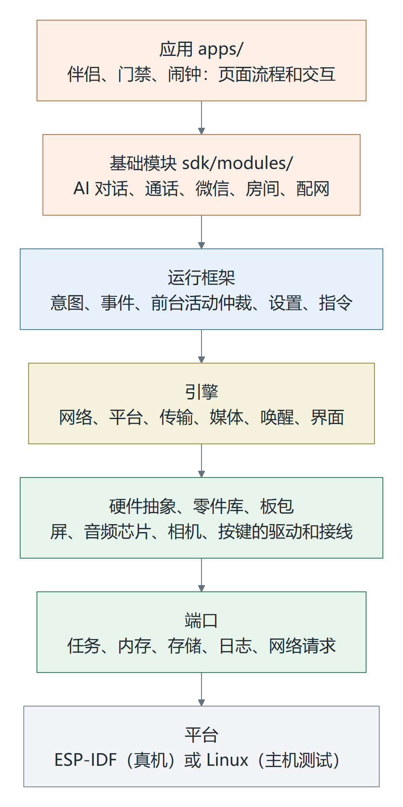
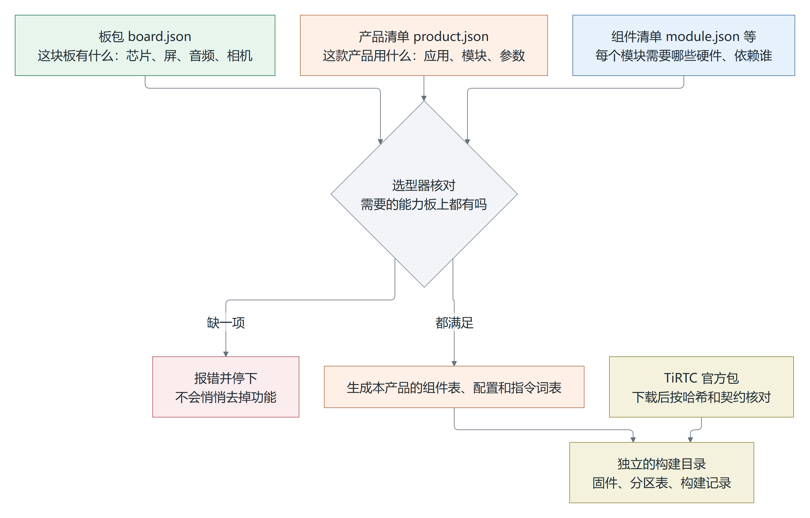
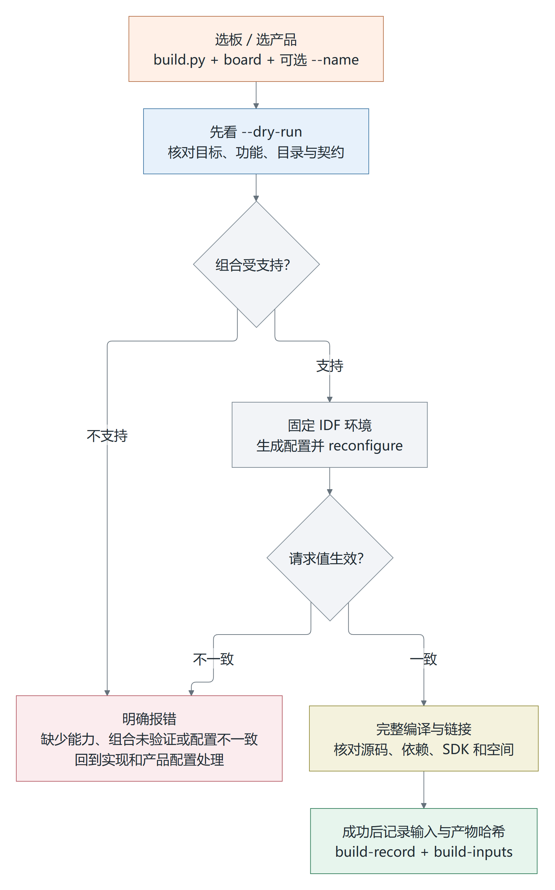
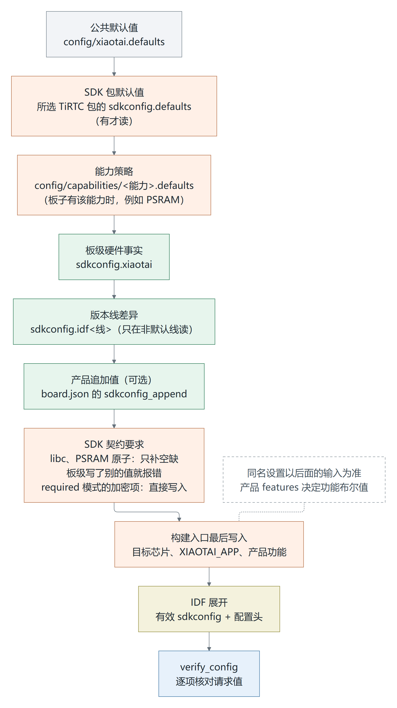
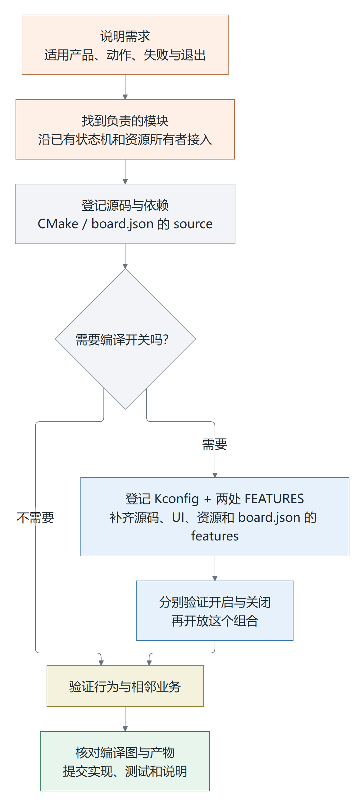

# 开发指南

[文档地图](README.md) · [第一次编译](第一次编译.md) · [架构总览](架构总览.md) · [新板接入](新板接入.md) · [测试与诊断](测试与诊断.md)

**给谁看**：已经能编出固件、准备动手改代码的开发者。还没编过，先走一遍[第一次编译](第一次编译.md)。

**读完能做到**：知道一个需求该改哪一层，会用各条版本线编译和烧录，会加一个功能并在提交前跑对检查。

这是一份做事时翻的手册，各节可以单独读。为什么这样分层，见[架构总览](架构总览.md)；从 v0.2 升级见[迁移说明](迁移说明.md)。

| 我想…… | 看这一节 |
| --- | --- |
| 知道一个需求该改哪里 | [先确定改哪一层](#先确定改哪一层) |
| 弄清每一层管什么 | [各层管什么](#各层管什么) |
| 改产品带哪些功能 | [产品是怎么组成的](#产品是怎么组成的) · [功能开关](#功能开关) |
| 用 ESP-IDF 5.5 或 6.1 编译，离线编译 | [编译与烧录](#编译与烧录) |
| 烧录时保留配网和绑定 | [烧录](#烧录) · [分区规则](#分区规则) |
| 加一个功能 | [加一个功能](#加一个功能) |
| 提交前该跑什么 | [提交前](#提交前) |

## 先确定改哪一层

| 需求 | 主要改哪里 | 容易犯的错 |
| --- | --- | --- |
| 加页面或状态提示 | `sdk/themes/`、`sdk/xiaotai_ui/`，必要时给 `apps/` 的视图补状态 | 在页面回调里释放 RTC 或操作 GPIO |
| 加业务动作或流程 | 对应的 `sdk/modules/`，由 `apps/` 组织交互 | 另起一套连接或通话状态机 |
| 加音频处理或编码格式 | `sdk/xiaotai_media/`，必要时改 `sdk/xiaotai_transport/` | 用屏幕类型推断编码，或者改了别的业务的传输格式 |
| 加按键、旋钮或其他输入 | `sdk/parts/`、板包和 `sdk/xiaotai_interaction/` | 让驱动根据通话状态决定做什么 |
| 换屏幕、codec、摄像头 | `boards/` 与对应的媒体或显示适配 | 在业务代码里加板名判断 |
| 加一个要保存的设置 | 在负责该功能的模块或应用登记，复用框架的设置存储 | 把运行期设置做成编译开关 |

例：加“通话时长显示”。通话的开始和结束时间由应用按会话状态记录；界面在通话页显示时长。板卡驱动不用动，UI 也不用自己再判断一次通话何时开始。

改联调步骤前，先核对[配网与绑定](功能/配网与绑定.md)、[通话与房间](功能/通话与房间.md)中写明的现有行为。

## 各层管什么



| 层 | 目录 | 负责什么 | 不负责什么 |
| --- | --- | --- | --- |
| 板包和零件 | `boards/<厂商>/<板>/`、`sdk/parts/` | 板包给出引脚、总线、供电和能力；同款外设复用零件实现 | 网络、身份、业务 |
| 产品 | `products/<产品名>/product.json` | 选板、应用、模块、选项与变体，规定功能组合 | 直接实现驱动 |
| 应用和基础模块 | `apps/`、`sdk/modules/` | 应用组织界面和功能；模块负责绑定、通话、房间等业务 | 绕过框架争抢硬件 |
| 框架 | `sdk/xiaotai_framework/` | 意图、事件、会话仲裁、设置登记和生命周期 | 实现某款板的业务规则 |
| 服务和传输 | `sdk/xiaotai_platform/`、`sdk/xiaotai_transport/` | 平台负责发现、鉴权、请求，传输负责 TiRTC 连接和帧收发 | 绘制界面、直接操作外设 |
| 媒体 | `sdk/xiaotai_media/`、`sdk/xiaotai_video/`、`sdk/xiaotai_wake/` | 采集、AEC、编解码、播放、摄像头和唤醒 | 业务会话状态 |
| 界面与输入 | `sdk/xiaotai_ui/`、`sdk/themes/`、`sdk/xiaotai_interaction/`、`sdk/xiaotai_at/` | 页面呈现、按键、触摸、本地 AT，根据操作产生意图 | 直接修改业务状态 |
| 平台端口 | `sdk/xiaotai_port/`、`sdk/xiaotai_net/` | KV、网络、配网、任务与内存等平台能力 | 决定某种交互的含义 |

几条贯穿各层的规则：

- **一个资源只有一个所有者。** 会话、音频设备、相机、NVS 写入都有明确的所有者任务，其他人发请求，不直接操作。
- **意图和结果分开。** 按键、触摸、AT 发出的是意图；意图入队后，还要等所有者回报结果。队列满、超时、资源不足分别给出错误。
- **代次。** 会话、连接、播放都带代次，迟到的旧事件直接丢弃。
- **回调里不做重活。** SDK 回调和定时器回调里不做阻塞网络请求、NVS 写入，也不等待播报。
- **错误原样上抛。** 不靠吞错、自动重启、清状态或无限重试来“恢复”。

## 产品是怎么组成的

一个产品 = 一块板 + 一组功能 + 一种交互。



| 产品 | 板卡参数 | 芯片 | 交互 | 网络音频 |
| --- | --- | --- | --- | --- |
| `xiaotai-szpi-s3` | `lckfb/szpi-esp32s3` | ESP32-S3 | 320×240 触摸 | PCMA 8 kHz |
| `xiaotai-cores3-lite` | `m5stack/core-s3` | ESP32-S3 | 320×240 触摸 | PCMA 8 kHz |
| `xiaotai-waveshare-p4-rev3` | `waveshare/esp32-p4-wifi6-touch-lcd-3.5` | ESP32-P4 | 480×320 触摸 | PCMA 8 kHz |
| `xiaotai-wt99p461-s1-1v1` | `wt99p461-s1` | ESP32-P4 | 1024×600 门禁 | PCMA 8 kHz |
| `xiaotai-jc1060f570c` | `guition/jc1060f570c` | ESP32-S31 | 1024×600 触摸 | PCMA 8 kHz |

上表是仓库里的五款产品。`xiaotai-jc1060f570c` 只在 ESP-IDF 6.1 线上编译（ESP32-S31 从 6.1 起才有支持），档案放在 `profiles/native-firmware/` 顶层、`idf_line` 写 6.1。

两件事分开写：`boards/.../board.json` 只写板子有什么；`products/.../product.json` 写产品用什么。选型器会核对板卡能力和所选模块的要求。缺少能力就报错，不会把功能悄悄裁掉。

使用伴侣应用内置交互样式的产品可声明 `"needs_any": ["key", "touch"]`，要求板包至少有按键或触摸。这个字段只校验能力，不替产品挑样式或驱动；用编码器等自定义样式时按自己的交互要求填写。

如果该产品还必须具备某项能力，可用 `needs_all` 单独声明。例如 `"needs_all": ["pcm_in"]` 要求板子有 PCM 输出的麦克风，只有编码音频输出的麦克风就不能作为它的采集端。两项声明同时存在时都要满足；其他产品可以按各自的音频组合保留编码采集。

加了会向框架登记的东西，要在所属组件的清单里写明数量上限，框架按它分配容量：

| 新增的东西 | 在清单里登记 | 怎么数 |
| --- | --- | --- |
| 意图、事件订阅 | `registrations.intents`、`registrations.subscribers` | 按真正登记的条数。只有选中某个可选模块才执行的登记，写在 `registrations.when_selected` 里：`any_of` 命中任意一个模块，这条上限计入一次 |
| 设置 | `registrations.settings` | 启动时最多会注册几项 |
| 串口指令 | `registrations.commands` | 按命令的首词。同一首词的多个动词只算一项；几个模块共用一个首词时，各记一项。本地救援指令在另一张表里，不计入 |

选型器把选中的组件加起来，再算上框架自带的登记，生成 `FRAMEWORK_MAX_INTENTS`、`FRAMEWORK_MAX_SUBSCRIBERS`，产品和变体不用手填这两个值。没有外部内存的产品，设置表和指令表的容量也按这些声明计算；有清单之外的扩展时，可以显式设置 `FRAMEWORK_MAX_COMMANDS`。

改完跑 `python scripts/sdk_selection.py --check --strict`，再跑相关产品的主机测试，确认实际登记没有超出声明。

`python scripts/check_change_impact.py` 按产品清单和变体查受影响的产品。两种报告都是检查计划，实际入图仍要看构建的编译数据库。

### 产品选型与主机验证

以下命令只验证新产品组合。在 Linux 或 WSL 的仓库根目录执行；彩屏主机用例需要本机已准备好的锁定 LVGL。如缓存已有源码但还没准备，先运行 `python3 -B tests/fetch_components.py --role lvgl --idf 6.0`，不加 `--download` 不会下载。

```bash
python3 -B scripts/sdk_selection.py --product products/xiaotai-szpi-s3/product.json --out-dir build/selection-szpi
python3 -B scripts/sdk_selection.py --check --strict
python3 -B tests/sdk/product/run.py --product xiaotai-szpi-s3
```

`selection.cmake` 给出选中的组件，`xiaotai_selected.c` 是启动时使用的配置表，`sdkconfig.selection` 记录选项，`commands.json` 是该选型的候选指令。要改功能组合，改产品清单或选一个已声明的 `--variant`，不直接改这些生成文件。命令不会生成 ESP 固件。

同一模块在不同产品上需要不同的行为时，在 `products/<产品名>/product.json` 的 `parameters` 下选值；编译期开关放在 `options`，运行时能改的设置不写进这两处。查看[产品选项](产品选项.md)可分清通用缺省值和各产品实际取值。改完用 `--dry-run` 看所选产品和变体，再跑该产品的主机用例。

SDK 目标构建使用 [`cmake/esp-idf-product/`](../cmake/esp-idf-product/) 工程模板，把这些选型产物、板包和锁定依赖编成目标固件。其他新组合仍需用独立 ESP-IDF 工程验证，生成选型不会替它们切换默认入口。需要上板时核对最终 `sdkconfig`、链接图和 ELF，主机产物不能烧录。

## 编译与烧录

### 准备环境

| | ESP-IDF 6.0（默认） | ESP-IDF 5.5（可选） |
| --- | --- | --- |
| ESP-IDF 版本 | 6.0.3（官方提交 `76f5dedd9950a3012fee8fb7d5586df21fc67802`） | 5.5.5（官方提交 `b774170ff46c393eeb5e495ea37936038d3f4f4f`） |
| 工具链 | `esp-15.2.0_20251204` | `esp-14.2.0_20260121` |
| TiRTC SDK | 官方 2.6.3，ESP-IDF 6.0.3 版 | 官方 2.6.3，ESP-IDF 5.5.4 版 |
| 参数 | 无 | `--idf 5.5` |
| 产物目录 | `build/<产品名>/sdk-firmware/` | `build/<产品名>/sdk-firmware-idf5.5/` |

ESP-IDF 用乐鑫官方发布的版本安装，比如官方安装器 EIM 或[官方文档](https://docs.espressif.com/projects/esp-idf/)，不要改动 IDF 源码。构建会核对 IDF 的官方提交，版本号相同但源码不同也会被拦下。装有多个版本时，先激活本次要用的环境，再构建。用下面这条命令确认当前环境、各板支持哪条线、用哪个 TiRTC 包：

```bash
python scripts/build.py --list-idf
```

#### TiRTC SDK 从哪里来

TiRTC 通话库不放在仓库里。[`components/tirtc_sdk/packages.json`](../components/tirtc_sdk/packages.json) 记着每条线、每种芯片用的官方包在 TiRTC 发布站上的位置和 SHA-256。第一次编译时，`build.py` 会自动下载、核对哈希、解压到 `components/tirtc_sdk/packages/`，以后直接复用。也可以先单独准备：

```bash
python scripts/fetch_tirtc.py               # 默认 6.0 线的包
python scripts/fetch_tirtc.py --all         # 两条线都准备
python scripts/fetch_tirtc.py --from <目录>  # 用自己下载好的 .tgz，不联网
```

编译机不能上网时，脚本会打印每个包的下载地址和 SHA-256，在别处下载后用 `--from` 交给它。构建还会按 `contracts/` 里的契约核对库和头文件的哈希、编译它的 ESP-IDF 和工具链、libc、FreeRTOS 类型大小和加密依赖，任何一项对不上就停下。升级 TiRTC 版本的做法见 [TiRTC 包说明](../components/tirtc_sdk/README.md)。

#### 选用 ESP-IDF 5.5

1. 激活官方 ESP-IDF 5.5.5。微雪 P4 和 WT99 的本地依赖要求 IDF Component Manager `>=2.5.2,<3`（5.5.5 自带的版本满足）。
2. 编译时加 `--idf 5.5`，第一条只检查选型：

   ```bash
   python scripts/build.py waveshare/esp32-p4-wifi6-touch-lcd-3.5 --idf 5.5 --dry-run
   python scripts/build.py waveshare/esp32-p4-wifi6-touch-lcd-3.5 --idf 5.5
   ```

3. 计划应显示 `idf_line: 5.5`，并指向 `profiles/dependency-locks/idf5.5/<产品名>-native.lock`。成品在 `build/<产品名>/sdk-firmware-idf5.5/`。

ESP32-S3 的 5.5 版官方包里有 5 条 `s32c1i` 硬件原子指令，构建时会打印一条提示；这是官方包的原样内容。6.0 版官方包没有这类指令。

#### 选用 ESP-IDF 6.1

GUITION 7 寸屏（ESP32-S31）只在 6.1 线上编译，立创 S3 和微雪 P4 也可以用这条线。激活官方 ESP-IDF 6.1.0，6.1 线的 TiRTC 包从本地目录安装：

```bash
python scripts/fetch_tirtc.py --line 6.1 --from <包所在目录>
python scripts/build.py guition/jc1060f570c --idf 6.1
```

成品在 `build/<产品名>/sdk-firmware-idf6.1/`。各板支持哪几条线，以 `python scripts/build.py --list-idf` 的输出为准。

#### 离线编译

在 Linux 或 WSL 激活同一环境，提前备好匹配锁的本地索引和组件缓存：

```bash
unshare -Urn python3 scripts/build.py waveshare/esp32-p4-wifi6-touch-lcd-3.5 --idf 5.5 \
  --component-index <本地索引> --component-cache <本地缓存>
python3 tests/verify_build.py --entry sdk --require-flash-layout build/xiaotai-waveshare-p4-rev3/sdk-firmware-idf5.5
```

### 编译

在仓库根目录执行：

```bash
python scripts/build.py --list-boards
python scripts/build.py lckfb/szpi-esp32s3 --dry-run
python scripts/build.py lckfb/szpi-esp32s3
python scripts/build.py m5stack/core-s3
python scripts/build.py lckfb/szpi-esp32s3 --idf 5.5
```



`--dry-run` 只展开配置，不编译。实际构建写入各自的 `sdk-firmware/`（5.5 线是 `sdk-firmware-idf5.5/`）。其他板用 `--list-boards` 给出的板卡参数。写入地址以本次构建的记录为准。

| 文件 | 是什么 |
| --- | --- |
| 产品名命名的 `.bin`（例如 `xiaotai_waveshare_p4_rev3.bin`）和同内容的 `xiaotai.bin` | 应用镜像，写入地址见本次 `flasher_args.json` |
| `bootloader/bootloader.bin`、`partition_table/partition-table.bin` | 启动程序和分区表 |
| `flasher_args.json`、`flash_args` | 每个文件该写到哪个地址 |
| `build-record.json`、`build-inputs.json` | 这次构建用了哪些输入、产出了什么，用来追溯 |

`build-record.json` 的 `static_memory` 从已校验的应用 ELF 读取静态段大小：`.iram0.text`、`.dram0.data`、`.dram0.bss`，以及实际存在的外部内存段。前后两次的产品、入口、构建阶段、IDF 和 PSRAM XIP 等标识一致才比较：任一普通段增减超过 1 KiB，构建会打印 `NOTE: static memory`，记录中的 `baseline` 指向用来对比的上次构建。首次构建没有基线；若无法解析 ELF，则记录 `unavailable` 和原因。

静态段大小适合定位哪次改动挤占了内部 RAM，不能代替运行时内存。PSRAM XIP 的 ELF 段大小另列，也不是启动时实际对齐占用。要确认没有 PSRAM 的小内存板是否跑得下，应上板分别读取空闲内存、会话最低值、最大连续块和任务栈余量。

同一个工作目录里的构建串行跑，避免共享的生成文件或依赖被另一次构建改动。要并行编多个板，分别用独立工作目录和输出目录，再复用只读的锁定组件缓存。

SDK 产物可离线核对，不会连接设备：

```bash
python tests/verify_build.py --board lckfb/szpi-esp32s3 --entry sdk --require-flash-layout build/xiaotai-szpi-s3/sdk-firmware
python tests/verify_build.py --board m5stack/core-s3 --entry sdk --require-flash-layout build/xiaotai-cores3-lite/sdk-firmware
python tests/verify_build.py --board waveshare/esp32-p4-wifi6-touch-lcd-3.5 --entry sdk --require-flash-layout build/xiaotai-waveshare-p4-rev3/sdk-firmware
```

### 功能开关

构建使用产品清单锁定的组合，不接受临时覆盖；要换组合，用产品清单里声明的 `--variant`。

| 功能键 | Kconfig | 含义 |
| --- | --- | --- |
| `ai` | `CONFIG_XIAOTAI_AI` | AI 对话 |
| `device_call` | `CONFIG_XIAOTAI_DEVICE_CALL` | 设备对讲 |
| `wechat_voip` | `CONFIG_XIAOTAI_WECHAT_VOIP` | 微信通话 |
| `room` | `CONFIG_XIAOTAI_ROOM` | 多人对讲 |
| `h5_stream` | `CONFIG_XIAOTAI_H5_STREAM` | 网页实时语音 |
| `h5_video` | `CONFIG_XIAOTAI_H5_VIDEO` | 网页实时视频，依赖 `h5_stream` |
| `ai_vision` | `CONFIG_XIAOTAI_AI_VISION` | AI 看图，依赖 `ai` |

每个产品默认打开自己支持的全部功能。产品清单里声明过的裁剪组合用 `--variant` 选择，例如立创 S3 关掉 AI 看图和网页视频：

```bash
python scripts/build.py lckfb/szpi-esp32s3 --entry sdk --variant no-video
```

没有在产品清单里声明的组合会被拒绝。这样可以避免出现“配置写着关闭，实际还在采集和上报”的固件。要开放一个新组合，见下文[加一个可开关的功能](#加一个可开关的功能)。

五款产品的默认固件都开放串口指令：立创 S3、CoreS3-Lite 和 GUITION 7 寸屏走芯片的原生 USB 口，微雪 P4 和 WT99 走 UART0，115200。可用的命令以设备上 `help` 或 `AT+HELP` 的回答为准，见 [AT 指令](AT指令.md)。

### 烧录

同一板型、分区和存储布局兼容时，可以**只更新应用**以保留配网和绑定。先从本次构建的 `flasher_args.json` 核对应用地址，下面以立创 S3 为例：

```bash
python -m esptool --chip esp32s3 -p <串口> write-flash 0x10000 build/xiaotai-szpi-s3/sdk-firmware/xiaotai_szpi_s3.bin
```

**写入全部分段**，包括启动程序、分区表和应用。在构建目录里执行：

```bash
cd build/xiaotai-szpi-s3/sdk-firmware
python -m esptool --chip esp32s3 -p <串口> write-flash @flash_args
```

`--chip` 按板子选 `esp32s3`、`esp32p4` 或 `esp32s31`。写完在串口里输入 `version`（或 `AT+VERSION`），核对设备上运行的固件就是刚编的这一份，见 [AT 指令](AT指令.md)。

ESP-IDF 5.5 环境里的 esptool 是 4.x 版，命令写作 `write_flash`。切换 IDF 版本线时，进入本次构建目录，用 `@flash_args` 写入该次构建的所有分段，不只写应用。5.5 SDK 入口使用 `sdk-firmware-idf5.5/`；不要拿另一条线的引导程序或分区表混用。

### 打包发布

把构建目录打成带完整镜像、清单和校验和的发布包，用 `scripts/package_release.py`。版本号只在 `cmake/esp-idf-product/CMakeLists.txt` 的 `PROJECT_VER` 一处。步骤、检查项和验证等级见[发布打包](发布打包.md)。

### 分区规则

所有板的分区表都遵守同样的规则：

- **主芯片 APP 不做 OTA。** APP 分区 `factory` 从 `0x10000` 开始，一直到 Flash 末尾。16 MB 的板有 16,320 KB，8 MB 的板有 8,128 KB。
- **`nvs` 的位置和大小永远不动。** 所以只改分区表、只写应用时，设备的配网和绑定都会保留。
- **P4 的 C6 和 C61 协处理器照常升级。** C6 的镜像编进 P4 的应用里，开机经 SDIO 校验，需要时升级；C61 用 AT 命令触发，从 HTTP 下载镜像，再经 SPI 写入。两者都不占 P4 的分区。

分区表在 [partitions/](../partitions/) 和各板目录的 `partitions.csv` 里。

### 看配置项

```bash
idf.py -B build/xiaotai-szpi-s3/sdk-firmware menuconfig
```

先用 `build.py` 编过一次，其余参数会从构建目录的 CMake 缓存里读出来。进入 `XiaoTai` 菜单查看；这里改的值只用于查看和试验，下次构建会按产品清单重新生成。配置按下图的顺序叠加，同名设置以后面的为准：



SDK 契约那一层要注意：libc 和 PSRAM 原子操作只补前面没写的，板级写了别的值，或者包需要 PSRAM 而板子没开，构建入口直接报错。6.0 版官方包自带加密实现，不约束 Mbed TLS 设置；5.5 版官方包要调用 ESP-IDF 的 DES 和硬件 SHA，这两项会直接写入，盖过板级设置（例如板级的 `CONFIG_MBEDTLS_DES_C=n` 会变成 `y`）。

要长期保留的板级默认值，写进板目录的 `sdkconfig.board`；只改 `build/` 下的 `sdkconfig`，下次重建时会丢失。

板级文件只写这块板的硬件事实（PSRAM 大小和速度、缓存、引脚相关的驱动选项）。由硬件能力决定的策略放在 `config/capabilities/<能力>.defaults`，构建入口看到板子有这个能力就自动套用，例如板子开了 PSRAM，就套用 `psram.defaults`：能放进 PSRAM 的缓冲（MQTT 收发缓冲、任务栈、语音前端的工作区）都放进去，把内部 RAM 留给 DMA、Wi-Fi 和通话。新板不用再抄这些配置；确实要不同，就在自己的 `sdkconfig.board` 里写明，板级文件仍然优先。

## 加一个功能

先按[上面的表](#先确定改哪一层)确定改哪一层，再往下做。

### 把源码加进构建

把文件加在所属组件的 `CMakeLists.txt`，并在该组件清单登记依赖、需求和配置项。产品在 `product.json` 选择该模块；板包只登记真实零件。完整规则见 [SDK 架构的组件约定](SDK架构.md#6-组件约定)。

编译后，到 `compile_commands.json` 里确认新文件确实参与了编译。配置里有名字，代码却没编进去，是最常见的遗漏。

### 加一个可开关的功能



优先用“选不选这个模块”来开关功能；确实需要一个编译期开关时，在组件的 `Kconfig` 和 `*_config.h` 声明，在产品 `options` 或 `variants` 选择。业务参数放对应组件的 `parameters`；用户在使用过程中会改的值用运行期设置。开、关都要验证，尤其是关闭后不再公布的能力和不再创建的任务。

## 代码约定

- **语言**：新的编排和接口用 C++23；成熟的 C 驱动、算法、状态机和 TiRTC C 接口保留，两边通过小范围的 C ABI 对接。
- **内存**：内部 RAM、PSRAM、DMA 内存分别考虑。有缓存关闭风险的 Flash 调用只交给内部栈的存储或网络任务。没有 PSRAM 的芯片按产品的内存上限和实测水位判断，不套用有 PSRAM 的板的做法。
- **SDK**：TiRTC SDK 用官方发布包，构建时下载，不放进仓库，也不修改。各产品每条版本线用哪个包，看 [packages.json](../components/tirtc_sdk/packages.json) 和契约，见 [TiRTC 包说明](../components/tirtc_sdk/README.md)。
- **依赖锁**：每款产品用 `profiles/dependency-locks/<产品名>-native.lock`（5.5 线在 `idf5.5/` 下）。用 `--entry sdk --variant <名称>` 选择产品清单中的变体，产物另存；只改选项或参数的变体（如立创 S3 的 `diagnostics`）共用 SDK 产品锁，声明 `without` 的变体（如 `no-video`）使用 `<产品名>--<变体>.lock`。间接依赖由解析器确定，不按模块名手删锁项。`--dry-run` 会列出所用的锁；正常构建不更新锁。用 `python tests/verify_build.py --entry sdk --variant <名称> --require-flash-layout <构建目录>` 核对实际链接进 ELF 的模块和锁。
- **5.5 SDK 锁**：位于 `profiles/dependency-locks/idf5.5/`，档案在 `profiles/native-firmware/idf5.5/`，组件声明为 `profiles/<产品名>-idf5.5-native.yml`。声明 `without` 的变体必须有本线的锁，不能借用 6.0 的锁。P4 在 5.5 使用 IDF 自带的 USB 组件，其他共享组件保持锁定版本。
- **更新依赖**：只能为含 `without` 的变体维护独立锁：在 Linux 的无网络命名空间（`unshare -Urn`）中，激活对应的 IDF 环境后，用 `--entry sdk --variant <名称> --write-lock --resolve-only --component-index <本地索引> --component-cache <本地缓存>`。工具只在解析和核验完成后写变体锁，保留产品锁；不得加入新注册表组件或改变已有版本与内容哈希。提交前审核间接依赖及锁差异。
- **日志**：按[日志规范](日志规范.md)写：信息级是给所有开发者看的主线，调试级给调试人员；实时路径不打日志；不打印凭据、Token、密钥、设备号和 Wi-Fi 名称密码。
- **命名**：产品代码和文案统一使用“小钛 / XiaoTai”。

## 提交前

先确认改动属于哪条入口。改 SDK 产品图时，影响检查加 `--graph sdk`，随后按上文跑[选型与主机验证](#产品选型与主机验证)。

```bash
python scripts/check_change_impact.py --files <改动的文件>   # 看影响哪些产品、该跑哪些测试
python scripts/check_structure.py                             # 结构与契约检查
python tests/fetch_components.py                              # 准备主机测试的组件源码（首次或升级依赖后）
python tests/run_host.py                                      # 主机测试（Linux）
python scripts/build.py <受影响的板>                          # 受影响的产品完整编译
```

有设备的话，再跑一次设备回归，见 [测试与诊断](测试与诊断.md)。

日常改动先编默认的 6.0 线。SDK 影响报告中的 `extra_idf_lines` 提示哪些产品需要补编其他版本线。改了 5.5 的 SDK 包或原生锁时，用 `--entry sdk --idf 5.5` 补编受影响的板；彩屏产品的 5.5 主机测试也要使用本线的依赖。在 Linux 或 WSL 执行：

```bash
python3 -B tests/fetch_components.py --role lvgl --idf 5.5
XIAOTAI_HOST_IDF_LINE=5.5 python3 -B tests/sdk/product/run.py --product xiaotai-waveshare-p4-rev3
```
