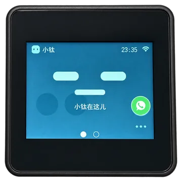
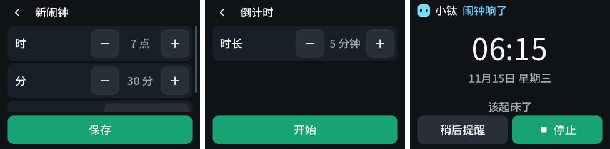

# M5Stack CoreS3-Lite

[开发板列表](README.md) · [快速开始](../快速开始.md) · [使用说明](../使用说明.md)

带外壳、触摸屏和摄像头的 ESP32-S3 整机。除了对话和通话，它还带闹钟。

| 项目 | 内容 |
| --- | --- |
| 芯片 | ESP32-S3 |
| 屏幕 | 320×240 触摸屏（ILI9342C） |
| 摄像头 | 有 |
| 固件关键字 | `m5stack-cores3-lite` |
| 下载页上的名字 | M5Stack开发板 · ESP32-S3(CoreS3-Lite) |
| 烧录时的芯片名 | `esp32s3`（只在用命令行烧录时要填） |
| 烧录和看日志用的 USB 口 | 机身上的 Type-C 口 |

## 功能

AI 对话、设备对讲、微信通话、多人对讲、实时查看（画面和声音）、声音识别、闹钟和倒计时；[门禁](../功能/门禁.md)的四种模式各是一页，左右翻就到，画面只给对方看，适合放门口。

和别的设备视频通话时，对方能看到这块板的摄像头画面（240×176，每秒最多 8 张）。AI 看图要 320×240 的画面，这块板没有。这块板自己不显示对方的画面，别的设备和微信的视频来电按语音接听。

在首页点右侧的箭头或向左滑，进入时钟页，可以设闹钟和倒计时：

闹钟的用法见[使用说明](../使用说明.md#闹钟)。

## 烧录

按[快速开始](../快速开始.md#2-烧录)的步骤做，下面是这块板要注意的：

- **固件文件**：在 [Releases](https://github.com/tangeai/xiaotai-esp32/releases/latest) 的 Assets 列表里下载 `v<版本>_m5stack-cores3-lite_merged.bin`，`<版本>` 是最新的版本号，例如 `v0.5.0_m5stack-cores3-lite_merged.bin`。
- **下载模式**：芯片等待电脑写入固件的状态。烧录工具连不上时这样做：
  1. 长按机身底部的复位键约 3 秒。
  2. 绿灯亮起后松手。
  3. 回到烧录页面再连接一次。
- 写完后设备重启，USB 会重新连接一次，电脑上的串口可能要等十几秒才重新出现。

烧录完成后屏幕出现「连接 Wi-Fi」页，说明烧录成功，接着按[快速开始](../快速开始.md#3-配网)配网和绑定。屏幕没有变化时，拔掉 USB 线再插回去；仍然黑屏或不停重启，看[常见问题](../常见问题.md#烧录)。

## 给开发者

| 项目 | 内容 |
| --- | --- |
| 硬件 | 16 MB Flash，带 PSRAM（外部内存），屏幕控制器 ILI9342C |
| 编译 | `python scripts/build.py m5stack/core-s3` |
| 产品清单 | `products/xiaotai-cores3-lite/product.json` |
| 板包 | `boards/m5stack/core-s3/` |
| 串口 | 芯片原生 USB，可以输入 `status` 等[串口命令](../AT指令.md) |
| 闹钟的参数和指令 | [闹钟](../功能/闹钟.md) |
