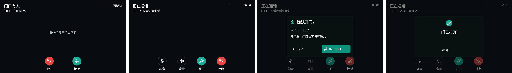

# WT99P461-S1

[开发板列表](README.md) · [快速开始](../快速开始.md) · [使用说明](../使用说明.md)

ESP32-P4 主芯片加 ESP32-C61 联网芯片的 1024×600 大屏，硬件版本 1V1。小钛在它上面默认是一台可视门铃：首页是时钟和“查看门口”“开门”两个按钮。

| 项目 | 内容 |
| --- | --- |
| 芯片 | ESP32-P4（芯片版本 rev3.1 及以上），Wi-Fi 由板上的 ESP32-C61 提供 |
| 屏幕 | 1024×600 触摸屏 |
| 摄像头 | 有 |
| 固件关键字 | `wt99p461-s1-1v1` |
| 烧录时的芯片名 | `esp32p4`（只在用命令行烧录时要填） |
| 烧录和看日志用的 USB 口 | 板上的 USB 转串口，串口速率 115200 |

## 功能

可视门铃和门禁机、AI 对话、设备对讲、微信通话、视频通话、多人对讲、实时查看（画面和声音）、闹钟和倒计时。

当室内机用时，门口有人按铃会弹出来电，接听后可以通话、开门：

也可以把它放在门口当门禁机，访客点“呼叫前台”或从通讯录里选人：

两种角色怎么切换、怎么选对方设备，见[使用说明](../使用说明.md#可视门铃和门禁)和[门禁](../功能/门禁.md)。

## 烧录

按[快速开始](../快速开始.md#2-烧录)的步骤做，下面是这块板要注意的：

- **固件文件**：在 [Releases](https://github.com/tangeai/xiaotai-esp32/releases/latest) 的 Assets 列表里下载 `v<版本>_wt99p461-s1-1v1_idf6.0_merged.bin`，`<版本>` 是最新的版本号，例如 `v0.3.1_wt99p461-s1-1v1_idf6.0_merged.bin`。
- **下载模式**：芯片等待电脑写入固件的状态。这块板不用手动进，烧录工具会让芯片自动进入。
- **联网芯片的程序**：C61 的程序和主芯片的固件分开。需要更新时用串口指令 `AT+COMPANION UPDATE`，设备从给定的地址下载并写入，见 [AT 指令](../AT指令.md)。

烧录完成后屏幕出现「连接 Wi-Fi」页，说明烧录成功，接着按[快速开始](../快速开始.md#3-配网)配网和绑定。屏幕没有变化时，拔掉 USB 线再插回去；仍然黑屏或不停重启，看[常见问题](../常见问题.md#烧录)。

## 给开发者

| 项目 | 内容 |
| --- | --- |
| 编译 | `python scripts/build.py wt99p461-s1` |
| 产品清单 | `products/xiaotai-wt99p461-s1-1v1/product.json` |
| 板包 | `boards/wt/wt99p461-s1/` |
| 串口 | UART0，115200，可以输入 `status` 等[串口命令](../AT指令.md) |
| 切换门禁角色 | `AT+DOOR SENDER`（门禁机）、`AT+DOOR VIEWER`（室内机） |
