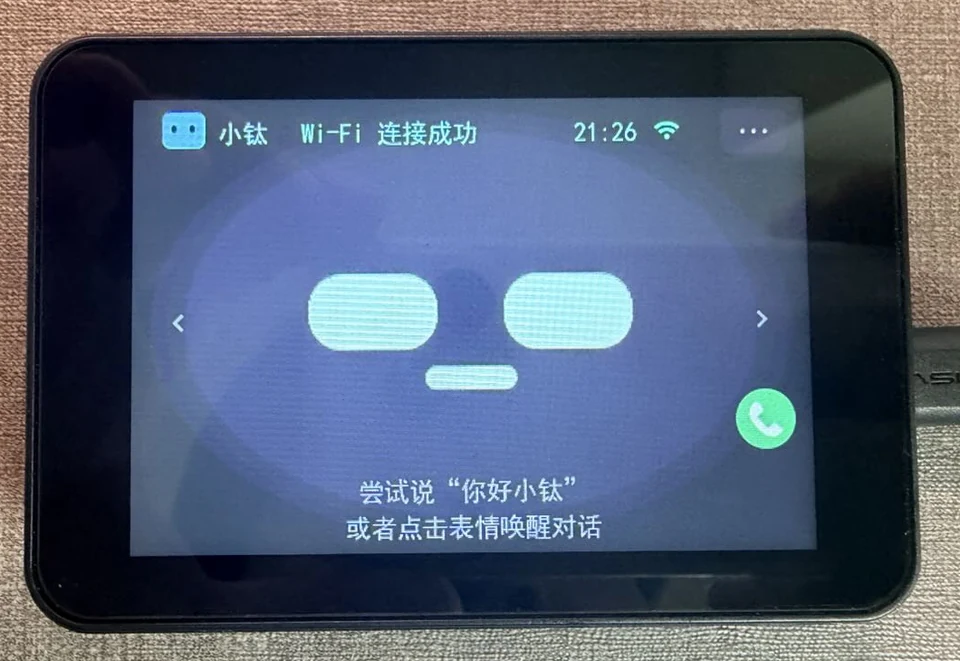
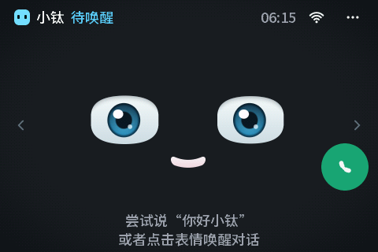
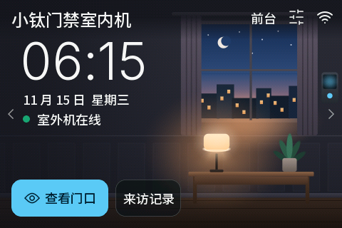
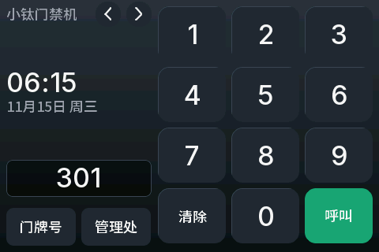

# 微雪 ESP32-P4-WIFI6-Touch-LCD-3.5

[开发板列表](README.md) · [快速开始](../快速开始.md) · [使用说明](../使用说明.md)

ESP32-P4 主芯片加 ESP32-C6 联网芯片的 3.5 寸触摸屏开发板。它支持视频通话，门禁的四种模式（可视门铃、门铃室外机、门禁室内机、门禁机）各是一页，左右翻就到。

| 项目 | 内容 |
| --- | --- |
| 芯片 | ESP32-P4（芯片版本 rev3.1 及以上），Wi-Fi 由板上的 ESP32-C6 提供 |
| 屏幕 | 480×320 触摸屏 |
| 摄像头 | 有 |
| 固件关键字 | `waveshare-esp32p4-3.5` |
| 下载页上的名字 | 微雪开发板 · ESP32-P4（3.5寸屏） |
| 烧录时的芯片名 | `esp32p4`（只在用命令行烧录时要填） |
| 烧录和看日志用的 USB 口 | 标有 UART 的 Type-C 口，串口速率 115200 |

微雪还有一块 4.3 寸的 P4 板，和这块不是同一个型号，固件不能通用。

## 功能

AI 对话、AI 看图、设备对讲、微信通话、视频通话、多人对讲、实时查看（画面和声音）、声音识别、门禁（可视门铃、门铃室外机、门禁室内机、门禁机）、闹钟和倒计时。

  
  
  

在首页向右滑，依次是可视门铃、门铃室外机、门禁室内机、门禁机四页，停在哪一页（两秒，或点了这一页上的按钮）就按哪种接来电，见[每种模式一页](../功能/门禁.md#每种模式一页)。在门禁室内机页选定门口的那台设备后，可以查看门口、接听门口来电、开门。用法见[使用说明](../使用说明.md#可视门铃和门禁)。

## 烧录

按[快速开始](../快速开始.md#2-烧录)的步骤做，下面是这块板要注意的：

- **固件文件**：在 [Releases](https://github.com/tangeai/xiaotai-esp32/releases/latest) 的 Assets 列表里下载 `v<版本>_waveshare-esp32p4-3.5_merged.bin`，`<版本>` 是最新的版本号，例如 `v0.5.0_waveshare-esp32p4-3.5_merged.bin`。
- **USB 口**：插标有 UART 的那个 Type-C 口。工具里识别到的芯片应当是 ESP32-P4；如果显示 ESP32-C6，说明插到了另一个口。
- **下载模式**：芯片等待电脑写入固件的状态。一般不用手动进，烧录工具连不上时这样做：
  1. 按住 BOOT 键不放。
  2. 按一下复位键。
  3. 松开 BOOT 键，回到烧录页面再连接一次。
- **联网芯片的程序**：C6 的程序已经包含在固件里。开机时主芯片会检查它的版本，需要时自动更新，不用单独烧录。

烧录完成后屏幕出现「连接 Wi-Fi」页，说明烧录成功，接着按[快速开始](../快速开始.md#3-配网)配网和绑定。屏幕没有变化时，拔掉 USB 线再插回去；仍然黑屏或不停重启，看[常见问题](../常见问题.md#烧录)。

## 给开发者

| 项目 | 内容 |
| --- | --- |
| 编译 | `python scripts/build.py waveshare/esp32-p4-wifi6-touch-lcd-3.5` |
| 产品清单 | `products/xiaotai-waveshare-p4-rev3/product.json` |
| 板包 | `boards/waveshare/esp32-p4-wifi6-touch-lcd-3.5/` |
| 串口 | UART0，115200，可以输入 `status` 等[串口命令](../AT指令.md) |
| 联网芯片的版本 | 串口指令 `AT+COMPANION` |
