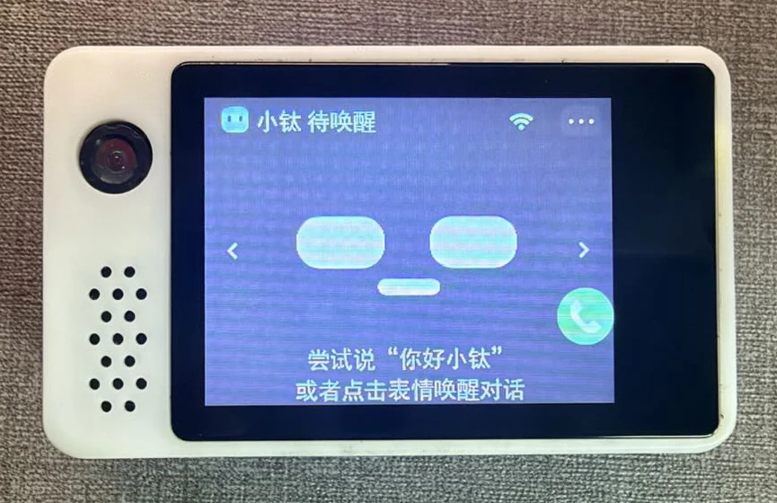
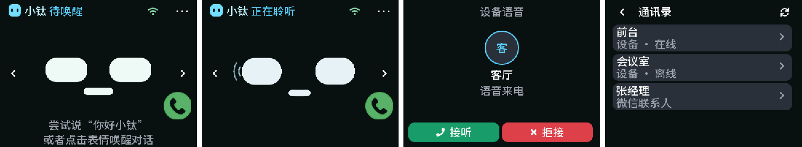

# 立创实战派 ESP32-S3

[开发板列表](README.md) · [快速开始](../快速开始.md) · [使用说明](../使用说明.md)

带 320×240 触摸屏和摄像头的 ESP32-S3 开发板，对应的硬件版本是 V1.0.1。文档里的大部分屏幕截图来自它。

| 项目 | 内容 |
| --- | --- |
| 芯片 | ESP32-S3 |
| 屏幕 | 320×240 触摸屏 |
| 摄像头 | 有（GC2145） |
| 固件关键字 | `szpi-s3` |
| 烧录时的芯片名 | `esp32s3`（只在用命令行烧录时要填） |
| 烧录和看日志用的 USB 口 | 接芯片原生 USB 的 Type-C 口 |

## 功能

AI 对话、AI 看图、设备对讲、微信通话、多人对讲、实时查看（画面和声音）、声音识别、闹钟和倒计时。

## 烧录

按[快速开始](../快速开始.md#2-烧录)的步骤做，下面是这块板要注意的：

- **固件文件**：在 [Releases](https://github.com/tangeai/xiaotai-esp32/releases/latest) 的 Assets 列表里下载 `v<版本>_szpi-s3_idf6.0_merged.bin`，`<版本>` 是最新的版本号，例如 `v0.3.1_szpi-s3_idf6.0_merged.bin`。
- **USB 口**：用接芯片原生 USB 的那个 Type-C 口，也就是直接连到主芯片的那一个。板上另一路串口只在上电时输出几行启动信息，接它看不到运行日志，也发不了串口指令。
- **下载模式**：芯片等待电脑写入固件的状态。一般不用手动进，烧录工具连不上时这样做：
  1. 拔掉 USB 线。
  2. 按住板上的 BOOT 键不放。
  3. 插回 USB 线。
  4. 松开 BOOT 键，回到烧录页面再连接一次。

烧录完成后屏幕出现「连接 Wi-Fi」页，说明烧录成功，接着按[快速开始](../快速开始.md#3-配网)配网和绑定。屏幕没有变化时，拔掉 USB 线再插回去；仍然黑屏或不停重启，看[常见问题](../常见问题.md#烧录)。

## 给开发者

| 项目 | 内容 |
| --- | --- |
| 硬件 | 16 MB Flash，带 PSRAM（外部内存），摄像头 GC2145 |
| 编译 | `python scripts/build.py lckfb/szpi-esp32s3` |
| 产品清单 | `products/xiaotai-szpi-s3/product.json` |
| 板包 | `boards/lckfb/szpi-esp32s3/`，引脚和外设见其中的 `README.md` |
| 串口 | 芯片原生 USB，可以输入 `status` 等[串口命令](../AT指令.md) |
| 预先声明的变体 | `no-video`（去掉 AI 看图和实时查看的画面）、`diagnostics`（多开一组调试指令） |
