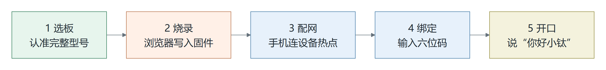
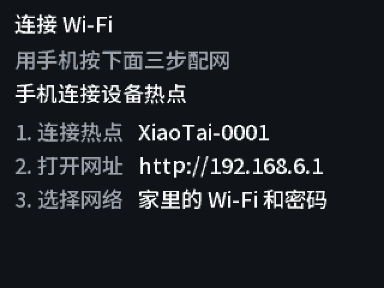
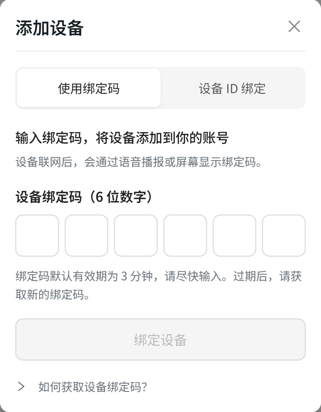
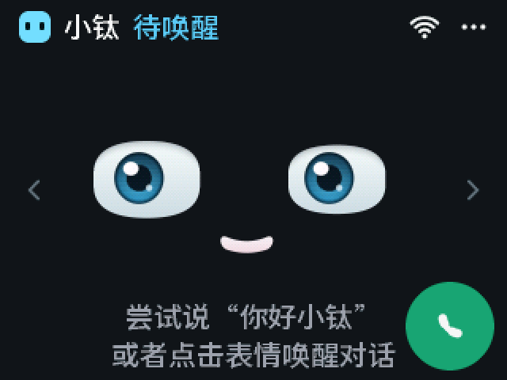
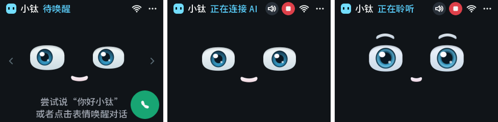

# 快速开始

[文档地图](README.md) · [开发板](开发板/README.md) · [使用说明](使用说明.md) · [常见问题](常见问题.md)

**给谁看**：手上有一块支持的开发板，想让它开口说话的人。不需要写代码，也不用装开发环境。

**读完能做到**：把小钛装进开发板，连上 Wi-Fi，绑定到自己的账号，完成第一次 AI 对话。



## 开始前准备

| 需要 | 说明 |
| --- | --- |
| 开发板 | [支持的五块板](开发板/README.md)之一 |
| USB 数据线 | 要能传数据。只能充电的线，电脑认不出板子 |
| 电脑 | Windows、macOS 或 Linux，装有 Chrome 或 Edge。后面要在网页里直接给开发板写入程序，Safari 和 Firefox 不支持这个功能 |
| 手机 | 用来给设备设置 Wi-Fi，也可以用来绑定账号 |
| Wi-Fi | 2.4 GHz，能上网。设备不支持 5 GHz；需要打开网页登录的 Wi-Fi（酒店、校园网）也用不了 |
| 小钛账号 | 在 [xiaotai.chat](https://xiaotai.chat/register) 注册，或直接用微信里的“小钛”小程序 |

路由器把 2.4 GHz 和 5 GHz 合成一个名字的，可以直接用。

## 1. 选板

固件是装进开发板的程序，按完整型号区分。“ESP32-S3”“ESP32-P4”只是芯片的名字，同芯片的不同板子不能用同一个固件。

打开[开发板列表](开发板/README.md)，对照购买订单、包装或板子背面印的字，找到型号完全一致的那一行，点进这块板的页面。**这个页面先别关**，下一步要对照它看三样东西：固件关键字、要插的 USB 口、下载模式怎么进（连不上时用）。

**做对了**：你打开了自己这块板的页面，知道了它的固件关键字（例如立创实战派 S3 是 `lckfb-esp32s3`）、要插的 USB 口和下载模式的做法。

## 2. 烧录

烧录就是把固件写进开发板。分两小步：先把固件文件下载到电脑，再从电脑写进板子。

### 下载固件

1. 打开[固件下载页（GitHub Releases）](https://github.com/tangeai/xiaotai-esp32/releases/latest)。页面是英文的，直接往下翻到 Assets（附件）列表。
2. 找到你这块板的名字加版本号的那一项，例如「立创实战派开发板 · ESP32-S3 固件 v0.5.0」（各板在下载页上的名字见[开发板列表](开发板/README.md)）。每块板只有一个。
3. 点它下载。下载到的文件名带有固件关键字、以 `_merged.bin` 结尾。

例如立创实战派 S3 下载到的是：

```text
v0.5.0_lckfb-esp32s3_merged.bin
```

**做对了**：电脑里多了一个以 `_merged.bin` 结尾的文件。不用双击打开，也不用解压。

### 写进开发板

> **注意**：烧录会覆盖设备里已有的 Wi-Fi 和绑定信息。已经在用的设备重新烧录后，要再配一次网、绑一次。新板子不受影响。

1. 用 USB 数据线把开发板接到电脑，插这块板的页面指定的那个口。
2. 用 Chrome 或 Edge 打开乐鑫的网页烧录工具 [esptool-js](https://espressif.github.io/esptool-js/)。页面是英文的，下面几步写出了要点的按钮。
3. 点 **Connect**，在浏览器弹出的列表里选中开发板对应的那一项，点连接。
   - 列表里的每一项是一个串口，也就是电脑和开发板通信的通道，名字通常是一串英文。看不出哪一项是开发板时，拔掉 USB 线再插回去，新出现的那一项就是。
   - 列表是空的，或者拔插之后没有变化，见文末的[卡住了](#卡住了)。
   - 点了连接却连不上时，按这块板的页面上“下载模式”的做法操作一次，再点 **Connect**。下载模式是芯片等待电脑写入固件的状态。
4. 在 **Flash Address** 一栏填 `0x0`，意思是从开头写入。
5. 点同一行的选择文件按钮，选刚才下载的 `_merged.bin` 文件。
6. 点 **Program**，页面下方会显示进度。写入期间不要拔线。

**做对了**：页面下方的记录里出现 `Hash of data verified.`，表示写入并核对成功；开发板的屏幕上出现「连接 Wi-Fi」页。进度到 100% 不等于核对成功，要看到这一行。屏幕没有变化时，拔掉 USB 线再插回去，或者按一下板上的复位键（重启按钮）。

<p align="center"></p>

后面几步开发板要一直通电，USB 线继续插着就行。

<details>
<summary>用命令行烧录（网页工具用不了时再看）</summary>

**命令行**：装有 Python 的电脑可以用 esptool。下面是 esptool 5 的写法；旧版本要把 `write-flash` 写成 `write_flash`。

```bash
pip install esptool
esptool --chip <芯片> -p <串口> -b 460800 write-flash 0x0 <下载的文件>
```

| 要替换的 | 换成什么 |
| --- | --- |
| `<芯片>` | 这块板的页面上写的“烧录时的芯片名”，例如 `esp32s3` |
| `<串口>` | 实际的串口。Windows 上形如 `COM5`，Linux 上形如 `/dev/ttyACM0`，macOS 上形如 `/dev/cu.usbmodem101` |
| `<下载的文件>` | 刚下载的 `_merged.bin` 文件的路径 |

看到 `Hash of data verified.` 表示写入并核对成功。

</details>

## 3. 配网

配网就是告诉设备连哪个 Wi-Fi。做法是：手机先连到设备自己发出的临时 Wi-Fi（热点），在网页里把家里的 Wi-Fi 填给它。这期间手机暂时上不了网，是正常的。

屏幕上已经列出了三步：

1. **连接热点**：打开手机的 Wi-Fi 列表，连接屏幕上显示的 `XiaoTai-XXXX`，不需要密码。`XXXX` 每台设备不同。手机提示“无互联网连接”或问要不要换网络时，选保持连接。
2. **打开网址**：多数手机会自动弹出配网页。没有弹出时，在手机浏览器的地址栏输入 `http://192.168.6.1`。开头是 `http`，不是 `https`。
3. **选择网络**：在页面里选家里的 2.4 GHz Wi-Fi，输入密码，提交。

密码填错时页面会提示，改好再提交就行，不用重启设备。

连上之后设备会关掉热点，有的板子还会自己重启一次。这时手机上的配网页打不开是正常的，看设备屏幕就行。

**做对了**：设备离开「连接 Wi-Fi」页，进入「设备绑定」页，显示六位验证码和倒计时。

## 4. 绑定

绑定是把设备加进你的账号。

1. 让手机恢复上网：切回家里的 Wi-Fi 或移动网络。也可以直接换到电脑的浏览器上做下面的操作。
2. 选一个入口，输入设备屏幕上的六位数字。设备屏幕上把它叫“验证码”，控制台里叫“绑定码”，是同一组数字。

| 入口 | 做法 |
| --- | --- |
| 网页 | 打开[小钛控制台](https://xiaotai.chat/devices)（管理设备的网页）并登录，点「添加设备」，输入六位数字，点「绑定设备」 |
| 微信 | 搜索“小钛”小程序，点「添加设备」，按提示输入六位数字 |

<p align="center"></p>

验证码有倒计时，过期后设备会换一个新的，填屏幕上当前显示的那个。

**做对了**：设备进入首页，左上角显示「待唤醒」；控制台或小程序的设备列表里出现这台设备，状态是“在线”。

<p align="center"></p>

## 5. 开口说话

两种方式，任选一种：

- **用语音**：对着设备说“你好小钛”，接着直接说你的话，例如“你好小钛，介绍一下你自己”。中间不用停顿，也不用等屏幕变化。
- **点屏幕**：点一下屏幕中间的表情，等左上角变成「正在聆听」再说。

<p align="center"></p>

对话开始后，左上角的状态会从「待唤醒」变成「正在连接 AI」，再变成「正在聆听」。

**做对了**：设备听懂了你的话，用语音回答；说完后回到「待唤醒」。

AI 回答到一半时，你可以直接开口，它会停下来听你说。声音太大或太小，点右上角的「···」打开菜单，在「设置」里调音量。

## 接下来

| 想做的事 | 看这里 |
| --- | --- |
| 给它换一个性格、换一种声音 | [控制台与 AI 角色](控制台与AI角色.md) |
| 设备对讲、微信通话、多人对讲、实时查看设备的画面 | [使用说明](使用说明.md) |
| 换一个 Wi-Fi | 在设备上点右上角的「···」打开菜单，进「设置 → 网络信息 → 断开当前连接」，重新配网；绑定会保留 |
| 改代码，自己编译固件 | [第一次编译](第一次编译.md) |

## 卡住了

| 现象 | 先检查 |
| --- | --- |
| 浏览器的列表里找不到开发板，或者点了连接不上 | 换一根能传数据的 USB 线；确认插的是这块板的页面指定的口；关掉其他连着这块板的软件或烧录网页；按页面上的方法进一次下载模式 |
| 烧录后黑屏或反复重启 | 先重新插一次 USB 线；再核对固件关键字和板子的完整型号是否一致、起始地址是不是 `0x0`；重新下载文件再烧一次 |
| 手机找不到 `XiaoTai-XXXX` | 设备是否停在「连接 Wi-Fi」页；手机靠近设备，刷新 Wi-Fi 列表 |
| 打不开配网页 | 手机此刻要连着设备的热点；地址是 `http://192.168.6.1`，开头是 `http` |
| 输入验证码后没有反应 | 手机要先切回能上网的网络；验证码过期后用屏幕上的新码 |
| 说“你好小钛”没有反应 | 首页是否显示「待唤醒」；菜单的「设置」里麦克风是否开着；也可以直接点表情 |

更多情况见[常见问题](常见问题.md)。需要帮忙时，到 [GitHub Issues](https://github.com/tangeai/xiaotai-esp32/issues) 或[社区](https://community.tange-ai.com/)提出，写明板子型号、固件版本、卡在哪一步、屏幕上显示了什么。发截图前先遮住验证码和 Wi-Fi 密码。
