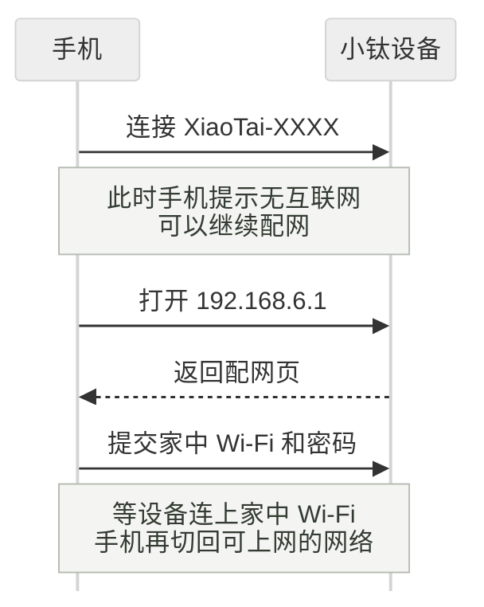
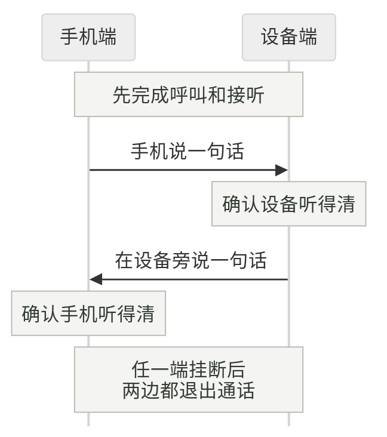

# 快速开始

[返回首页](../README.md) · [支持的开发板](../README.md#支持的开发板) · [开发指南](开发指南.md)

先完成一次对话或通话。暂时不用读代码，也不用记住 SDK、分区表这些名字。

已经装好小钛的设备，可以直接从[连接 Wi-Fi](#4-连接-wi-fi)开始；已经联网并绑定，就去[试一个功能](#6-试一个功能)。

| 现在到哪一步了 | 接着做什么 |
| --- | --- |
| 还没选好板子或固件 | [认准板子](#1-认准板子)，找到完全匹配的固件和说明 |
| 设备已装好小钛，正在等配网 | [连接 Wi-Fi](#4-连接-wi-fi)，再[绑定设备](#5-绑定设备) |
| 已绑定，但还没试过声音 | [试一个功能](#6-试一个功能)，分别听两个方向的声音 |
| 某一步没有成功 | 看[排查表](#卡在哪一步就先查哪一步)，先保留现象，不急着重刷 |

## 1. 认准板子

查看板背面、包装或购买记录，确认完整型号、板卡版本和屏幕型号。只知道“ESP32-S3”还不够，它是芯片名称，不是完整板型。拍一张正反面照片留作核对，比凭外观猜更可靠。

支持的板子见[首页列表](../README.md#支持的开发板)。特别留意：

- 微雪 P4 **3.5 寸和 4.3 寸**不是同一板型，固件不能混用。
- 两块 P4 板只支持芯片修订 rev3.1 及以上，不能用于 rev1.x。板上印的 PCB 版本与芯片修订是两回事。
- M5Stack 要确认是 CoreS3-Lite，并核对所用固件要求的屏幕控制器；名称相近不代表固件通用。
- WT99P461-S1 是门禁屏，固件只适用于这一型号。

还没买板时，先核对是否有匹配的固件和说明，再决定硬件。不要只按“都是 S3”购买替代型号。

**这一步完成的标志：你能写出板子的完整型号，并找到完全匹配的说明。**

## 2. 准备设备和固件

准备好开发板、一根能传数据的 USB 线、一台电脑、一部手机，以及能上网的 2.4 GHz Wi-Fi。只供电的充电线无法用于烧录。微信通话还需要手机上的微信和相应授权。

固件是安装到开发板里的程序文件。这里分两种情况：

| 你的目的 | 到哪里拿程序 |
| --- | --- |
| 先体验小钛 | 在 Release 页面下载对应板型的完整镜像 `v<版本>_<板型>_idf<ESP-IDF 版本>_merged.bin` |
| 修改代码后自己编译 | 按[开发指南](开发指南.md#编译与烧录)生成固件 |

从源码编译时默认用 ESP-IDF 6.0.3，也可以用 5.5.5（构建命令加 `--idf 5.5`），见[开发指南](开发指南.md#编译与烧录)。Release 页面两条线的固件都有，文件名里的 `idf6.0`、`idf5.5` 标明版本；不确定就选 `idf6.0`。

找不到对应型号时，先停在这里，不要试刷相近的型号。也不要把不同版本的文件凑在一起，或者把源码 ZIP 当成固件烧录。

**这一步完成的标志：板型、固件版本、文件与烧录指南能一一对应。**

## 3. 把固件装进开发板

“烧录”就是把固件写进设备。最简单的办法是用浏览器：

1. 用 Chrome 或 Edge 打开 [ESP Launchpad / esptool-js](https://espressif.github.io/esptool-js/)，用能传数据的 USB 线连上开发板，点 **Connect** 并选中这块板的串口。同时连着多块设备时，先拔掉其他设备，或者核对串口名。
2. 点 **Add File**，选完整镜像 `…_merged.bin`，地址填 `0x0`。
3. 点 **Program**，等写入和校验都完成。进度条到 100% 不等于校验成功。
4. 按一下复位键，或者重新插拔 USB，观察屏幕、语音或灯光提示。

完整镜像会覆盖设备里原有的 Wi-Fi、绑定等数据，烧完需要重新配网和绑定。

自己编译出来的应用 `.bin` 不包含引导程序和分区表，不能当完整镜像写到 `0x0`。已有固件的板子要保留配网和绑定，先按[分区核对方法](../tools/xt/README.md#写固件之前核对分区)确认旧表、引导程序和新应用兼容，再按构建记录里的应用偏移写入。库内这些常见产品的应用偏移是 `0x10000`；新板或自定义分区以该次构建为准。

**这一步完成的标志：写入校验成功，设备也能正常启动。** 黑屏、反复重启或一直没有启动提示时，先查板型、文件和供电，不急着配网，更不要反复全片擦除。

## 4. 连接 Wi-Fi

“配网”就是告诉设备要连接哪个 Wi-Fi、密码是什么。已经联网的设备跳过这一步，不必为了跟教程走而清除配置。

要给已联网的设备换网络，打开「菜单 → 设置 → 网络信息」，点「断开当前连接」，设备会重新开启配网热点。换网络不会解除设备绑定。

配网时，设备屏幕上会列出三步：连接热点 `XiaoTai-XXXX`、打开网址 `http://192.168.6.1`、选择家里的 Wi-Fi 并输入密码。`XXXX` 是每台设备不同的后缀，以屏幕上显示的为准。

手机在这里要换一次网络：先连设备热点，把家中 Wi-Fi 交给设备；设备连上后，手机再恢复正常上网。

图中是操作顺序；账号绑定需要外网，不能一直留在设备热点里操作。

1. 等设备进入配网状态，用手机在 Wi-Fi 列表中连接它的 `XiaoTai-XXXX` 热点。
2. 手机提示“无互联网”时，保持这次连接。此时是在设置设备，不是在用它上网。
3. 配网页没有自动打开，就在浏览器地址栏输入 `http://192.168.6.1`。这个地址只在连着设备热点时使用。
4. 选择家里或测试用的 2.4 GHz Wi-Fi，填入密码并提交，等待设备连接。
5. 设备连上网后，让手机恢复正常上网：切回路由器 Wi-Fi 或移动网络，再去绑定。

SDK 固件的网页配网会先尝试连接，再保存。页面显示已经收到提交时，先等结果；密码不对可以留在页面重试，不需要重刷。遇到失败提示时可对照[配网与绑定](功能/配网与绑定.md)。

**这一步完成的标志：设备结束配网，开始获取绑定码；已绑定的设备恢复在线。** 热点页面能打开，只说明手机连到了设备，还不能说明设备已经连上外网。

## 5. 绑定设备

绑定是把设备加入你的账号，之后才能在手机或网页上找到它。连接 Wi-Fi 和绑定是两步，完成其中一步不会自动完成另一步。

1. 读取设备显示或播报的六位绑定码。
2. 按设备屏幕上的提示进入绑定入口：在微信里搜索“小钛”小程序，或打开屏幕上给出的网址。
3. 在相应入口登录账号，添加设备并输入**当前这次**的绑定码。验证码过期就使用新码，不继续填旧码。
4. 等待手机或网页中出现设备，确认设备本身也结束绑定提示。按界面要求补好设备名称，再发起通话。

**这一步完成的标志：你的设备列表里出现了这台设备，并且设备在线。** 仅有绑定码、仅显示 Wi-Fi 已连接，都不等于已经可以通话。

固件只负责设备这一端。在线功能还依赖绑定平台、TiRTC 实时音视频服务，以及所用的 AI 或微信服务。自己编译固件不会自动部署这些服务；接自建平台时，服务配置另见开发文档。

遇到“已经连上了，为什么还不能通话”，先分清看到的是哪种状态：

| 看到的状态 | 它能说明什么 | 还不能据此判断什么 |
| --- | --- | --- |
| Wi-Fi 已连接 | 设备连到了路由器 | 平台和音视频服务是否可达 |
| 账号里有这台设备 | 账号有这台设备的绑定记录 | 设备此刻是否在线 |
| 平台在线 | 平台连接已建立 | TiRTC 音视频服务是否就绪 |
| RTC 就绪，或已经开始通话计时 | 对应的服务或会话状态已建立 | 麦克风、上传、下行和扬声器是否都正常 |

这些是不同的检查项，不代表每块板都有同名提示。下一步用实际声音确认。开发者可以用串口 [AT 指令](AT指令.md)直接查看这些状态。

## 6. 试一个功能

先试最简单的一项，成功后再试其他功能。按手上固件的实际支持范围操作，不要求每块板都完成下面所有项目。

### AI 聊天

在支持 AI 的设备上进入 AI 对话，说一句“你好，请介绍一下自己”。听到回复后再问一句，然后退出，观察设备能否回到待机。

说“你好小钛”，或者点一下屏幕上的表情，就开始对话；AI 回答时可以直接说话打断它。

算这次体验成功，要同时满足：它听懂了你的话、回复能听清、结束后能正常待机。只看到“正在聆听”还不够。

### 手机和设备通话

确认手机端已登录、设备已命名并在线。完成小程序要求的通话授权后，从设备页发起呼叫，在设备上接听，两边各说一句，再挂断。

来电时屏幕上会显示对方的名字，点绿色的「接听」接通，点红色的「拒接」挂掉。发不出电话时，先在小程序确认设备在线、已授权通话联系人。

箭头表示这次要检查的声音方向，不是网络直连。某一边无声时，记清方向，例如“手机听不到设备”，排查时就不会把采集和播放混在一起。

算这次体验成功，要两边都能听到对方，挂断后也都退出通话。接通计时或音频计数增加，只能说明部分链路工作，不能代替实际听声音。

完成其中一项，就已经走通了首次体验。之后再按本板支持的范围试其他功能。

## 卡在哪一步，就先查哪一步

| 看到的情况 | 先检查什么 |
| --- | --- |
| 电脑找不到设备 | USB 线能否传数据、是否插在本板的烧录口、串口是否被其他程序占用 |
| 烧录后黑屏或反复重启 | 完整板型、屏幕版本、同版文件清单、写入地址和供电 |
| 手机连热点后显示无互联网 | 配网阶段正常；保持连接并打开设备配网页，不用因此重刷 |
| 打不开配网页 | 手机是否仍连着这台设备的热点，地址是否为 `http://192.168.6.1` |
| 有绑定码，但添加不了设备 | 手机是否已恢复上网，是否填了本台设备尚未过期的码 |
| 手机里有设备，但显示离线 | 先看设备当前网络和启动状态；有历史绑定记录不等于当前在线 |
| 显示正在聆听，但没有回复 | 记下发生时间、屏幕状态和说了什么，分别查采集、上传和服务回复；先保留现场 |
| 能接通，某一边听不到声音 | 写清“手机听不到设备”还是“设备听不到手机”，再检查对应方向，不笼统写成“没声音” |

需要帮忙时，提供板型、固件版本、卡住的步骤、原本期待的结果、实际提示和发生时间。照片或日志可以补充，但先遮住绑定码、Wi-Fi 密码、账号凭据和设备密钥。串口检查方法见 [AT 指令](AT指令.md)。

几个常见词，用到时再看

| 词 | 可以怎样理解 |
| --- | --- |
| 固件 | 安装在开发板里的程序 |
| 编译 | 从源码生成设备能运行的程序文件 |
| 烧录 | 把这些程序文件写进设备 |
| 配网 | 给设备设置 Wi-Fi 名称和密码 |
| 绑定 | 把设备加入你的账号 |
| ESP-IDF | 乐鑫提供的开发工具，自己编译 ESP32 程序时需要 |
| H5 | 网页端，不是另一种开发板 |
| RTC / TiRTC | 实时音视频通信，以及本项目使用的相关软件开发包与服务 |

## 想继续开发

先保留一份能运行的固件，再看[开发指南](开发指南.md)：怎么编译、代码怎么分层、从哪里加功能。接自己的板子看[新板接入](新板接入.md)。
