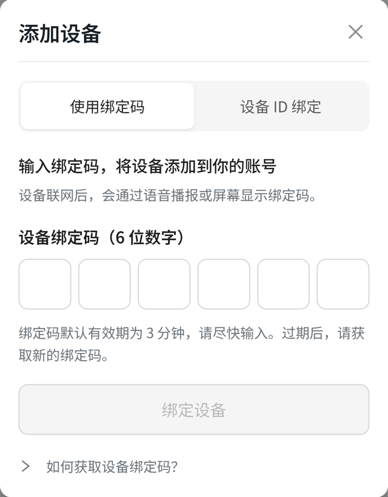

# 控制台与 AI 角色

[文档地图](README.md) · [快速开始](快速开始.md) · [使用说明](使用说明.md)

**给谁看**：设备已经绑定好，想在网页上管理它、给它换一个 AI 角色的人。

**读完能做到**：在小钛控制台里找到自己的设备，换一个现成的角色，或者写一个自己的角色。

小钛控制台是网页 [xiaotai.chat/devices](https://xiaotai.chat/devices)，手机和电脑的浏览器都能打开。用绑定设备时的那个账号登录，登录用的是邮箱和密码。微信里的“小钛”小程序也能添加和管理设备，微信通话的授权在小程序里做。

## 设备列表

登录后看到的是「我的设备」，每台设备一张卡片：

| 卡片上的内容 | 作用 |
| --- | --- |
| 设备名称和在线状态 | 列表不会自动刷新。状态看着不对时，先点右上的「刷新」 |
| 「AI 角色」 | 这台设备当前用的角色，点进去可以更换 |
| 「实时」 | 看设备摄像头的画面、听声音、对设备说话 |
| 「联系人」 | 这台设备的通讯录 |
| 「多人对讲」 | 这台设备所在的房间 |
| 「更多」 | 修改名称、设备信息、会话记录、解绑设备 |

新设备的名称是“未命名设备”。在「更多 → 修改名称」里起个名字，通讯录和来电页显示的就是它。给设备授权微信通话之前，也要先起好名字。

## 换一个现成的角色

AI 角色决定了设备说话的性格、音色和能力。

1. 在设备卡片上点「AI 角色」。页面上方写着这台设备的名称和「当前角色」。
2. 列表里是可以用的角色。带「系统预设」字样的是自带的，其余是你自己建的。
3. 在想用的角色那一行点「使用」。

**做对了**：那一行的按钮变成「使用中」；回到设备上再说一次“你好小钛”，回答的语气和声音已经是新角色的。

## 写一个自己的角色

系统预设的角色只能查看，不能修改。想在它的基础上调整，先点开它看一遍设定，再照下面的步骤新建一个。

1. 在设备卡片上点「AI 角色」，到角色列表的底部点「新建角色」。
2. 填「角色」页签。控制台的表单里把 AI 角色叫“智能体”：

   | 项目 | 填什么 |
   | --- | --- |
   | 智能体名称 | 角色的名字 |
   | 地域 | 在国内使用选「国内」。**创建后不能改**，要换地域只能再新建一个角色 |
   | 角色类型 | 从下拉列表里选一个最接近的 |
   | 角色设定 | 用平常的话写清楚它是谁、怎么说话。例如“说话亲切自然，像朋友聊天，一般一两句话说完” |
   | 语音设置 | 音色等和声音有关的设置 |

3. 另外两个页签按需要再调：

   | 页签 | 内容 |
   | --- | --- |
   | 模型与记忆 | 选哪个大模型来回答，也就是负责理解和生成回复的 AI；要不要开长期记忆，让它记住以前聊过的内容 |
   | 扩展能力 | 视频识别（让 AI 结合设备摄像头的画面回答）、知识库（给 AI 补充参考资料）、工具与插件（让 AI 能做对话以外的事） |

4. 点「保存角色」。
5. 回到角色列表，在刚建好的角色那一行点「使用」。

**做对了**：按钮变成「使用中」；对设备说“你好小钛”，听到的是新角色。

> **注意**：一个角色可以给多台设备用。修改并保存一个角色，所有正在用它的设备都会跟着变。只想换某一台设备的角色，用「使用」切换，不要去改角色本身。

## 看会话记录

设备卡片的「更多 → 会话记录」，或者 AI 角色页上方的「会话记录」，可以看这台设备的对话记录。调角色设定时，对照记录看 AI 实际是怎么回答的，比凭感觉改更快。

<!-- AI 角色里“直接操作设备”（调音量、设闹钟等）的能力在这里补充 -->

## 再添加一台设备

要在这个账号下再绑定一台设备时，先让它完成配网（见[快速开始](快速开始.md#3-配网)），等它的屏幕上出现六位验证码：

1. 在「我的设备」页点「添加设备」。
2. 输入设备屏幕上的六位数字，点「绑定设备」。设备屏幕上把它叫“验证码”，控制台里叫“绑定码”，是同一个东西。

**做对了**：「我的设备」里多出这台设备的卡片。

## 解绑设备

设备卡片的「更多 → 解绑设备」会把设备从账号里移除。解绑之后，这台设备要重新绑定才能使用在线功能，做法见[快速开始](快速开始.md#4-绑定)。
