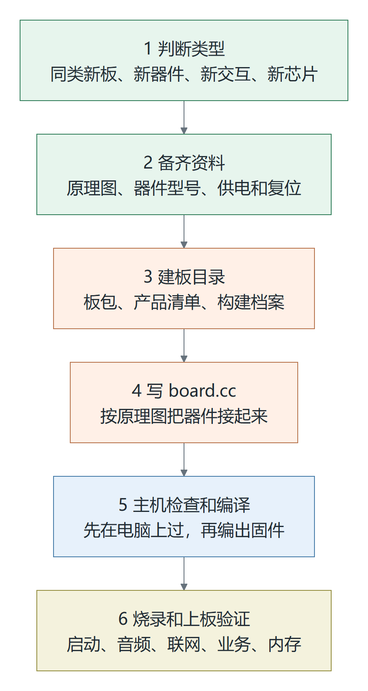
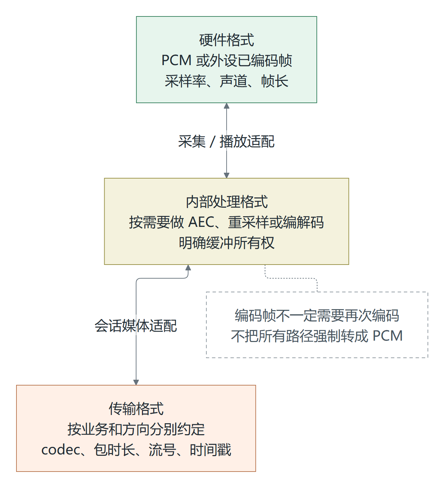

# 新板接入

[文档地图](README.md) · [架构总览](架构总览.md) · [开发指南](开发指南.md) · [SDK 架构](SDK架构.md) · [测试与诊断](测试与诊断.md)

**给谁看**：要让小钛跑在一块新开发板上的开发者。假定你已经[编过一次](第一次编译.md)，知道[板包和产品清单是什么](架构总览.md#决定一板子有什么和产品用什么分开写)。

**读完能做到**：为新板写出板包、产品清单和构建档案，编出固件，烧进去，并按顺序在真板上验证。

接一块板，只补它和已有板不同的部分：引脚、外设、能力、默认配置。业务和交互复用已有的。

用 AI 编程助手时，直接说“接一块新板”，它会按 `xiaotai-new-board` 技能先问清硬件资料，再照下面的步骤做，见[用 AI 助手开发](用AI助手开发.md)。



## 1. 先判断是哪一类适配

| 类型 | 例子 | 要做的事 |
| --- | --- | --- |
| 同类新板 | 芯片已经支持，屏和音频芯片在 `sdk/parts/` 里已经有零件 | 建板包、产品清单和构建档案，复用已有的零件和交互 |
| 新器件 | 芯片已经支持，但屏或音频芯片是仓库里还没有的 | 先在 `sdk/parts/` 里把它做成通用零件，再按同类新板接 |
| 新交互形态 | 旋钮、只有灯没有屏 | 增加交互适配：把输入变成已有的意图，把状态变成反馈 |
| 新芯片 | 仓库里还没有支持的芯片 | 先按技能 `xiaotai-port` 把芯片和它的 TiRTC 包登记进来，再接板 |

仓库里已有产品的芯片是 `esp32s3`、`esp32p4` 和 `esp32s31`。动手之前先看一眼 `sdk/parts/`，确认你的屏、触摸、音频芯片和摄像头有没有现成的零件。

找一块最接近的板当参照：

| 你的板 | 参照的板包 | 参照的产品 |
| --- | --- | --- |
| ESP32-S3、触摸屏、ES8311 加 ES7210 | `boards/lckfb/szpi-esp32s3` | `products/xiaotai-szpi-s3` |
| ESP32-S3，电源或 IO 扩展的接法不同 | `boards/m5stack/core-s3` | `products/xiaotai-cores3-lite` |
| ESP32-P4 | `boards/waveshare/esp32-p4-wifi6-touch-lcd-3.5`、`boards/wt/wt99p461-s1` | `products/xiaotai-waveshare-p4-rev3` |
| RGB 并口屏、ES8389、芯片自带 Wi-Fi | `boards/guition/jc1060f570c` | `products/xiaotai-jc1060f570c` |

## 2. 准备资料

| 资料 | 用来做什么 |
| --- | --- |
| 完整板型、修订号、原理图或引脚表 | 引脚、总线 |
| 芯片、Flash 大小、有没有 PSRAM | 选芯片档位和分区表 |
| 音频：codec 或麦克风、功放的型号，有没有回采参考 | 选音频零件和回声处理方式 |
| 屏幕和触摸的型号、分辨率、方向 | 显示零件和界面主题 |
| 按键、灯、摄像头的型号和接口 | 交互和视频能力 |
| 网络：芯片自带 Wi-Fi，还是外挂联网芯片 | 联网方式 |
| 供电和复位：哪些电源、复位脚是几个器件共用的，上电要等多久 | 上电顺序 |
| 想要哪些功能 | 产品清单里选什么 |

厂家给了 ESP-IDF 示例的话，引脚、时序、器件地址先从示例的板级配置里取，再拿原理图核对。

## 3. 建板目录

把参照板和参照产品的文件复制过来，逐个改成新板的事实。一款新产品由三处文件组成：

```text
boards/<厂商>/<板>/
  board.json            这块板有什么：芯片、身份、内存、能力、用到的零件、分区表
  board.cc              接线：各器件在哪些引脚上，怎么创建
  CMakeLists.txt        把板类编成组件 xiaotai_board，有 ESP-IDF 和主机两个分支
  sdkconfig.board       硬件事实：Flash、PSRAM、串口走哪里
  partitions.csv        分区表
  test/                 板包的主机测试
products/<产品名>/
  product.json          这款产品选哪块板、哪些应用和模块、参数取什么值
profiles/
  native-firmware/<产品名>.json            构建档案：板参数、芯片、版本线、TiRTC 包
  <产品名>-native.yml                      这款产品声明要用的组件
  dependency-locks/<产品名>-native.lock    依赖锁，第 5 节生成
```

默认的 ESP-IDF 6.0 线用上面的文件名。别的版本线各有自己的一份：5.5 线的档案在 `native-firmware/idf5.5/`，组件声明叫 `<产品名>-idf5.5-native.yml`，锁在 `dependency-locks/idf5.5/`。新板先在 6.0 线上做通，再考虑加别的线。

每个文件要核对的点：

| 文件 | 核对什么 |
| --- | --- |
| `board.json` | `target`、`identity`、`memory.external_ram` 按实物填；`parts` 只写已经实现的能力，屏幕宽高是旋转之后产品看到的尺寸；`components` 列出实际用到的零件 |
| `CMakeLists.txt` | 零件列表和 `board.json` 的 `components` 一致。照参照板的写法改 |
| `sdkconfig.board` | 只写这块板的硬件事实。PSRAM 这类能力带来的策略由 `config/capabilities/` 自动套用，不要从参照板抄过来 |
| `partitions.csv` | `nvs` 放在 `0x9000`，`factory` 从 `0x10000` 开到 Flash 末尾，不做 OTA 分区。按实际的 Flash 容量算 |
| `product.json` | `name` 全仓库唯一，`board` 指向新板包，`applications` 和 `modules` 见下面“选应用和模块” |
| `profiles/native-firmware/<产品名>.json` | 板参数、芯片、版本线和 TiRTC 包名写对 |

### board.json 怎么写

这是[立创实战派 S3 的板包声明](../boards/lckfb/szpi-esp32s3/board.json)，完整的一份：

```json
{
  "schema": 3,
  "target": "esp32s3",
  "identity": {
    "model": "lckfb-szpi-esp32s3",
    "revision": "1.0.1",
    "profile_model": "LCKFB-SZPI-ESP32S3-V1.0.1",
    "profile_chip": "ESP32-S3"
  },
  "memory": {"external_ram": true},
  "parts": {
    "audio_input": [{"encoding": "pcm16", "rate_hz": 16000, "roles": ["mic", "reference", "mic", "unused"]}],
    "audio_output": [{"encoding": "pcm16", "rate_hz": 16000, "channels": 2}],
    "display": [{"pixel": "rgb565", "width": 320, "height": 240, "touch": true}],
    "input": [{"kind": "button", "role": "main"}],
    "camera": [{"formats": ["yuv422"], "max_width": 320, "max_height": 240}],
    "network": [{"kind": "wifi", "provisioning": ["portal", "serial"]}]
  },
  "components": ["xiaotai_part_bus", "xiaotai_part_power", "xiaotai_part_audio", "xiaotai_part_display",
                 "xiaotai_part_panel_spi", "xiaotai_part_touch_ft5x06", "xiaotai_part_button", "xiaotai_part_camera_dvp"],
  "partitions": "partitions.csv",
  "idf": ["6.0", "5.5", "6.1"]
}
```

- `parts` 是“已经实现”的声明，写上去不会自动生成驱动。缺零件时先实现零件，再写能力。
- [选型器](../scripts/sdk_selection.py)按各模块的清单检查它们需要的能力，缺一项就拒绝。固件启动时还会核对 `board.cc` 实际提供的器件和这里声明的是否一致。
- 有相机只说明能采集画面。视频通话、实时查看的画面由产品选不选对应的模块决定。
- `memory.external_ram` 按实物写。没有外部内存时，SDK 自动选用精简的形态。

### 选应用和模块

`product.json` 里按屏幕和输入方式选应用和界面主题：

| 交互形态 | `applications` | 界面主题（写在 `modules` 里） | 板子要有 |
| --- | --- | --- | --- |
| 320×240 彩色触摸屏 | `companion`，要闹钟再加 `alarm` | `theme_lcd320` | `rgb565` 显示、触摸 |
| 480×320 及更大的彩色触摸屏 | `companion`，要门禁再加 `door` | `theme_lcd480` | `rgb565` 显示、触摸 |
| 无屏 | [语音终端应用](../apps/xiaotai_app_voice_terminal/application.json) | 不选 | 按键、网络和双向音频；有状态灯的登记状态灯 |

功能模块（`ai_talk`、`call`、`wechat`、`room`、`stream` 等）照参照产品的清单选，去掉新板硬件不支持的。例如没有摄像头，就不选 `video`、`ai_vision` 和 `stream_video`。


无屏只是少了显示。选进产品的配网、绑定、接听、拒绝、挂断和出错提示，仍然要有办法操作和反馈，例如按键、提示音、播报验证码。

## 4. 实现板级端口

`board.cc` 里写一个继承 `xiaotai::board::Board` 的类。可以对照[立创实战派 S3 的 board.cc](../boards/lckfb/szpi-esp32s3/board.cc)。应用和模块通过[硬件抽象](../sdk/xiaotai_hal/include/xiaotai/hal.h)取用器件，不会反过来包含某块板的代码。

| 要实现的 | 做什么 |
| --- | --- |
| `Init()` | 按上电顺序创建总线和各个器件。某一步失败时，按相反的顺序释放已经申请的资源，把错误码原样返回 |
| `Identity()` | 给出型号和修订号，串口的 `version` 和上报都用它 |
| `AudioInput()`、`AudioOutput()` | 给出硬件的采样率和各声道的角色，分清麦克风和回采参考。外设直接输出编码音频的，写实际的编码格式，不要当成 PCM |
| `Display()` | 给出显示和触摸。核对像素格式、旋转后的尺寸、触摸坐标和背光 |
| `Input()` | 给出按键的状态。按键代表什么操作由交互层决定 |
| `Camera()` | 给出采集零件。上板后验证帧归还、关闭和再次打开 |
| `Network()` | 给出联网方式 |

板子没有的器件不用实现，默认返回空。

引脚只出现在板包里。可复用的芯片驱动放进 `sdk/parts/`，不要在应用、媒体或界面里按板名分支。

**音频有三处格式，板包只管第一处。**



| 格式 | 谁来定 |
| --- | --- |
| 硬件采集和播放的格式 | 你在 `board.cc` 的音频零件里声明 |
| 内部处理的格式（回声消除等） | 媒体层 |
| 网络传输的格式 | 媒体层按业务转换 |

例如立创 S3 的采集、回声消除和播放都是 16 kHz，网络上传的是 PCMA 8 kHz，中间的转换在媒体层完成。

**容易踩的坑：**

| 情况 | 怎么避开 |
| --- | --- |
| 几个器件共用一路电源或一个复位脚，却把它放在其中一个器件的上电步骤里，别的器件先用就打不开 | 共用的电源和复位归板级：在 `Init()` 开头、任何总线访问之前就置位并等稳定；某个器件关闭时不去动它 |
| 相机传感器的默认档位和 `board.json` 里声明的采集模式不一致 | 在板级配置里把传感器的默认档选成和声明一致 |
| 有的屏要等界面的渲染器就绪之后才能点亮 | 给显示零件设 `bind_before_commit`，写法参考 [WT99 的 board.cc](../boards/wt/wt99p461-s1/board.cc) |

## 5. 主机检查和编译

先在电脑上把能查的查完，再编固件。主机检查在 Linux 或 WSL 里做，新板带彩屏的要先准备[锁定的 LVGL 依赖](开发指南.md#产品选型与主机验证)。把下面命令里的 `<厂商>/<板>` 和 `<产品名>` 换成你自己的。

**第一步：核对清单。**

```bash
python3 -B scripts/sdk_selection.py --check --strict
```

做对了：没有报错。板子缺少产品所选模块需要的能力、清单里有拼错的字段，都会在这一步报出来。

**第二步：给主机测试补两行。** 产品的主机测试有两张表要为新产品各加一行，不加的话一跑就报 `No host wiring fixture for the selected board`：

| 文件 | 加什么 |
| --- | --- |
| `tests/sdk/product/product_board.c` | 新板在主机上要挂哪些 I2C 器件：控制器号和地址 |
| `tests/sdk/product/product_arbitration.c` | 新产品的优先级策略，和 `product.json` 的 `priorities`、`preemptions` 对应。照抄了参照产品的，就指向同一组 |

**第三步：跑板包和产品的主机测试。**

```bash
python3 -B tests/sdk/run.py --board <厂商>/<板>
python3 -B tests/sdk/product/run.py --product <产品名>
```

做对了：第二条的结尾是 `PASS: <产品名>/default: … tests`。

**第四步：有屏的板，看每一页在新屏上的样子。**

```bash
python3 tools/ui_preview.py --product <产品名>
```

**第五步：准备依赖锁，编译。** 新产品还没有自己的依赖锁。把芯片相同、模块相近的参照产品的锁复制成 `profiles/dependency-locks/<产品名>-native.lock`，然后在激活了 ESP-IDF 的终端里：

```bash
python scripts/build.py --list-boards          # 新板应当出现在列表里
python scripts/build.py <厂商>/<板> --dry-run
python scripts/build.py <厂商>/<板>
```

第一次编译时，实际解析出的依赖可能和复制来的锁不一样。这时构建会停下，给出两个文件的路径。逐项看过差异，确认多出来或少掉的都是新板该有的，把构建目录里的 `dependencies.lock` 复制回 `profiles/dependency-locks/<产品名>-native.lock`，再编一次。

做对了：结尾是 `Project build complete.`，产物在 `build/<产品名>/sdk-firmware/`。

**第六步：核对编进去的是不是新板的东西。**

```bash
python scripts/check_structure.py
```

再到构建目录的 `compile_commands.json` 里确认：新板的零件参与了编译，参照板的驱动没有混进来。

锁和板包一起提交。

## 6. 烧录和上板验证

烧录的命令和[第一次编译的第 6 节](第一次编译.md#6-烧录)一样，把 `--chip` 和文件名换成新板的。然后按顺序验证，前一项没过不要往后做：

| 顺序 | 验证什么 | 怎么做 | 做对了 |
| --- | --- | --- | --- |
| 1 | 启动 | 串口输入 `version` | `board=` 是新板在 `board.json` 里的型号；屏幕、按键、灯在实物上逐个看过 |
| 2 | 音频 | 播一段提示音，同时用 `AT+STATUS media` 看 `+MEDIA-LEVELS:` | 喇叭出声；麦克风和回采参考两路都有电平，峰值没有顶到 32767 |
| 3 | 联网和绑定 | 按[快速开始](快速开始.md#3-配网)配网、绑定 | `status` 里 `connected=1`、`online=1` |
| 4 | 业务 | 按产品选的模块逐项试：AI 对话、和另一台设备互相呼叫 | 两个方向都能听清，结束后回到首页 |
| 5 | 退出和恢复 | 反复进出、挂断、断开路由器再恢复 | 每次都能回到待机 |
| 6 | 内存 | 多轮对话和通话之后看 `status` 里的 `+MEM` | 空闲内存没有一轮比一轮少 |

第 4 到 6 项可以用仓库里的测试工具自动跑，例如 `python tools/xt/xt.py soak <串口> --rounds 10` 连续做十轮 AI 对话。用法、授权方式见[测试与诊断](测试与诊断.md)和 [xt 的说明](../tools/xt/README.md)。

听感和按键的手感要人来确认。

## 一个完整的例子

GUITION JC1060F570C（ESP32-S31，7 寸屏）是最近接进来的一块板。它同时碰上了三件事：有新器件，芯片是新的，再加上板包本身。

**第一件：板上有两样仓库里还没有的器件。** 一块不带命令接口的 RGB 并口屏，一颗 ES8389 音频芯片。它们各自做成通用零件，放在 `sdk/parts/` 下：

| 器件 | 零件 |
| --- | --- |
| RGB 并口屏 | `sdk/parts/xiaotai_part_panel_rgb/` |
| ES8389 音频芯片 | 加进 `sdk/parts/xiaotai_part_audio/` |

零件只管怎么驱动这个器件，不知道是哪块板在用它。以后别的板用到同样的屏或音频芯片，直接引用。

**第二件：芯片是新的。** ESP32-S31 从 ESP-IDF 6.1 起才有支持，所以先登记 6.1 这条版本线和它的 TiRTC 包，再登记芯片。这部分照 `xiaotai-port` 技能做。

**第三件：板包和产品清单。** 这块板自己的文件就是下面这些：

| 文件 | 行数 | 内容 |
| --- | --- | --- |
| `boards/guition/jc1060f570c/board.json` | 21 | 这块板有什么：屏、音频、联网方式，用到哪几个零件，支持 6.1 线 |
| `boards/guition/jc1060f570c/board.cc` | 143 | 接线：I2C 在哪两个引脚、功放和背光各接哪个引脚、怎么创建音频和显示零件 |
| `boards/guition/jc1060f570c/sdkconfig.board` | 15 | 硬件事实：16 MB Flash、PSRAM 的类型和速度、串口走原生 USB |
| `boards/guition/jc1060f570c/partitions.csv` | 6 | 分区表 |
| `boards/guition/jc1060f570c/CMakeLists.txt` | 20 | 把板类编成组件 `xiaotai_board` |
| `boards/guition/jc1060f570c/test/` | 3 个文件 | 在电脑上核对零件表、上电顺序和出错后的回收 |
| `boards/guition/jc1060f570c/README.md` | 21 | 给人看的引脚表 |
| `products/xiaotai-jc1060f570c/product.json` | 350 | 产品选了哪些应用和模块，参数取什么值 |
| `profiles/native-firmware/xiaotai-jc1060f570c.json` | 10 | 构建档案：用哪条版本线、哪个 TiRTC 包 |
| `profiles/xiaotai-jc1060f570c-idf6.1-native.yml` | 7 | 这款产品声明要用的组件 |
| `profiles/dependency-locks/idf6.1/xiaotai-jc1060f570c-native.lock` | 208 | 依赖锁，记下每个组件的确切版本 |

因为它只在 6.1 线上，档案放在 `native-firmware/` 顶层并写明 `idf_line`，组件声明和锁用的是 6.1 线的文件名。

`board.cc` 开头的几行就是全部的接线信息：

```cpp
constexpr uint16_t kWidth = 1024, kHeight = 600;
// GT911 touch and the ES8389 codec share I2C0.
constexpr xiaotai_i2c_config_t kI2c{0, 2, 3, 400000, true, 100};
constexpr xiaotai_gpio_config_t kAmplifier{42, false, false, false, false, false};
constexpr xiaotai_pwm_config_t kBacklight{52, 0, 0, 20000, 10, false};
```

产品清单里选的模块和立创实战派 S3 相同，主题换成大屏的，去掉了需要摄像头的三个：

```json
"modules": ["theme_lcd480", "contacts", "ai_talk", "call", "wechat", "room", "stream", "wake", "recognition", "environment"]
```

共享代码没有为这块板改动：在 `sdk/` 和 `apps/` 里搜索 `guition` 或 `jc1060`，没有结果。

## 常见问题

| 现象 | 先查 |
| --- | --- |
| `--list-boards` 里没有新板 | `product.json` 的 `board` 是否指向新板包；`profiles/native-firmware/` 下有没有这款产品的构建档案 |
| 选型失败 | 报错里点名的模块需要什么能力，`board.json` 的 `parts` 里有没有；模块之间的依赖是否都选上了 |
| 能力匹配失败 | `board.json` 的 `parts` 和实物、和模块的要求是否一致，特别是显示尺寸、相机格式和音频的声道布局 |
| 产品主机测试一跑就报 `No host wiring fixture` | 第 5 节第二步的两张表里有没有给新产品加行 |
| 构建停下，说依赖锁不一致 | 第一次编译的正常情况，按第 5 节第五步处理 |
| 编译通过但硬件不工作 | `compile_commands.json` 里是否真的编了新板的驱动，有没有残留参照板的引脚 |
