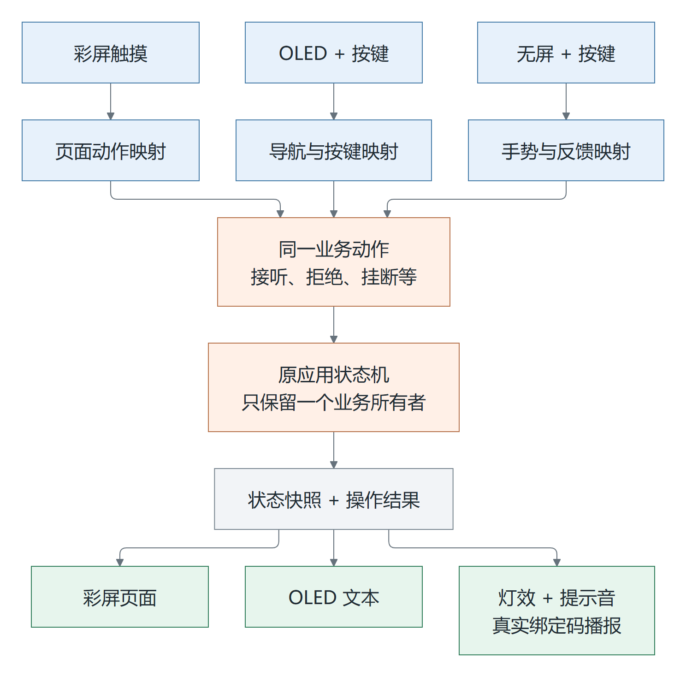

# 新板接入

[返回首页](../README.md) · [开发指南](开发指南.md) · [SDK 架构](SDK架构.md) · [测试与诊断](测试与诊断.md)

目标：拿到一块新开发板，只补它和已有板不同的部分，比如引脚、外设、能力、默认配置，然后复用已有的业务和交互。

本文用 `boards/` 和 `products/` 接板。只加板包、还没有产品清单和原生构建档案时，新板不会出现在 `scripts/build.py --list-boards`。


## 1. 先判断是哪一类适配

| 类型 | 例子 | 要做的事 |
| --- | --- | --- |
| 同类新板 | 另一块 ESP32-S3 触摸屏板，codec 和屏幕型号相同或相近 | 板级驱动、能力声明、默认配置；复用已有媒体和交互 |
| 新交互形态 | 旋钮、只有灯没有屏 | 增加交互适配：把输入变成已有意图，把状态变成反馈 |
| 新芯片 | 当前没有支持的芯片 | 先拿到对应芯片的 TiRTC SDK，单独验证初始化和链接，再做产品集成 |

目前随仓库提供产品的芯片是 `esp32s3` 和 `esp32p4`。

## 2. 准备资料

| 资料 | 用来做什么 |
| --- | --- |
| 完整板型、修订号、原理图或引脚表 | 引脚、总线、供电 |
| 芯片、Flash 大小、有没有 PSRAM | 选芯片档位和分区表 |
| 音频：codec 或麦克风/功放型号，有没有回采参考 | 选音频驱动和回声处理方式 |
| 屏幕和触摸型号、分辨率、方向 | 显示驱动和界面布局 |
| 按键、灯、摄像头 | 交互和视频能力 |
| 网络：芯片自带 Wi-Fi，还是外挂协处理器 | 联网方式 |
| 想要哪些功能 | 产品功能集 |

## 3. 建板目录

从最接近的 `boards/` 板包开始。S3 触摸板可看[立创实战派](../boards/lckfb/szpi-esp32s3/board.json)。接无屏板时，只登记实际存在的零件；交互需求单独对照[语音终端应用清单](../apps/xiaotai_app_voice_terminal/application.json)。拿原理图核对每个引脚，不要把参考板的接线当成新板默认值。

```text
boards/<厂商>/<板>/
  board.json            芯片、板型、内存、零件能力和依赖
  board.cc              用暂存的零件描述符将板卡接到 HAL
  CMakeLists.txt        组件 xiaotai_board，含 ESP-IDF 和主机分支
  sdkconfig.board       Flash、PSRAM 等板级配置
  partitions.csv        板载分区表
  test/                 板包测试（按需）
products/<产品名>/
  product.json          板包、应用、模块、参数、选项和变体
```

每个文件要核对的点：

| 文件 | 核对什么 |
| --- | --- |
| `board.json`（schema 3） | `target` 和 `identity` 准确；`memory.external_ram` 按实物；`parts` 只写已经实现的能力。屏幕宽高是产品看到的逻辑尺寸。 |
| `board.json` 的 `components` 和 `partitions` | 登记实际用到的零件组件和分区表。平台驱动放对应零件的 `esp-idf/`，板类用零件接口接线。 |
| `product.json`（schema 1） | `name` 全仓库唯一，`board` 指向板包，`applications` 和 `modules` 选择相容的组合。默认用本芯片的 TiRTC 官方通用包，`tirtc` 字段可为某条版本线另选包。 |
| `partitions.csv` | 核对实际 Flash 容量、APP 偏移和可用空间。已有产品升级时另核对分区兼容，不能用擦除 NVS 代替。 |

### board.json 怎么写

下面是[立创板包](../boards/lckfb/szpi-esp32s3/board.json)与彩屏和网络有关的字段摘录。完整文件还包含音频、相机、零件组件和分区；这个片段不能直接当成一块完整的板卡。

```json
{
  "schema": 3,
  "target": "esp32s3",
  "memory": {"external_ram": true},
  "parts": {
    "display": [{"pixel": "rgb565", "width": 320, "height": 240, "touch": true}],
    "input": [{"kind": "button", "role": "main"}],
    "network": [{"kind": "wifi", "provisioning": ["portal", "serial"]}]
  }
}
```

- 能力是“已经实现”的声明，写上去不会自动生成驱动。
- [选型器](../scripts/sdk_selection.py)按组件清单检查所需能力；缺一项就拒绝。启动时还会核对板包实际提供的零件。
- 有相机只说明能采集画面，不代表视频编码、视频通话已经实现。

## 4. 实现板级端口

`board.cc` 实现一个 `xiaotai::board::Board`，构建时只选一个 `SelectedBoard()`。板类按索引提供零件，没有的返回空；应用和模块经 [HAL](../sdk/xiaotai_hal/include/xiaotai/hal.h) 读取零件，不能反过来包含某块板的实现。

- **身份** `Identity()`：给出型号和修订号，串口识别与上报都用它。
- **音频** `AudioInput()` / `AudioOutput()`：声明采样率和通道角色，区分麦克风与回采参考。外设若直接输出编码音频，描述符应写实际编码格式，不要当成 PCM。
- **显示和触摸**：分别核对像素格式、旋转后尺寸、触控坐标和背光。主题只从所选零件绘制，不在主题里定义引脚。板级显示若要求渲染器就绪后才提交启动，可像 WT99 一样选择 `bind_before_commit`：由显示零件按板包定义的顺序回滚本次新开的资源；已有显示和其他零件共用的电源不能由界面回滚。
- **按键** `Input()`：提供输入状态，按键代表什么业务操作由交互层决定。
- **相机** `Camera()`：板类提供采集零件；是否选打开、编码、实时查看等模块由产品决定。验证帧归还、关闭和再次打开。

音频要分别核对三处格式：硬件采集和播放的格式、内部处理的格式、网络传输的格式。比如 S3 采集、AEC 和播放都是 16 kHz，网络上传的是 PCMA 8 kHz，两者之间由媒体层转换。


引脚留在板包。可复用的芯片驱动进 `sdk/parts/`，不要在应用、媒体或界面里按板名分支。初始化失败时按相反顺序释放已经申请的资源，并把错误码原样返回。

## 5. 选择交互

| 交互 | 可参考的实现 | 检查实际能力 |
| --- | --- | --- |
| 彩色触摸屏 | 立创 320×240、微雪 480×320、WT99 1024×600 | `rgb565`、触摸、屏幕方向；门禁和伴侣按需选择应用 |
| 无屏 | [语音终端应用](../apps/xiaotai_app_voice_terminal/application.json) | 按键、网络和双向音频；按需登记状态灯，不登记显示零件 |



无屏只少了显示设备。选入产品的配网、绑定、接听、拒绝、挂断和错误反馈仍需要可用的交互，例如按键操作、提示音反馈或播报绑定码。当前没有随 SDK 提供的无屏整板组合，接入后按实际硬件逐项验证。

## 6. 编译和验证

第一次可以先拿立创实战派跑一遍。接自己的板时，新建独立板包和产品清单，先用新清单的路径运行选型器。下面的板包和产品测试以仓库已登记的立创 S3 为例；它们通过不代表新板已经编译或上板。

```bash
python3 -B scripts/sdk_selection.py --check --strict
python3 -B scripts/sdk_selection.py --product products/xiaotai-szpi-s3/product.json --out-dir build/selection-szpi
python3 -B tests/sdk/run.py --board lckfb/szpi-esp32s3
python3 -B tests/sdk/product/run.py --product xiaotai-szpi-s3
python3 -B scripts/check_change_impact.py --graph sdk --files boards/lckfb/szpi-esp32s3/board.json
```

这组命令检查选型、板包和生成产品，最后列出修改可能影响哪些产品，不会生成可烧录固件。在 Linux 或 WSL 执行，彩屏主机测试要先准备[锁定的 LVGL 依赖](开发指南.md#产品选型与主机验证)。可用[立创 S3 默认入口](开发指南.md#编译)参考目标构建；其他新板仍需独立验证 ESP-IDF 编译、TiRTC 包、有效 `sdkconfig`、分区和依赖锁。

新板开发与发布构建分开。开发阶段用 [ESP-IDF 产品模板](../cmake/esp-idf-product/) 编译新清单的选型结果，使用与目标芯片匹配的 TiRTC 包，保留独立构建目录。到 `compile_commands.json` 看实际编译的是哪个板包，再用链接 map 和 ELF 确认新板入口已链接、被移除的外设没有进固件。仓库的构建入口要求新产品有自己的原生构建档案和依赖锁：第一次可以从参照产品的锁复制起步，构建报出差异后逐项审过再采用，不要长期借用参照产品的锁。

上板后按顺序验证：

1. **启动**：核对 ELF 和板型；如该构建开放物理 AT，用 `AT+VERSION` 取证，否则用启动日志。屏幕、按键、灯有实物证据才算验证。
2. **音频**：放一段提示音，看麦克风和参考通道的电平是否合理，有没有削顶。
3. **联网和绑定**：配网、绑定，平台在线。
4. **业务**：按选中的模块测试 AI 聊天、双向通话等。串口自动化按[本次构建的词表、指纹和动作授权](AT指令.md#词表与权限)运行。
5. **退出和恢复**：挂断、重复进出、断网重连之后，都能回到待机。
6. **内存**：`xt.py soak` 多轮运行，空闲内存不持续下降。

测试工具的用法见 [测试与诊断](测试与诊断.md)。

## 常见问题

| 现象 | 先查 |
| --- | --- |
| 找不到板包 | `products/<产品名>/product.json` 的 `board` 是否指向 `boards/<厂商>/<板>/board.json` |
| 选型失败 | 产品是否声明了该变体，模块的依赖和板卡能力是否齐全 |
| 能力匹配失败 | `board.json` 的 `parts` 与实物及模块要求是否一致，特别是显示尺寸、相机格式和音频布局 |
| 编译通过但硬件不工作 | `compile_commands.json` 里是否真的编了新板的驱动，有没有残留旧板的引脚 |
