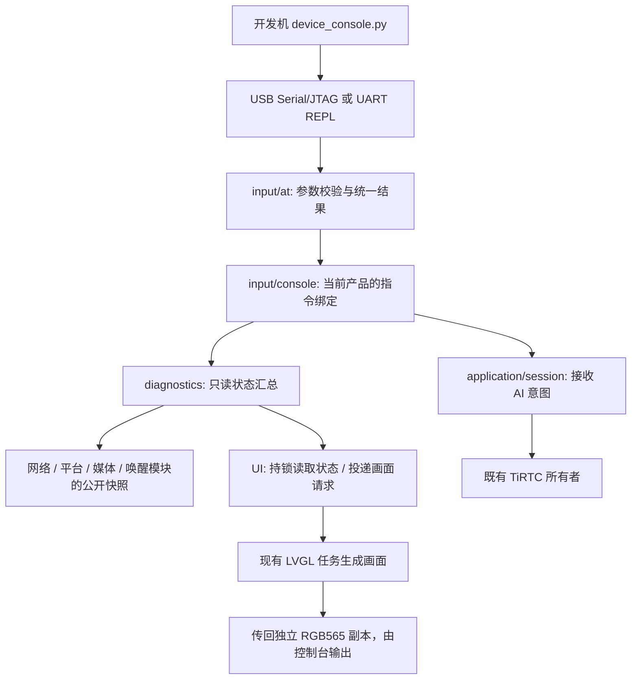
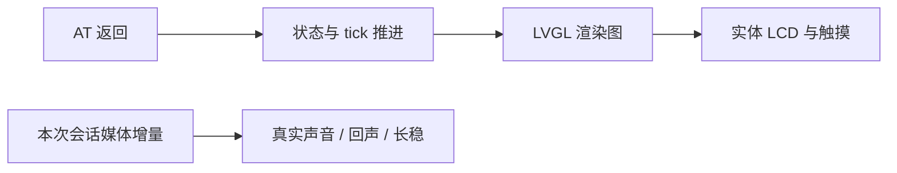

# 本地诊断与 AT 指令

这套入口用于开发机通过串口查看设备、导出界面和提交测试动作。它不经过 EP、MQTT 或远程执行通道，不持有第二套业务状态机。

以下指令表适用于立创实战派 S3 的诊断构建。其他板型保留各自的控制台，命令和能力以实际固件为准。

## 代码放在哪里



- `main/xiaotai/input/at/` 只认识命令、参数和返回码，不包含 GPIO、LVGL、TiRTC 实现。
- `main/xiaotai/input/console/` 绑定本地传输和产品接口，保留旧命令别名。
- `main/xiaotai/diagnostics/` 汇总只读信息，版本中的板名来自所选 Board；不读出设备密钥。
- `main/xiaotai/ui/lcd320/` 自己处理 LVGL 锁、渲染任务和画面内存。控制台不能持有 LVGL 对象，也不直接改页面变量。画面请求进入容量为 1 的队列，由现有 LVGL 任务执行；调用方最多等 2 秒，超时后任务仍持有自己的请求和结果，不引用已离开的调用栈。
- AI 动作仍走 `starter_runtime_ai_start/stop()`。网络未就绪、队列满等错误原样返回。

新板接入时，为公共 AT 操作提供本板的查询和意图适配器。无屏板对画面操作返回 `ESP_ERR_NOT_SUPPORTED`；不能返回空白图再报成功。新交互仍由交互适配器实现，不写进 AT 解析器。

## 怎样编译

普通产品配置默认关闭开发控制台。立创 S3 的诊断构建使用独立目录，不改产品配置：

```sh
python scripts/build.py lckfb/szpi-esp32s3 --build-options-json '{"development_console":true}'
```

输出为 `build/xiaotai-szpi-s3/firmware-diagnostics/`。原产品输出仍为 `firmware/`。对应选项是 `CONFIG_XIAOTAI_DEVELOPMENT_CONSOLE=y`，同时启用 LVGL snapshot。当前构建入口会拒绝尚未接入此诊断适配器的其他板型，不会悄悄生成缺功能固件。

控制台在本地媒体、UI 和 Wi-Fi 初始化之后、等待联网和绑定之前启动。TiRTC 内存预留先建立，再创建控制台；离线时也能查询状态。启动按钮和业务就绪条件保持原来的所有权。

## 指令表

大小写敏感，每条命令用回车结束。以下已注册命令以 `OK` 或 `ERROR: ESP_ERR_...` 收尾。普通运行日志可能穿插出现，不应把其中的单词当作命令结果。

| 命令 | 用途 | 影响 |
| --- | --- | --- |
| `AT` | 检查本地命令入口 | 只读 |
| `AT+HELP` | 列出本入口的语法 | 只读；可用能力仍以返回码为准 |
| `AT+VERSION` | Board、固件、IDF、MAC、ELF SHA 与编译能力 | 只读 |
| `AT+STATUS` | Wi-Fi、平台、RTC、会话、音频计数、缓冲、唤醒、堆水位 | 只读 |
| `AT+UI` | UI 就绪、背光请求状态、尺寸、页号、顶层子对象数、tick、捕获后的 UI 栈最低余量 | 只读 |
| `AT+SCREEN` | 导出当前活动页面的 RGB565 渲染副本 | 额外渲染一次；只在会话空闲时受理 |
| `AT+AI START` | 投递 AI 开始意图 | 会使用现有网络、麦克风和 AI 服务 |
| `AT+AI STOP` | 投递 AI 停止意图 | 结束测试会话 |

`OK` 对动作表示已受理，不代表已经建连、收到音频或播放成功。应继续查看会话状态、generation 和本次采样区间的媒体增量。

旧版 `version`、`status`、`ai-start`、`ai-stop`、`voice-config`、`voice-diag`、`voice-test` 继续保留。`voice-test self-test` 只验证文本意图解析，不证明声学唤醒成功。

原有 `wifi-set/clear`、`tirtc-set/clear` 和 `restart` 也保留在开发控制台，它们会修改凭据或重启，不属于自动回归脚本的允许列表。`AT+EP?`、`AT+EP=...` 尚未实现；不能借调试命令绕过 RTC 重建流程或改变服务协议。

## 自行抓取与看图

先枚举串口并核对板卡身份。脚本不自动猜端口、不烧录、不清 NVS，也不自动呼叫联系人。将下例的 `COMx` 换为实际串口，日志保存在源码目录外：

```sh
python scripts/device_console.py --port COMx --idf-open --seconds 20 --command AT+VERSION --command AT+UI --output ../s3-state.log
python scripts/device_console.py --port COMx --idf-open --seconds 30 --command AT+SCREEN --output ../s3-screen.log
python scripts/decode_screen.py ../s3-screen.log ../s3-screen.png
```

脚本依赖 `pyserial`。只有明确传入 `--reset-usb` 或 `--reset-uart` 才调用复位；Windows 打开端口时的控制线行为仍需按板卡核对。`--idf-open` 使用 ESP-IDF monitor 的 DTR/RTS 打开顺序。

画面传输含尺寸、字节数、连续块序号和 FNV 校验。解码器遇到缺块、乱序、重复、尺寸异常或校验失败会报错，不输出“看起来完整”的图片。日志和导出的画面可能含联系人、绑定界面等个人信息，应保存在仓外私有目录。

立创 S3 的 `page=0` 是表情首页，`page=1` 是时钟首页，`page=3` 是菜单；这些编号属于该 UI，不作为无屏或其他 UI 的公共协议。`capture-stack-min=0` 表示本次启动还没有执行捕获，不是栈耗尽。

整帧 RGB565 占 153600 字节，单独从 PSRAM 申请，不挤占原有 64 KiB LVGL 固定池。渲染在 UI 任务上执行，控制台只等待、传输和释放结果，不通过扩大控制台栈来承担渲染职责。

大块画面输出属于后台工作。`input/console` 在执行截图命令期间把当前 REPL 任务降到 `tskIDLE_PRIORITY`，结束后恢复原优先级，错误返回也恢复。这样发送任务不会持续抢在空闲任务前面；UI 渲染仍在原 UI 任务上执行。这个约束放在本地传输适配器，不让公共 AT 解析器依赖 FreeRTOS，也不改变音频任务或看门狗配置。其他板接入时应按自己的调度器实现后台传输策略。

## 证据边界



图中的每一步都需要自己的证据：

- 渲染图证明活动页面能生成像素，不是 LCD 回读；不覆盖物理面板、背光实际亮度，也不包含独立 top/system layer。
- `AT+UI` 连续查询中的 tick 增量证明 UI 定时器在运行，不能单独证明触摸有效。
- 截图有额外内存和渲染成本，不能拿截图期间的耗时当正常性能基线。已有实时会话时明确拒绝截图；并发启动会话的压力情况仍需单独验证。
- 累计音频计数非零不等于当前会话通畅，要按 generation 和前后差值检查。数字链路通过也不等于声音质量通过。

## 兼容性检查

`tests/test_at_diagnostics.py` 运行实际公共 AT 解析器和 UI 查询/捕获函数，覆盖参数错误、缺失能力、忙碌、锁超时、分配失败、图像步幅、队列满、调用方超时、迟到完成、二次就绪检查、1000 次回收和传输损坏；还检查后台输出在成功和错误返回后都恢复优先级。C 测试启用 ASan/UBSan。

构建测试检查开发选项类型、适用板型和输出目录隔离。完整主机回归仍通过 `python tests/run_host.py` 运行。

CoreS3 的 MQTT 内存适配固定校验 1.0.0 源码，立创 S3 当前锁文件使用 1.1.0。切换构建后，根 `managed_components` 可能属于最后编译的板型。跨板主机检查可用 `XIAOTAI_CORES3_MQTT_SOURCE` 指定已缓存的 CoreS3 1.0.0 组件目录，原 SHA 门禁保持不变。当前共享依赖目录不支持多板同时构建，完整的依赖目录隔离仍是后续架构事项。
