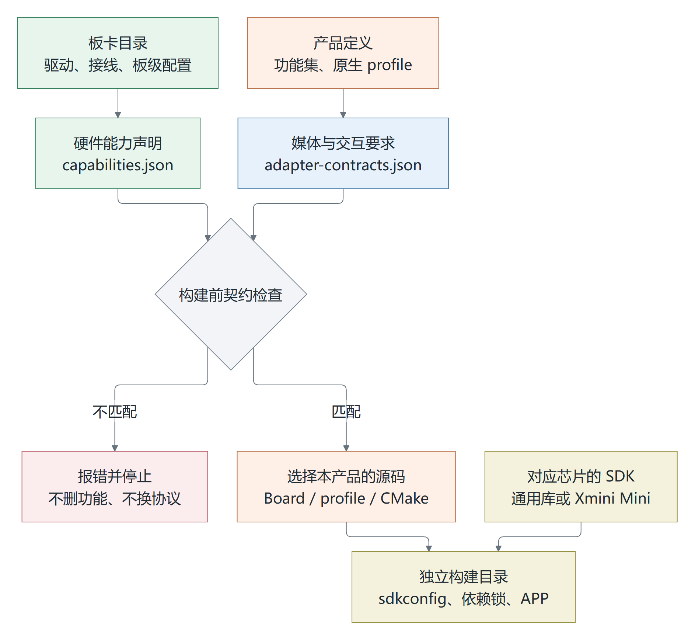
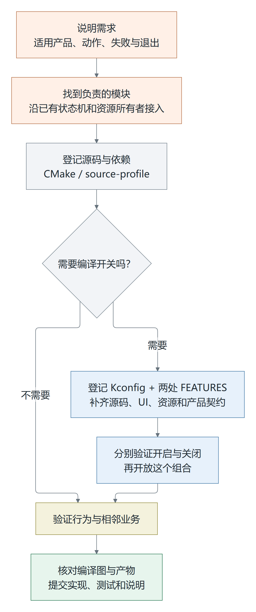
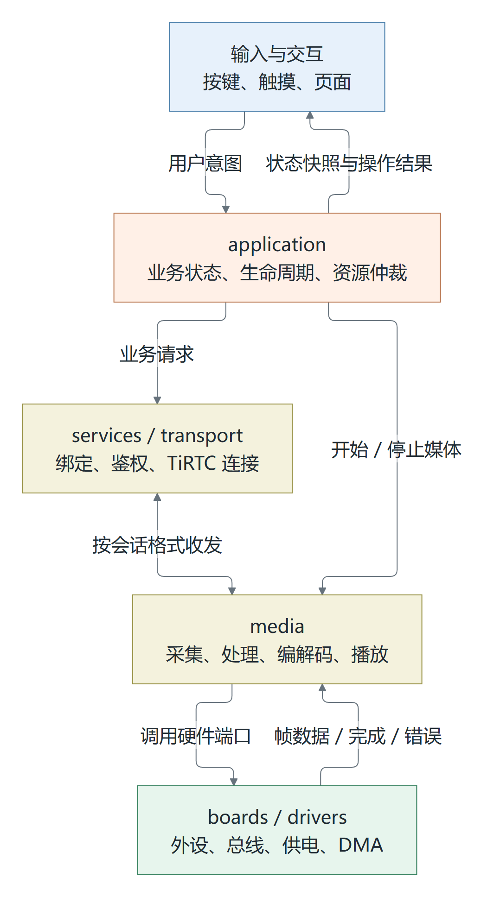
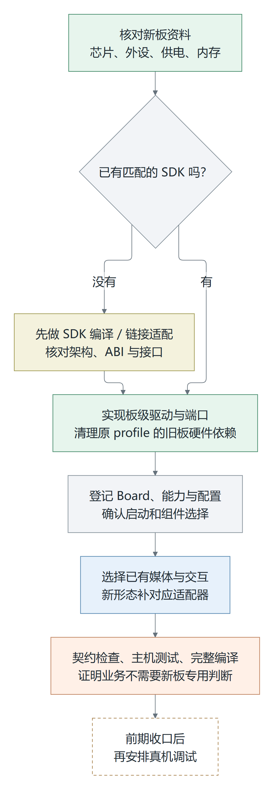
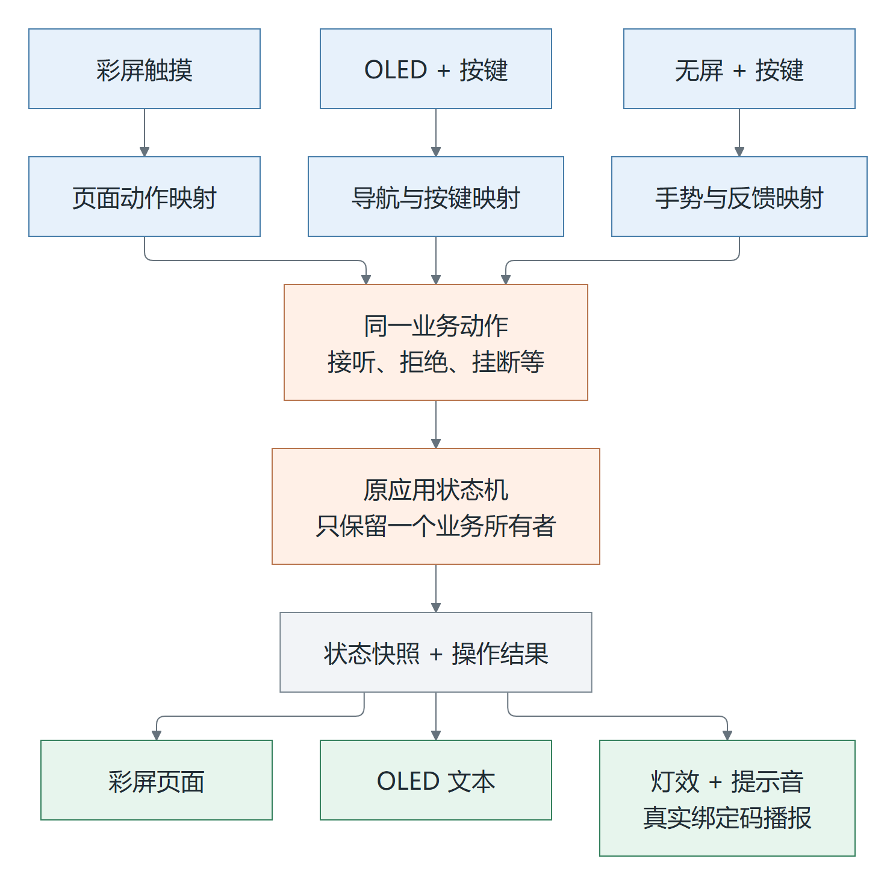
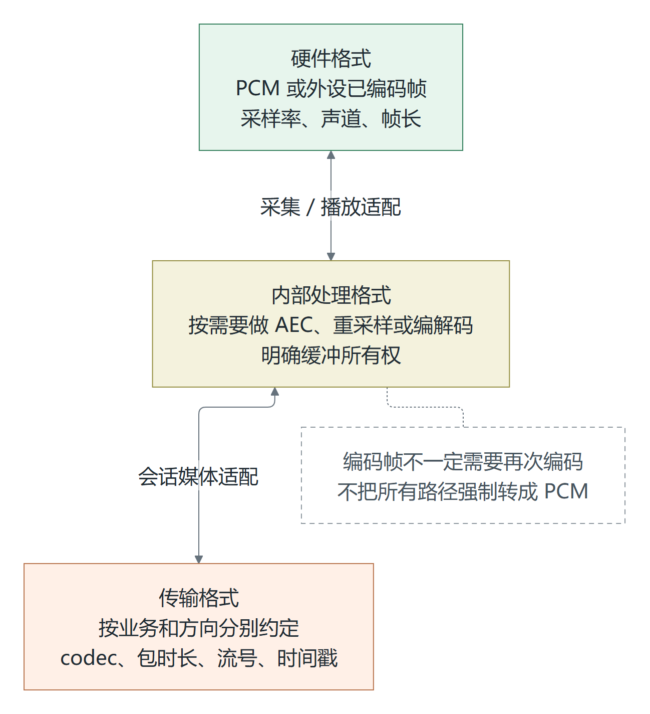
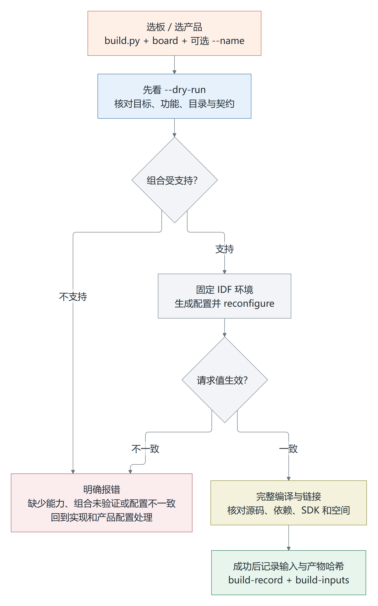
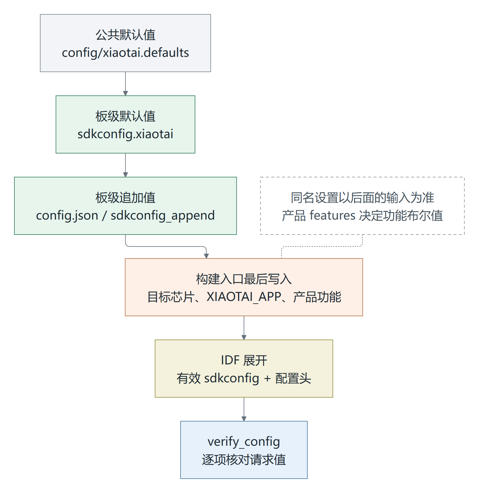
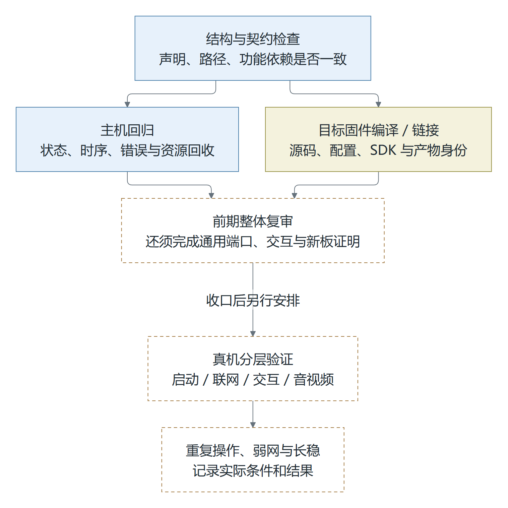

# 小钛架构开发指南

小钛统一开发仓 `xiaotai-next`，2026-11-04 核对。

要改功能，先找负责的模块；要换板，先核对硬件和 SDK；要编译已有产品，直接看配置与编译一节。这里把对应文件、操作步骤和容易踩到的问题放在一起。

[加功能](#2-在开发版中加入新功能) · [做适配](#3-做硬件和交互适配) · [选配置和编译](#4-选择配置和编译)

2026-11-05 补充：[本地诊断与 AT 指令](本地诊断与AT指令.md) 说明了诊断分层、立创 S3 的独立诊断构建、旧指令兼容、UI 查询和画面导出；实机结果及未通过项见 [S3 诊断迁移与回归](S3诊断迁移与回归.md)。这里的诊断构建开关不代表其他业务功能已能任意裁剪。

## 1. 先理解仓库的组织方式

先看一份固件是怎么组成的。板卡目录提供驱动和硬件配置，产品定义决定功能组合。构建入口比对这些配置，选入对应源码和 SDK，再生成固件。



图 1：当前构建流程。媒体和交互的实际源码仍由 Board/profile/CMake 选入，JSON 中的适配器名称只描述要求。

板卡负责接线和物理资源，媒体层处理音视频，交互层接收操作并给出反馈。业务代码尽量通过这些接口工作，少依赖“当前是哪块板”的判断。

### 现在能用到哪一步

六个已有产品已经接入同一个仓库，可以分别编译 S3、P4、C3 固件。每个产品有自己的 `sdkconfig`、依赖锁和产物目录。构建入口会检查硬件能力、媒体/交互要求、功能依赖及 SDK 配置，并记录输入、输出的 SHA-256。

这里的 profile 指某个产品选入的原生源码组合。后续迁入的五块板仍保留各自 profile，还没有合成一套能自由组合的运行时。`portability: native-bound` 就是这个限制的标记：新板需要先处理原 profile 中的硬件依赖，不能只改名字。

编译也先沿用各产品的完整默认功能集。任意开关功能、通用硬件端口、统一交互接口和独立新板验证还需要继续完成。下文会分别说明现成操作和开发这些能力时要补的工作。

详细约束见 [新板适配与兼容性契约](新板适配与兼容性契约.md)，证据状态见 [验证状态](VALIDATION.md)。

### 代码放在哪里

| 位置 | 开发者在这里处理什么 |
| --- | --- |
| `main/boards/<board>/` | 板型、引脚、供电、总线、驱动、板级构建限制和能力描述 |
| `main/xiaotai/application/` | 启动编排、业务状态机、资源仲裁、会话进入/退出 |
| `main/xiaotai/services/` | 绑定、联系人、鉴权、业务请求等服务逻辑 |
| `main/xiaotai/transport/` | TiRTC 连接、回调、会话代次和媒体收发边界 |
| `main/xiaotai/media/` | 音频/视频处理、编解码、AEC、唤醒及缓冲管理 |
| `main/xiaotai/ui/`、`input/` | 页面、灯效、交互映射、按键和控制台入口 |
| `main/xiaotai/platform/` | NVS、配置持久化、Wi-Fi、配网等平台服务 |
| `components/` | SDK 和跨模块公共组件 |
| `config/` | 公共默认配置、产品/适配契约及开发阶段约束 |
| `cmake/`、`scripts/` | 源码选择、版本适配、构建和检查入口 |
| `tests/` | 配置契约、主机回归、故障注入和 SDK 链接检查 |

新编排和接口优先用 C++，成熟的 C 驱动、算法、业务状态机及 TiRTC C 接口继续保留。两边通过小范围的 C ABI 对接，协议、回调顺序和资源寿命保持原样。

## 2. 在开发版中加入新功能

### 2.1 先确定改动属于哪一层

| 需求 | 主要修改位置 | 容易改错的地方 |
| --- | --- | --- |
| 增加一个页面或状态提示 | `ui`，必要时补应用状态快照 | 在页面回调中直接释放 RTC 或操作 GPIO |
| 增加业务动作或业务流程 | `application`、`services` | 新建一套并行的连接/通话状态机 |
| 增加音频处理、编码或视频格式 | `media`，必要时调整 `transport` | 用屏幕类型推断 codec，或改变其他业务的传输格式 |
| 增加按键、旋钮或其他输入 | 板级驱动、`input` 与交互适配 | 让驱动根据当前通话状态决定业务动作 |
| 更换屏幕、codec、摄像头 | `boards` 与相应媒体/显示适配 | 在公共业务里不断增加板名判断 |
| 增加可持久化设置 | `platform`，由应用消费设置 | 把运行期设置全部变成编译开关 |

动手前先写清这个功能给哪些产品用，谁接收操作、谁保存状态、谁申请和释放资源。把失败、取消和退出也列出来。像改一条提示文字这样的需求，通常不必新增顶层编译开关。



图 2：新增功能的工作顺序。带开关的功能多一段工作：验证开启和关闭之后，才开放这个组合。

### 2.2 沿原有生命周期接入

新代码按下面的关系接入。先调用所选 profile 已有的命令和状态接口，公共接口再逐步抽出来。



图 3：要逐步收敛到的职责关系。现有 profile 尚未全部按这张图解耦，仓库也还没有一套通用的 `IntentSink` API。

- 状态机持有业务状态；UI 只表达状态和意图。
- 硬件与媒体资源由明确的所有者申请、停止和回收。
- 保留原来的 session generation、playback epoch、wake token 和命令发布顺序。
- 命令入队后，还要等操作结果。队列满、超时和资源不足要分别返回错误。
- SDK/定时器回调不执行阻塞网络请求、NVS 写入、等待播报或深层资源释放。

比如加“通话时长显示”，开始和结束时间由应用根据原会话状态记录。彩屏把时长放在通话页，OLED 用短文本，无屏产品再决定是否需要播报。BSP 通常不用动，UI 也不用重新判断一次通话何时开始、何时结束。

### 2.3 把源码加进构建

当前有两条源码接入路径，按所选产品处理：

| 产品路径 | 注册位置 | 注意事项 |
| --- | --- | --- |
| 立创 S3 | [main/CMakeLists.txt](../main/CMakeLists.txt) 的 `modules`、`sources`、`includes`、`REQUIRES` 等 | 当前模块扫描只覆盖 `src/*.c` 和 `src/*.cpp`；新增 `.cc` 或更深目录时应显式登记，不能以文件存在作为编译证据 |
| CoreS3/P4/WT/Xmini/MZ28 | 对应板的 `source-profile.json`，以及组件自己的 `CMakeLists.txt` | `components` 使组件可被发现；还要由启动组件或其他消费者声明 `REQUIRES`/`PRIV_REQUIRES`，并实际调用或注册功能 |

可参照 [Xmini 的 source profile](../main/boards/xmini/c3-v3/source-profile.json) 和 [启动组件](../main/xiaotai/application/xmini/startup/CMakeLists.txt)。启动入口仍由 `main/main.cc` 统一提供；原生 profile 使用 `xiaotai_profile_main()` 接入，不再增加第二个 `app_main()`。

加完后，到 `compile_commands.json` 里查实现文件。涉及运行入口的功能，再查链接符号和调用路径。配置里有名字，代码却没编译进去，是这一步最容易漏的问题。

### 2.4 需要新增“可勾选功能”时

给功能加开关时，源码、依赖、初始化、UI、能力上报和内存占用要一起处理。尤其是关闭状态：菜单隐藏了，后台任务和缓存还在，也不算完成。

1. 在 [main/Kconfig.projbuild](../main/Kconfig.projbuild) 定义 `CONFIG_XIAOTAI_<功能>`，声明必要依赖；有依赖不满足时不允许选择。
2. 在 [构建入口](../scripts/xiaotai_build.py) 和 [契约检查器](../scripts/product_contract.py) 的 `FEATURES` 中登记功能键。当前两处都有明确列表，只改其中一处会被另一处拒绝。
3. 在应用、服务和交互中接入完整行为；在各产品的 CMake 中处理源文件、组件依赖、模型和提示音等资源的选入/排除。
4. 更新适用板的 `config.json` 与 [product-contracts.json](../config/product-contracts.json)，保持功能集一致。需要新的硬件条件时同步补能力检查与适配契约。
5. 分别验证开启和关闭：关闭后没有残留菜单、服务入口、能力上报、任务或大块缓存；开启后依赖齐全，失败路径仍明确。
6. 验证完成后，再有针对性地扩展 `configuration()` 的选项策略及相应 CMake 限制，开放该组合。保留未验证组合的拒绝逻辑。

目前 `--build-options-json` 只接受与产品默认值相同的布尔值。先保留这个检查，等新组合的实现和测试补齐，再开放对应选项。

改公共代码，就检查所有使用它的产品；只改某个 profile，则先覆盖该产品和相邻业务。共享逻辑有清晰接口后放在共同模块维护，不要把整份旧工程再复制给每块板。

## 3. 做硬件和交互适配

### 3.1 区分三类适配

先判断变化发生在哪里。换引脚、换输入方式和换芯片，要补的工作不同。

| 适配类型 | 应增加什么 | 验收重点 |
| --- | --- | --- |
| 同类新板 | BSP/驱动、能力描述、板级构建配置；复用已有媒体与交互实现 | 不改业务状态机；不残留旧板引脚、供电和 BSP 依赖 |
| 新交互形态 | 输入映射、状态呈现、反馈适配及回放测试 | 彩屏、OLED、无屏完成相同业务动作时，状态机行为一致 |
| 新芯片/SDK | 对应架构的 SDK、ABI/工具链契约与平台适配 | 先验证 SDK 的初始化、全部必要符号和链接，再进入产品集成 |

当前入口登记了 `esp32s3`、`esp32p4`、`esp32c3`。新芯片先验证 SDK 和工具链，再加入 `TARGETS`。

同类新板应当只改硬件层。眼下还要把原 profile 中散落的硬件依赖移到板级端口，才能做到这一点。`SelectedIdentity` 只提供板型身份；驱动和初始化还得真正接上。



图 4：新板接入顺序。框里的“清理旧板硬件依赖”不能省，否则新名字下面仍可能跑着旧 BSP。

### 3.2 新板需要准备的文件

```text
main/boards/<板卡目录>/
  config.json             构建名称、芯片、板型符号和现有产品配置
  capabilities.json       能力与逻辑显示尺寸
  board.cc                所选 Board 的实现
  board.cmake             芯片/板级约束和源码选择
  sdkconfig.xiaotai        该板的固件默认配置
  source-profile.json     原生 profile 的启动与组件清单
  drivers/                板级驱动；按需创建
  build-support/          版本适配脚本/补丁；按需创建
```

目录可以像 `xmini/c3-v3` 一样分层，文件名按上表约定。立创 S3 走特殊的非原生 profile 路径，没有 `source-profile.json`。新板若误入这条路径，CMake 会报错；应补齐新板的入口和源码选择，保留这条检查。

登记时对照这些文件：

| 位置 | 核对什么 |
| --- | --- |
| `config.json` | `target`、唯一 `builds[].name`、`sdkconfig_append` 的板型符号、`xiaotai` 功能与 profile |
| `capabilities.json` | 真实端口能力；显示宽高是板级旋转后的逻辑 viewport |
| `main/Kconfig.projbuild` | 新板对应的 `BOARD_TYPE_*`，以及芯片依赖 |
| `config/product-contracts.json` | 以构建名称为键的产品项，板目录、profile、功能集、媒体、交互和 SDK 变体 |
| `config/adapter-contracts.json` | 所选媒体/交互需求是否成立；没有实现的适配器不能只登记名字 |
| `source-profile.json` / CMake | 启动入口、组件、依赖、资源和实际 BSP 是否都指向新板实现 |
| SDK 选择逻辑 | 同时核对构建脚本和 SDK 组件的选择规则，不能仅改 `sdk_variant` 字段 |

这里有个容易混淆的例子：Xmini 和 MZ28 都是 C3，但前者使用独立 Mini SDK，后者使用通用 C3 SDK。要按 API 和行为契约选库，不能只看 CPU。JSON 中的 `sdk_variant` 用来核对选择，并不会自动加载一份新的库。

### 3.3 能力描述怎么写

以实际 MZ28 的 [capabilities.json](../main/boards/mz28-ai-ppd/capabilities.json) 为例：

```json
{
  "schema": 1,
  "target": "esp32c3",
  "capabilities": [
    "audio.opus16k20.capture", "audio.pcm.playback",
    "input.key", "feedback.rgb", "feedback.audio",
    "network.ip", "storage.nvs"
  ],
  "display": {"kind": "none", "width": 0, "height": 0}
}
```

读这份配置就能看出：输入是已编码音频，播放用 PCM，交互靠按键、RGB 和声音。PCM 麦克风、屏幕、PSRAM、相机都没有声明。

- `capabilities.json` 是实现声明，不会自动生成驱动，也不是上电探测结果。
- 新能力先实现接口、错误语义和测试，再扩展检查器的 `CAPABILITIES` 词汇；不能用任意字符串绕过检查。
- `adapter-contracts.json` 的 `requires` 必须全部满足；`one_of` 的每一组至少满足一个选项；非空 `display` 要求尺寸和格式精确匹配。
- 声明有相机只表明采集条件，不能推出视频编码、解码或视频呼叫已实现。
- PSRAM 可用不代表容量、DMA、cache-disabled 路径、内部堆和任务栈都满足要求。

### 3.4 无屏和不同交互怎么适配

无屏只是少了显示屏。配网、绑定、接听、拒绝、挂断和错误反馈仍要能操作，设置变更也要有确认。适配时逐项检查这些动作怎么完成，不要把 UI 初始化直接留空。



图 5：交互层的复用目标。同一动作进入原业务状态机，结果再按设备形态呈现；公共意图/快照接口仍在迁移中。

当前 MZ28 使用 `headless-key-led-voice`，按键、RGB 灯和声音反馈都属于必需能力；绑定需要真实六位码播报和取消机制。Xmini 使用 `oled-keys`，保留按键上下文、字幕、联系人和原有业务入口。

旋钮、遥控和识别后的语音命令，也在交互层映射成已有动作。远程输入先过鉴权和权限检查；原始语音仍归媒体层处理。换输入方式时，继续使用原来的通话状态机。

### 3.5 媒体适配分别核对三个格式



图 6：三处格式分开核对。外设已经输出编码帧时，可能直接适配传输格式，不必先转成 PCM 再编码。

每一处都写清采样率、声道、位宽或 codec、包时长、时间戳，以及缓冲区由谁持有、何时归还。需要转换的地方给出实际实现。换屏幕通常不用动音频协议。

例如 CoreS3 的 `audio` 标签写着 `opus16k`，实际 H5/AI/房间与呼叫/微信却使用不同传输格式，见 [接口定义](../main/xiaotai/transport/cores3/starter_tirtc/include/starter_tirtc.h)。适配时要查到具体业务，不能只读这个简称。UART 编码采集与 I2S PCM 采集也要分开处理。

## 4. 选择配置和编译

### 4.1 当前推荐流程

先选板卡和产品，看一遍展开配置，再编译、核对产物。目前选中产品，也就选中了它已经登记的完整功能组合。



图 7：当前构建入口会在组合不支持或配置没有生效时停止。处理原来的问题后重建，不靠删检查继续。

以下命令均在仓库根目录执行。列出和预览不需要启动编译，也不访问设备：

```sh
python scripts/build.py --list-boards
python scripts/build.py --list-boards --json
python scripts/build.py xmini/c3-v3 --dry-run
```

看 `--dry-run` 输出时，先确认 `board`、`name`、`target` 是自己要的产品，再看 `config`、`compatibility` 和输出路径。当前每板只有一个变体；以后同板登记多个变体时，需要用 `--name` 指定。

| 板卡参数 | 构建名称 | 芯片 |
| --- | --- | --- |
| `lckfb/szpi-esp32s3` | `xiaotai-szpi-s3` | ESP32-S3 |
| `m5stack/core-s3` | `xiaotai-cores3-lite` | ESP32-S3 |
| `waveshare/esp32-p4-wifi6-touch-lcd-3.5` | `xiaotai-waveshare-p4-rev3` | ESP32-P4 |
| `wt99p461-s1` | `xiaotai-wt99p461-s1-1v1` | ESP32-P4 |
| `xmini/c3-v3` | `xiaotai-xmini-c3-v3` | ESP32-C3 |
| `mz28-ai-ppd` | `xiaotai-mz28-ai-ppd` | ESP32-C3 |

### 4.2 功能选项分别是什么

| JSON 功能键 | Kconfig 符号 | 含义 |
| --- | --- | --- |
| `ai` | `CONFIG_XIAOTAI_AI` | TiRTC AI 业务 |
| `device_call` | `CONFIG_XIAOTAI_DEVICE_CALL` | 设备呼叫 |
| `wechat_voip` | `CONFIG_XIAOTAI_WECHAT_VOIP` | 微信 VoIP |
| `room` | `CONFIG_XIAOTAI_ROOM` | LIVE/GROUP 房间 |
| `h5_stream` | `CONFIG_XIAOTAI_H5_STREAM` | Web 实时音频会话 |
| `h5_video` | `CONFIG_XIAOTAI_H5_VIDEO` | Web 摄像头视频，依赖 `h5_stream` |
| `ai_vision` | `CONFIG_XIAOTAI_AI_VISION` | AI 视觉，依赖 `ai` |

表里列的是顶层业务开关。配网、绑定、设置、维护等功能仍由各产品实现提供，没有在这里逐项列出。

| 当前产品 | 默认业务项 |
| --- | --- |
| 立创 S3 | 上表七项 |
| CoreS3 / 微雪 P4 / WT99 | 除 `ai_vision` 外的六项 |
| Xmini | `ai`、`device_call`、`wechat_voip`、`room`、`h5_stream` |
| MZ28 | `wechat_voip` |

下面是 Bash 写法，要求 Xmini 保持默认的 AI 开启状态：

```bash
python scripts/build.py xmini/c3-v3 --dry-run --build-options-json '{"ai":true}'
```

改成 `{"ai":false}`，当前入口会报 `source/UI/capability trimming has not been validated`，因为关闭 AI 的组合尚未验证。未登记的键同样会被拒绝。值要用 `true/false`，不能用 `1/0`。

### 4.3 环境与编译命令

V0.1.0 起先查看所选产品 `--dry-run` 的 `idf_environment`。立创 S3 使用固定的 ESP-IDF 6.0.3 源码归档环境，其他五板继续使用 ESP-IDF 6.0.2。不能把立创 S3 的新库覆盖到 CoreS3，也不把其他板一起切到 6.0.3。

6.0.2 环境仍核对这个提交：

```text
7101770dc6db2667b3c477cc31365dd1acd6db4e
```

6.0.3 环境按 `scripts/idf_environment.py` 的源码摘要核对，具体来源见 [立创 S3 SDK 变体](../components/tirtc_sdk/variants/szpi-http/README.md)。版本字符串相同仍不足以通过。当前完整构建记录来自 WSL/Linux；Windows 可以直接做配置预览和静态检查，原生 Windows 的完整工具链还要单独验证。

在已激活的 Bash 环境中先核对，再调用仓库入口：

```bash
git -C "$IDF_PATH" rev-parse HEAD
idf.py --version
python scripts/build.py xmini/c3-v3
```

需要明确产品名称时：

```sh
python scripts/build.py xmini/c3-v3 --name xiaotai-xmini-c3-v3
```

板卡或产品配置发生变化后，使用：

```sh
python scripts/build.py xmini/c3-v3 --fresh-config
```

`--fresh-config` 只归档该产品的旧配置，再从源码默认值重新生成；它不清空仓库，也不烧录。长期要保留的参数改在源码配置中，不只改 `build` 下的 `sdkconfig`。

换板时先激活对应 IDF 环境，再换构建参数，让脚本选择另一套目录。不要在同一目录执行全局 `idf.py set-target` 后继续混用旧配置。遇到 `IDF_TARGET` 冲突，先检查环境变量。

各产品的依赖锁保存在 `profiles/dependency-locks/`，新构建会复制对应锁到自己的输出目录，已有构建不覆盖。更新依赖时核对源码、组件哈希和回归，再更新对应锁；不要清空锁文件以规避不匹配。立创 S3 的直接依赖版本另已固定为隔离验证时的版本。

### 4.4 如何查看 menuconfig 的勾选项

`main/Kconfig.projbuild` 中有 `XiaoTai` 菜单，可以查看板型和业务勾选项。现阶段用它核对配置、开发新选项；任意组合仍要先完成第 2.4 节的工作，才能开放。

Xmini 已通过仓库入口生成配置后，在固定 IDF 环境中打开同一个构建目录。下面仍是 Bash 示例：

```bash
BUILD=build/xiaotai-xmini-c3-v3/firmware
idf.py -B "$BUILD" \
  -D IDF_TARGET=esp32c3 \
  -D XIAOTAI_BOARD_DIR=xmini/c3-v3 \
  -D SDKCONFIG="$PWD/$BUILD/sdkconfig" \
  -D SDKCONFIG_DEFAULTS="$PWD/$BUILD/sdkconfig.defaults" \
  -D DEPENDENCIES_LOCK="$PWD/$BUILD/dependencies.lock" \
  menuconfig
```

进入 `XiaoTai` 菜单后，按界面提示查看勾选状态与依赖。不改配置时退出且不保存。`menuconfig` 可能重新配置构建目录，因此也应与其他构建串行执行。

换板型时退出菜单，回到 `scripts/build.py <另一板>` 重新选择。只改菜单里的板型符号，并不会替换旧板的源码和输出目录。

要保留新的默认参数，就把它写进对应源码配置，核对依赖和 SDK 契约，再用 `--fresh-config` 重建。业务开关还需完成源码、UI、依赖和开启/关闭两种状态的验证。

有些手工选项未必被当前检查覆盖，也要纳入配置和回归。直接运行 `idf.py build` 绕过产品入口，不能证明这个组合受支持。

### 4.5 配置优先级与输出

固件配置按下图顺序组合，同名设置以后面的输入为准：



图 8：`firmware` 阶段的配置优先级。SDK 链接检查有自己的配置流程，不混用完整产品配置。

例如，产品 `features` 里保留了 `ai`，即使在 `sdkconfig.xiaotai` 写 `CONFIG_XIAOTAI_AI=n`，构建入口仍会按产品定义写回开启值。要改功能组合，需要同时处理产品定义和实现。

固件产物位于：

```text
build/<构建名称>/firmware/
  requested.json           本次请求的配置与兼容契约
  sdkconfig.defaults       自动生成的配置输入
  sdkconfig                IDF 实际生效配置
  config/sdkconfig.h       编译使用的配置头
  dependencies.lock        本产品依赖锁
  compile_commands.json    实际编译单元与参数
  xiaotai.bin              APP 镜像，不是合并后的完整 Flash 镜像
  xiaotai.elf / xiaotai.map
  build-record.json        成功构建记录及产物身份
  build-inputs.json        构建输入与 SHA-256
```

每次新构建会先归档旧成功记录。若这次失败，目录里可能还留着上次的 BIN，所以要看本次记录，不能只看有没有文件。`managed_components` 是共享缓存，仍需串行构建。遇到锁文件先确认对应进程，别直接删锁再启动一轮。

`sdk-check` 是另一种用途：

```sh
python scripts/build.py xmini/c3-v3 --stage sdk-check --dry-run
python scripts/build.py xmini/c3-v3 --stage sdk-check
```

它在 `build/<构建名称>/sdk-check/` 中检查 SDK 符号和链接，不走完整产品的启动、UI 和业务路径。这个目录里的产物不用于六板产品烧录或功能验收。

## 5. 提交前检查与适配完成标准

改动影响哪些地方，就检查哪些地方。公共模块要覆盖使用它的产品；纯文档修改检查内容和链接即可，不需要重编全部固件。



图 9：不同检查回答不同问题。当前通用端口、交互和独立新板证明仍待完成，真机阶段还没有开始。

常用入口：

```sh
python scripts/check_structure.py
python tests/test_product_contracts.py
python tests/test_build_profiles.py
python tests/run_host.py
```

这些命令都不访问设备。完整主机回归需要匹配的依赖源码、C/C++ 编译器、CMake 和 Ninja，沿用已验证的 WSL/Linux 环境。单项结果看命令输出；`run_host.py` 的汇总在 `build/host/result.json`。

新增功能或板卡至少确认：

- [ ] 新代码在正确分层，没有第二个状态机或资源所有者。
- [ ] 注册、Kconfig、产品功能、硬件/适配契约及实际源码选择一致。
- [ ] 正常、失败、取消、重复进入/退出和迟到回调都有覆盖。
- [ ] 无屏或替代交互有完整动作与反馈，不靠串口日志代替用户体验。
- [ ] 声音/视频格式逐业务、逐方向核对，未改变其他产品协议。
- [ ] 新源码实际编译、链接；轻量产品没有意外引入 LVGL、PSRAM 或视频依赖。
- [ ] 内部 RAM、PSRAM、栈、队列、DMA 与 APP 分区余量符合要求。
- [ ] 有效配置、依赖、SDK、资源和产物身份可追溯；必要许可保留。
- [ ] 原产品回归有记录；未知和未执行项明确列出。

新板接入后，公共业务应当能继续使用原来的接口，不必增加这块板的专用判断。我们还需要通过运行时解耦和一块独立新板的接入来证明这一点。

结果按构建、主机测试、烧录、上电/联网、音视频与 UI、弱网/长稳分别记录。前一项通过，就写前一项通过；后面的检查按实际执行情况填写。

## 6. 常见问题

| 现象 | 优先检查 |
| --- | --- |
| 新选项在 JSON 中被拒绝 | 是否在两处 `FEATURES` 登记；是否只是写了 Kconfig；是否仍在请求未验证裁剪 |
| 菜单有勾选项，编译仍拒绝 | 产品契约、请求值与有效 sdkconfig 是否一致；该组合的源码/UI/依赖是否真的补齐 |
| 新板可列出但不能构建 | board.cmake、启动/组件路径、芯片与 SDK、`native-bound` 限制以及是否误入立创路径 |
| 新功能没有编译进去 | `.cc`/子目录是否显式登记；组件是否被消费者依赖；入口和资源是否实际引用 |
| GPIO 换了但行为仍像旧板 | 原 profile 的 UI/媒体/startup 是否还直接使用旧 BSP 或硬件常量 |
| 无屏产品仍链接显示库 | CMake 依赖图、组件声明、资源及 UI 选择，不只检查宏 |
| 两块 C3 换库后出问题 | Mini 与通用 SDK 的 API、回收、命令顺序、诊断和内存契约，不能只比较 CPU 架构 |
| 更新配置提示使用 `--fresh-config` | 请求与已有记录不同；审查源码配置变更后再归档重建，不覆盖旧记录伪装一致 |

## 参考入口

- [架构与重构审查](架构与重构审查.md)：现有实现、迁移差异与未完成项。
- [新板适配与兼容性契约](新板适配与兼容性契约.md)：详细接口、资源所有权与兼容矩阵。
- [验证状态](VALIDATION.md)：已有证据及明确未验证的范围。
- [构建脚本](../scripts/xiaotai_build.py)、[产品契约检查](../scripts/product_contract.py)、[板级源码选择](../cmake/select_board.cmake)：操作行为的源码依据。
- [配图源文件与生成方式](assets/architecture/配图说明.md)：九张图的 Mermaid 源文件和本地图片生成方式。
