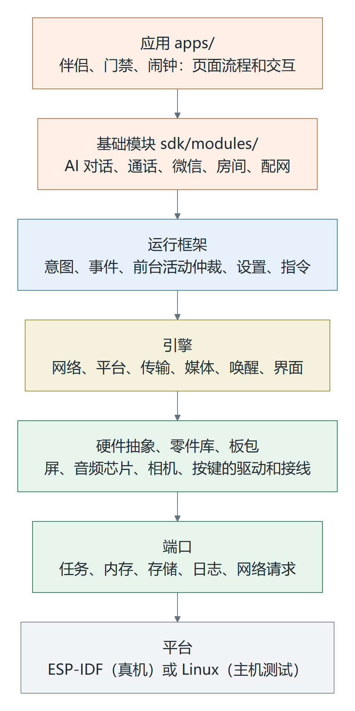
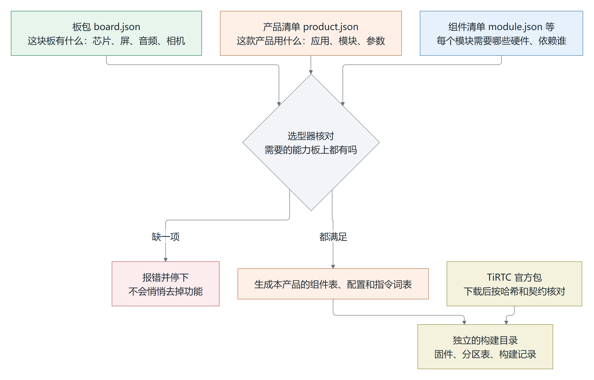
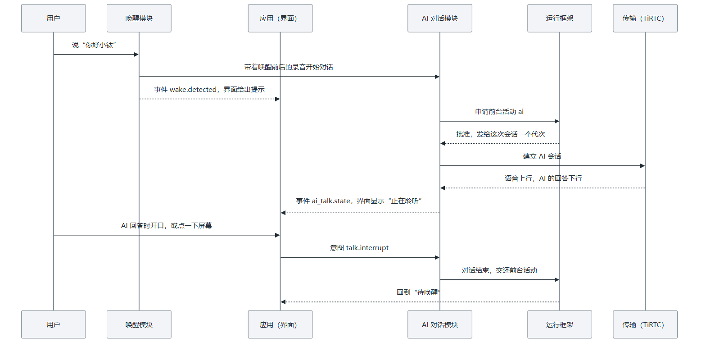

# 架构总览

[文档地图](README.md) · [开发指南](开发指南.md) · [SDK 架构](SDK架构.md) · [新板接入](新板接入.md)

**给谁看**：要在小钛上改功能、接新板的开发者，以及想参考它的结构设计的人。

**读完能了解**：代码分几层、每层管什么，五个关键的设计决定各自解决什么问题，以及这些做法要付出什么。精确的规则在 [SDK 架构](SDK架构.md) 里，这一篇讲思路。

## 要解决的问题

小钛的结构围绕四个工程问题。做法概括成一句话：把板子之间的差异写成数据，把对麦克风和喇叭的争用和模块之间的配合收进框架，把业务代码和芯片平台隔开，把外部依赖逐项核对。

| 问题 | 具体是什么 |
| --- | --- |
| 五块板差别很大 | 屏幕从 320×240 到 1024×600；芯片有 ESP32-S3、ESP32-P4 和 ESP32-S31；有的带摄像头，有的不带；有的 Wi-Fi 在主芯片上，有的在另一颗联网芯片上。每块板复制一份工程，修一个通话问题要改五遍；在公共代码里按板名写分支，接第六块板要读懂所有分支 |
| 几项功能共用麦克风和喇叭 | 通话、AI 对话、多人对讲、实时查看都要用同一套音频硬件，谁先谁后要有统一的规矩 |
| 只能在真机上验证，太慢 | 业务代码一旦直接调用芯片和 ESP-IDF，就没法在电脑上成批地跑测试、看界面 |
| 外部库容易配错 | 通话库是预编译的，它和 ESP-IDF、工具链的版本稍有出入，就会出现换一台机器编不过、或者运行不正常 |

## 分层



| 层 | 目录 | 一句话 |
| --- | --- | --- |
| 应用 | `apps/` | 一种产品形态的页面和流程，例如伴侣、门禁、闹钟 |
| 基础模块 | `sdk/modules/` | 一项可以复用的业务，例如 AI 对话、通话、配网、绑定。模块不画页面 |
| 运行框架 | `sdk/xiaotai_framework/` | 意图、事件、谁占用麦克风和喇叭、设置、串口指令 |
| 引擎 | `sdk/` 下其余的 `xiaotai_*` 目录 | 底层能力：网络、云端连接、传输、媒体、唤醒、界面 |
| 硬件抽象和零件 | `sdk/xiaotai_hal/`、`sdk/parts/` | 屏、音频芯片、触摸、相机这些器件的通用驱动，和上层取用它们的接口 |
| 板包 | `boards/` | 一块具体的板：它有什么，各器件接在哪些引脚上。板包用零件把一块板装起来，它引用零件，别人不引用它 |
| 端口 | `sdk/xiaotai_port/` | 任务、内存、存储、日志、网络请求这些操作系统能力 |
| 运行平台 | ESP-IDF 或 Linux | 真机，或者电脑上的测试环境 |

三条依赖规则：

- **只向下。** 下层不包含上层的头文件。
- **依赖要写进清单。** 一个应用、模块或引擎用到另一个模块或引擎，要在自己的清单里声明。
- **没有人引用板包。** 板包引用硬件抽象、零件和端口，把一块具体的板装起来；`apps/` 和 `sdk/` 里的代码只通过硬件抽象拿到器件，不知道自己跑在哪块板上。

`scripts/check_sdk_layers.py` 核对这些规则，运行 `python scripts/check_structure.py` 或主机测试时都会执行它。

## 决定一：板子有什么和产品用什么，分开写

分成两份清单，是因为板子和产品是多对多的关系。同一个伴侣应用要落在五块不同的板上；同一组应用在 WT99 上以门禁为首页，在微雪 P4 上以伴侣为首页。

**板子有什么**写在板包的 `board.json` 里。这是 GUITION 7 寸屏的完整声明，共 23 行：

```json
{
  "schema": 3,
  "target": "esp32s31",
  "identity": {
    "title": "GUITION 7 寸屏",
    "model": "guition-jc1060f570c",
    "revision": "1.0",
    "profile_model": "GUITION-JC1060F570C-V1.0",
    "profile_chip": "ESP32-S31",
    "release": {"slug": "guition-esp32s31", "model": "晶彩开发板 · ESP32-S31（7寸屏）", "file": "guition-esp32s31"}
  },
  "memory": {"external_ram": true},
  "parts": {
    "audio_input": [{"encoding": "pcm16", "rate_hz": 16000, "roles": ["mic", "reference", "unused", "unused"]}],
    "audio_output": [{"encoding": "pcm16", "rate_hz": 16000, "channels": 2}],
    "display": [{"pixel": "rgb565", "width": 1024, "height": 600, "touch": true}],
    "network": [{"kind": "wifi", "provisioning": ["portal", "serial"]}]
  },
  "components": ["xiaotai_part_bus", "xiaotai_part_audio", "xiaotai_part_display",
                 "xiaotai_part_panel_rgb", "xiaotai_part_touch_gt911"],
  "partitions": "partitions.csv",
  "idf": ["6.1"]
}
```

它只说这块板有什么：一块 1024×600 的触摸屏、一路麦克风加一路回采、双声道输出、自带 Wi-Fi，没有摄像头。`parts` 是这块板具备的能力，`components` 是它要用到的零件。

**产品用什么**写在 `product.json` 里。同一块板的产品清单开头是这样的：

```json
{
  "schema": 1,
  "name": "xiaotai-jc1060f570c",
  "board": "guition/jc1060f570c",
  "applications": ["door", "companion", "alarm"],
  "home": "companion",
  "needs_any": ["key", "touch"],
  "modules": ["theme_lcd480", "theme_character", "contacts", "ai_talk", "call", "wechat", "room", "stream", "wake",
              "recognition", "video_call", "environment", "clock"]
}
```

（节选，后面还有参数和选项。）

**哪些是数据，哪些是代码。** `board.json` 放的是给选型器和构建核对用的事实。引脚接在哪、上电顺序、怎么创建各个器件，写在同目录的 `board.cc` 里。固件启动时还会核对一次：`board.cc` 实际提供的器件和 `board.json` 声明的不一致，就停下。

**选型器**是 `scripts/sdk_selection.py`。编译之前，它把三样东西对一遍：板包的 `board.json`、产品的 `product.json`、各个应用和模块自己的清单。



产品选的模块需要摄像头而板子没有，构建直接报错停下，不会悄悄把这个功能去掉。都对上之后，它生成这款产品的组件表、配置和串口指令词表，再交给 ESP-IDF 编译。

**换来了什么**：GUITION 这块板自己的东西，集中在三处：`boards/guition/jc1060f570c/` 下的 9 个文件（其中 `board.cc` 146 行）、一份产品清单，以及 `profiles/` 里它的构建档案和依赖锁。它用到的新屏和新音频芯片做成了通用零件，放在 `sdk/parts/`，别的板也能用。在 `sdk/` 和 `apps/` 里搜索这块板的名字，一处都没有。

## 决定二：每个模块自己声明需要什么

模块把自己的要求写在清单里。这是 AI 对话模块的 `module.json`：

```json
{
  "name": "ai_talk",
  "registrations": {"commands": 1, "intents": 5, "subscribers": 3},
  "depends": ["binding", "platform", "transport", "media", "identity", "eventlog", "at"],
  "needs": ["audio_in", "audio_out", "network"],
  "activities": {"ai": 2},
  "start": true,
  "commands": [
    {"command": "AT+AI", "access": "read"},
    {"command": "AT+AI", "verb": "START", "access": "action"},
    {"command": "AT+AI", "verb": "STOP", "access": "action"}
  ]
}
```

（节选，省略了配置函数和 `AT+AI` 的另外两个动作。）

| 字段 | 意思 |
| --- | --- |
| `needs` | 要求板子有麦克风、喇叭和网络 |
| `depends` | 用到哪些引擎和模块，选型器据此把它们一起带进固件 |
| `activities` | 它会占用麦克风和喇叭，这件事叫 `ai`，默认优先级是 2（见决定三） |
| `commands` | 它提供哪些串口指令，每条是只读还是会触发动作 |
| `registrations` | 它会向框架登记多少东西：几组串口指令（按首词算，`AT+AI` 的五种写法算一组）、几个意图、几个事件订阅（意图和事件见决定三） |

为什么要预先写明登记数量：框架里这些表的容量是编译时算好的固定值，由选型器把选中的清单加起来生成。实际登记超出了声明，设备启动就会失败并报错，不会悄悄丢掉一条。

应用的清单叫 `application.json`，写法相同。

**换来了什么**：加一个模块时，在它自己的目录里写实现和 `module.json`，再在需要它的 `product.json` 里把它选上。这块板能不能用它、要连带编进哪些依赖、框架该留多少容量、串口指令表里有没有它，都由选型器从清单推出来，不用去改别处的总表。

## 决定三：争用硬件和模块之间的配合，都交给框架

通话（`call`）、AI 对话（`ai`）、声音识别（`recognition`）、多人对讲（`room`）、实时查看（`stream`）都要用麦克风和喇叭。各模块不自己抢，而是向框架申请“前台活动”。优先级的默认值在各模块的清单里，产品可以在 `product.json` 里改。立创实战派 S3 是这样写的：

```json
"priorities": {"call": 3, "ai": 2, "recognition": 2, "room": 1, "stream": 1, "alarm": 1}
```

| 情况 | 结果 |
| --- | --- |
| 新来的优先级更高 | 接管。正在进行的那件事被结束，不会自动恢复 |
| 新来的优先级相同或更低 | 被拒绝，得到“忙” |

所以 AI 对话进行中有电话打进来，电话会接管；通话中说唤醒词，不会打断通话。产品还可以在 `preemptions` 里对某一对活动单独规定能不能打断，这条规定优先于上面按数字比大小的规则。五款彩屏产品用的是同一张表，单独规定的只有一对：加入多人对讲可以接管实时查看（人在设备前，优先于远端）；带声音识别的产品另规定它不打断多人对讲和实时查看。

### 三个贯穿全局的约定

一次 AI 对话里各部分是这样配合的：



| 约定 | 做法 | 解决什么 |
| --- | --- | --- |
| 意图 | 按键、触摸、唤醒词、串口指令都只发出“想做什么”，例如 `talk.interrupt`，由负责的模块处理 | 界面和驱动不直接改业务状态 |
| 事件 | 模块把“发生了什么”发出来，例如 `ai_talk.state`，界面订阅后更新显示 | 业务不知道界面长什么样 |
| 代次 | 每次会话有一个编号，迟到的旧消息编号对不上就丢弃 | 上一通电话的挂断消息不会挂掉下一通 |

图里第二步的“带着录音”指的是：唤醒模块会把唤醒词前后的一段录音一起交给对话，所以“你好小钛，今天天气怎么样”可以一口气说完。

**换来了什么**：只要业务模块已经提供了对应的意图和事件，界面可以单独改，新的触发方式（例如多一个按键）可以单独加，产品可以调整谁能打断谁，都不用改业务模块本身。

## 决定四：业务代码不直接碰平台，所以能在电脑上跑

`sdk/`、`apps/` 和 `boards/` 里的可移植代码不包含 ESP-IDF、FreeRTOS 和驱动的头文件，只通过端口层和零件接口使用平台。一个组件确实需要平台相关的实现时，把它单独放在组件里名为 `esp-idf/` 的子目录，对应的电脑版放在 `host/` 子目录。其中创建总线、屏、音频芯片这类硬件的调用，只允许出现在零件和端口层的 `esp-idf/` 里。端口层因此有两套实现：一套给 ESP-IDF，一套给 Linux。

**换来了什么**：

- **主机测试。** 同一份业务代码在电脑上编译运行，网络、云端和外设换成假实现。仓库里有两百八十多个这样的测试，带地址检查和未定义行为检查，几分钟跑完。入口在 `tests/`。它测的是逻辑；真机上的内存、时序和听感仍然要上板看。
- **界面预览。** 真实的产品、主题和 LVGL（界面用的图形库）在电脑上运行，`tools/ui_preview.py` 一条命令把每一页画成图片。这套文档里的屏幕截图都是它生成的。
- **业务代码不认识芯片。** `apps/` 和 `sdk/modules/` 里没有按芯片型号写的分支，`scripts/check_sdk_layers.py` 会拦下这种写法。支持 ESP32-S31 时，改的是 `scripts/` 里的构建登记、`sdk/parts/` 里的零件和依赖声明。

## 决定五：外部依赖只用官方发布版，逐项核对

为了不让预编译库和环境的版本对不上，小钛在编译之前逐项核对：

- **通话库 TiRTC 不放在仓库里。** `components/tirtc_sdk/packages.json` 记着每种芯片、每条 ESP-IDF 版本线用哪个官方包，以及它的 SHA-256。第一次编译时自动下载，哈希不对就停下。库和头文件还要对上一份构建契约：它是用哪个 ESP-IDF、哪个工具链编的，依赖哪些配置。
- **ESP-IDF 核对官方提交。** 版本号相同但源码被改过，会被拦下。
- **每款产品的依赖有锁。** `profiles/` 里记着各产品在每条版本线上用到的组件和版本。
- **每次构建留一份记录。** `build-record.json` 记下这次用了哪些输入、产出了什么，其中有应用的 ELF SHA-256。设备上用串口命令 `version` 读出的是同一个哈希。

**换来了什么**：同样的源码换一台机器，只要通过了核对并编了出来，用的就是同一套依赖和工具链。留着每次构建的 `build-record.json`，设备出了问题，就能用它报出的哈希对上是哪一次构建。

## 代价和适用的前提

这些做法都有成本。想在自己的项目里借鉴，先看是不是值得：

| 做法 | 要付出什么 | 什么时候值得 |
| --- | --- | --- |
| 清单加选型器（决定一、二） | 要维护清单的格式和选型器本身 | 多块板或多种产品形态并行。只有一块板、一种产品时收益有限 |
| 前台活动、意图和事件（决定三） | 每个会用麦克风和喇叭的功能都要先向框架申请；模块之间不直接互相调用，查问题时要顺着意图和事件去找 | 有两项以上功能要共用同一套音频硬件，或者界面和业务要分开演进 |
| 两套端口实现加主机测试（决定四） | 要长期维护 ESP-IDF 和 Linux 两套端口，以及网络、云端和外设的假实现 | 业务逻辑多、真机验证慢的项目 |
| 只用官方发布版并逐项核对（决定五） | 不能在本地改 ESP-IDF 源码救急；升级依赖要先更新登记和契约 | 多人协作，或者要长期维护已经发出去的固件 |

## 仓库目录和这些决定的对应

| 目录或工具 | 放什么 | 对应的决定 |
| --- | --- | --- |
| `boards/` | 每块板的 `board.json`、接线代码、分区表 | 一 |
| `products/` | 每款产品的 `product.json` | 一 |
| `scripts/sdk_selection.py` | 选型器 | 一、二 |
| `apps/`、`sdk/modules/` | 应用和基础模块，各带自己的清单 | 二 |
| `sdk/xiaotai_framework/` | 意图、事件、前台活动、设置 | 三 |
| `sdk/xiaotai_hal/`、`sdk/parts/` | 硬件抽象和通用零件 | 一、四 |
| `sdk/xiaotai_port/` | 端口层的两套实现 | 四 |
| `scripts/check_sdk_layers.py` | 分层和依赖规则的检查 | 四 |
| `tests/`、`tools/ui_preview.py` | 主机测试和界面预览 | 四 |
| `components/tirtc_sdk/`、`profiles/` | TiRTC 包的登记和契约、各产品的依赖锁 | 五 |

## 接着读

| 想做的事 | 看这里 |
| --- | --- |
| 自己编一次 | [第一次编译](第一次编译.md) |
| 加一个功能 | [开发指南](开发指南.md#加一个功能) |
| 接一块新板 | [新板接入](新板接入.md) |
| 查某一层的精确规则 | [SDK 架构](SDK架构.md) |
