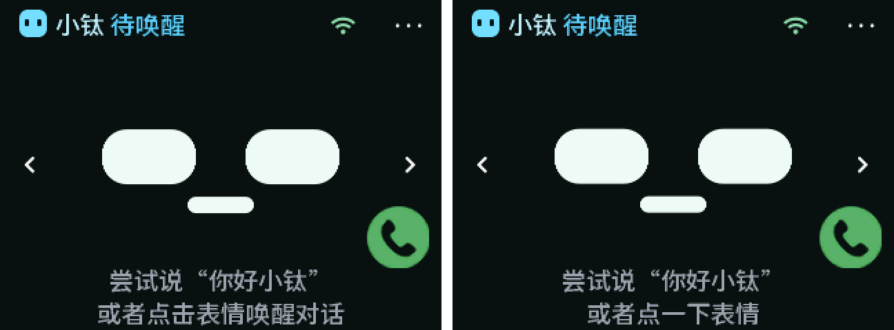

# 用 AI 助手开发

[文档地图](README.md) · [第一次编译](第一次编译.md) · [开发指南](开发指南.md) · [测试与诊断](测试与诊断.md)

**给谁看**：用 AI 编程助手（例如 Claude Code）写代码的开发者，以及想了解“怎么让助手在一个固件工程里靠谱地干活”的人。

**读完能做到**：知道仓库自带的十个技能各管什么，会对助手提需求，能判断它有没有按技能做，看得懂它为什么按那个顺序做事。

## 技能是什么

技能是写给 AI 助手的操作手册。每个技能是 `.claude/skills/<名字>/` 下的一份 `SKILL.md`，有的还带脚本和参考资料。它用这个仓库自己的命令和约定，把一类任务该怎么做、按什么顺序做、做完怎么确认写清楚。

固件工程里，助手最容易出的问题不是写不出代码，而是不知道这个仓库的规矩：该用哪个脚本编译、烧录前要核对什么、改了界面要看几种屏、哪些串口指令会改变设备状态。技能把这些规矩交给它。文档解释为什么，技能规定怎么做。

## 怎么用

**先看环境。** 技能要运行的命令，对电脑的要求和你自己手动做是一样的：

| 要做的事 | 电脑上要有 |
| --- | --- |
| 界面预览、主机测试 | Linux 或 WSL，Python 3、C/C++ 编译器、CMake 和 Ninja。不用接开发板 |
| 编译 | 装好并激活的 ESP-IDF，见[第一次编译](第一次编译.md) |
| 烧录、真机上查问题 | 装好并激活的 ESP-IDF，再加一块用 USB 接好的开发板 |

**提需求。** 在对应的环境里进入仓库根目录，启动 Claude Code，用平常的话说需求。要编译和烧录，就在激活了 ESP-IDF 的终端里启动；要做界面预览和主机测试，就在 Linux 或 WSL 里启动。

| 情况 | 怎么办 |
| --- | --- |
| 想确认它用了技能 | 助手用到技能时，对话里会显示它加载的技能名，例如 `xiaotai-ui` |
| 它没有用技能，或者选错了 | 在需求里直接写上技能名，例如“按 `xiaotai-build` 编一下立创那块板” |
| 你用的是别的 AI 助手 | 多数别的助手不会自动加载这些文件。没有自动加载时，先让它读 `.claude/skills/<名字>/SKILL.md`；目录里有 `references/` 的一起读，有 `scripts/` 的按说明调用，再开始干活 |

## 十个技能

表里的几个词是这个仓库的概念：板包是一块板的硬件描述，产品是“一块板加一组功能”，层是代码的分层，主机测试是不接开发板、在电脑上跑的测试。详见[架构总览](架构总览.md)和[术语表](术语表.md)。

| 你可以这样说 | 用到的技能 | 它会做什么 |
| --- | --- | --- |
| “编一下立创那块板”“只更新应用”“设备上跑的是哪个版本” | `xiaotai-build` | 日常的编译和烧录：选板和 ESP-IDF 版本、预检、编译、核对产物、烧录、确认版本 |
| “接一块新板”“适配我的板子” | `xiaotai-new-board` | 先说明能选哪些功能，只问还缺的硬件资料，再建板包、写产品清单、编译 |
| “新固件第一次上这块板，验一遍” | `xiaotai-bringup` | 一款产品第一次上真板：核对、决定怎么烧、十项基础功能逐项过 |
| “升级到新的 ESP-IDF”“支持一种新芯片” | `xiaotai-port` | 先用自带的盘点脚本列出已知要适配的位置，再逐项登记、编译、验证 |
| “加一个闹钟”“加一条串口指令” | `xiaotai-feature` | 先对照已有的模块确定改哪一层，再写组件、选进产品、补测试 |
| “这一页不好看”“改一下文案”“出图看看” | `xiaotai-ui` | 在电脑上把每一页画成图片，按设计规范改，核对几种屏，跑界面测试 |
| “对方能听到自己的回声” | `xiaotai-echo` | 先让设备自己的喇叭出声、旁边没人说话，量出回声被压低了多少，再逐项排查原因 |
| “这两份代码重复了，合并一下” | `xiaotai-refactor` | 判断属于哪一层，把按板名写死的差异改成按硬件能力选择，并用测试验证行为不变 |
| “这个改动要测什么”“回归一下” | `xiaotai-test` | 按改动的范围选测试：静态检查、主机测试、编译、真机回归 |
| “开不了机”“通话断断续续”“内存越来越少” | `xiaotai-verify` | 先用一条命令取到数据，再从硬件到界面逐层判断问题在哪一层 |

一件事跨了几个技能时，它们会互相指路。例如 `xiaotai-test` 测出问题后，会转到 `xiaotai-verify` 去定位。

## 一次真实的过程：改一句界面文字

下面是在这个仓库里实际做过的一次。输出是当时的原样，命令里的目录换成了通用的写法。

**需求**

> 首页那句“或者点击表情唤醒对话”太长了，改短一点。先别烧板，出图给我看。

**助手做了什么**

这是改界面，对应 `xiaotai-ui`。技能要求分清改的是“页面上有什么”还是“页面长什么样”，改之前先出一套图，改完再出一套对比，最后跑测试。

1. **找到这句话在哪。** 文字属于“页面上有什么”，在应用里，不在主题里：

   ```text
   apps/xiaotai_app_companion/src/companion_home.c:301
   ```

2. **改之前先出图。** 这句话在几款屏上是同一段代码，先拿立创实战派 S3 看：

   ```bash
   python3 tools/ui_preview.py --product xiaotai-szpi-s3 --out build/ui-preview
   ```

   ```text
   xiaotai-szpi-s3: 21 pictures
   ```

3. **改一行。**

   ```diff
   -            else if (wake) view->text = tap ? "尝试说“你好小钛”\n或者点击表情唤醒对话" : "尝试说“你好小钛”";
   +            else if (wake) view->text = tap ? "尝试说“你好小钛”\n或者点一下表情" : "尝试说“你好小钛”";
   ```

4. **再出一次图**，输出到另一个目录，免得盖掉改之前的那一套。用时 40 秒：

   ```bash
   python3 tools/ui_preview.py --product xiaotai-szpi-s3 --out build/ui-preview-after
   ```

5. **跑这款产品的主机测试**，确认已有的测试没有因为改这句话而失败。用时 68 秒：

   ```bash
   python3 -B tests/sdk/product/run.py --product xiaotai-szpi-s3
   ```

   ```text
   PASS: xiaotai-szpi-s3/default: 81 tests
   ```

**结果**

左边是改之前，右边是改之后。整个过程没有碰开发板。

<p align="center"></p>

按需求，助手做到这里就停下，把对比图交给你。接下来还有两件事由你决定：提交之前把其余几款屏也出一遍图（不带 `--product` 就是全部）；要不要烧到板子上。`xiaotai-ui` 里有一条提醒：真屏的颜色和触摸的手感从图片里看不出来，上板后要在真机上再看一眼。

## 另一个例子：编译一块板

**需求**

> 编一下立创那块板，用默认的 ESP-IDF。

对应 `xiaotai-build`。它不会上来就编，而是按这个顺序：

| 步骤 | 命令 | 作用 |
| --- | --- | --- |
| 确认环境 | `python scripts/build.py --list-idf` | 确认当前激活的 ESP-IDF 是要用的那个版本 |
| 准备通话库 | `python scripts/fetch_tirtc.py` | 下载官方包并核对哈希 |
| 预检 | `python scripts/build.py lckfb/szpi-esp32s3 --dry-run` | 板子缺能力、组合不支持，在这一步就能看出来 |
| 编译 | `python scripts/build.py lckfb/szpi-esp32s3` | 生成固件。这次 2478 步，用时 172 秒 |
| 核对产物 | `python tests/verify_build.py --board lckfb/szpi-esp32s3 --entry sdk --require-flash-layout build/xiaotai-szpi-s3/sdk-firmware` | 确认编出来的正是选中的那些模块，烧录地址也对 |

两个例子里同一块板有两种写法：编译命令用板参数 `lckfb/szpi-esp32s3`，界面预览和主机测试用产品名 `xiaotai-szpi-s3`。`python` 和 `python3` 的区别在于环境：编译在激活了 ESP-IDF 的终端里做，那里的命令是 `python`；界面预览和主机测试在 Linux 或 WSL 上做，用系统的 `python3`。

如果你接着让它烧录，它会先读设备上的分区表，再决定怎么写：

| 设备上的情况 | 它的做法 |
| --- | --- |
| 分区表和新固件一致 | 只写应用，配网和绑定保留 |
| 分区表变了但数据分区没变，或者设备是全新的 | 启动程序、分区表、应用三个文件都写 |
| 数据分区变了 | 停下来，告诉你重装会清掉配网和绑定，等你决定 |

这个过程的完整输出见[第一次编译](第一次编译.md)。

## 技能里有什么

```text
.claude/skills/
├── xiaotai-build/SKILL.md
├── xiaotai-new-board/SKILL.md
├── xiaotai-bringup/SKILL.md
├── xiaotai-port/
│   ├── SKILL.md
│   └── scripts/port_inventory.py     盘点脚本：列出移植时已知要适配的位置
├── xiaotai-feature/SKILL.md
├── xiaotai-ui/SKILL.md
├── xiaotai-echo/SKILL.md
├── xiaotai-refactor/SKILL.md
├── xiaotai-test/SKILL.md
└── xiaotai-verify/
    ├── SKILL.md
    └── references/
        ├── 定界方法.md               怎么从现象判断到层
        └── 案例.md                   22 个实际遇到过的故障和判断过程
```

一份 `SKILL.md` 的骨架是这样的，以 `xiaotai-ui` 为例：

```markdown
---
name: xiaotai-ui
description: 改小钛彩屏的界面和交互：在电脑上把每一页画成 PNG 看效果……用户说界面难看、改样式、调布局……时使用。
---

# 改界面
（先分清改应用还是改主题的一张表）

## 1. 先出图
## 2. 设计规范
## 3. 改的时候注意
## 4. 测试
```

开头的 `description` 写它管什么、用户说什么话时该用它，助手靠这一段决定要不要加载。正文是步骤、命令、要核对的输出和常见的错法。

多数技能一份 `SKILL.md` 就够。只有两种情况拆出了子目录：要自动列清单的，带脚本（`xiaotai-port`）；参考资料很长的，单独放（`xiaotai-verify`）。

## 几条贯穿所有技能的规矩

这些规矩也适合人照着做：

| 规矩 | 例子 |
| --- | --- |
| 先看，再动 | 编译前先预检（`--dry-run`）；烧录前先读设备上的分区表；发指令前先读状态 |
| 能在电脑上验证的，不留到板子上 | 界面先出图，逻辑先跑主机测试 |
| 会改变设备的动作要明确授权 | 测试工具 `tools/xt/xt.py` 做通话、重启、写设置这类动作，要在命令里逐条写 `--allow`，用法见[测试与诊断](测试与诊断.md) |
| 用数据判断，不凭印象 | “通话断续”先抓两端的帧对比，再说是哪一层 |
| 做完要确认 | 烧完核对设备上运行的固件就是刚编的那一份 |

### 哪些是工具拦住的，哪些靠约定

| 约束 | 靠什么保证 |
| --- | --- |
| 板子缺少产品需要的硬件 | 工具拦住：编译时选型器（核对板子和产品是否对得上的脚本）报错，编不出来 |
| 通话库、ESP-IDF 的版本不对 | 工具拦住：编译时核对通话库的哈希和 ESP-IDF 的官方提交 |
| 代码违反分层规则 | 工具能查出来：运行 `scripts/check_structure.py` 或主机测试会不通过。编译本身不查这一项 |
| 测试工具执行会改变设备状态的动作 | 工具拦住默认情况：命令里没写 `--allow` 就不执行。助手自己加不加 `--allow`，要靠你在它执行前看一眼 |
| 先预检再编译、先出图再改、会清数据的烧录先停下来问 | 靠技能里的步骤约定 |

靠约定的那一类，助手偶尔会跳步。看到它跳过了核对，直接叫停，让它回到 `SKILL.md` 的那一步重做。

## 想加一个自己的技能

1. 先读 `.claude/skills/xiaotai-ui/SKILL.md`。它只有七十来行，结构最简单。
2. 在 `.claude/skills/` 下新建一个目录，目录名就是技能名。放一份 `SKILL.md`，照上面“技能里有什么”的骨架填好 `name`、`description` 和正文的步骤。
3. 重新开一次 Claude Code 的会话，提一个应该用到它的需求，看对话里有没有显示加载了这个技能。
