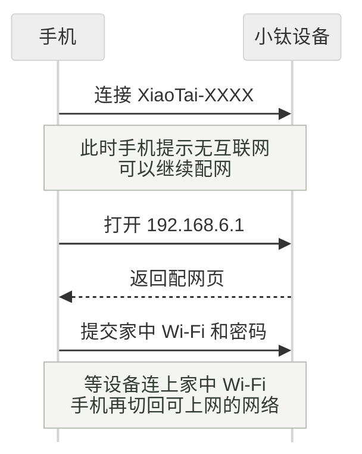
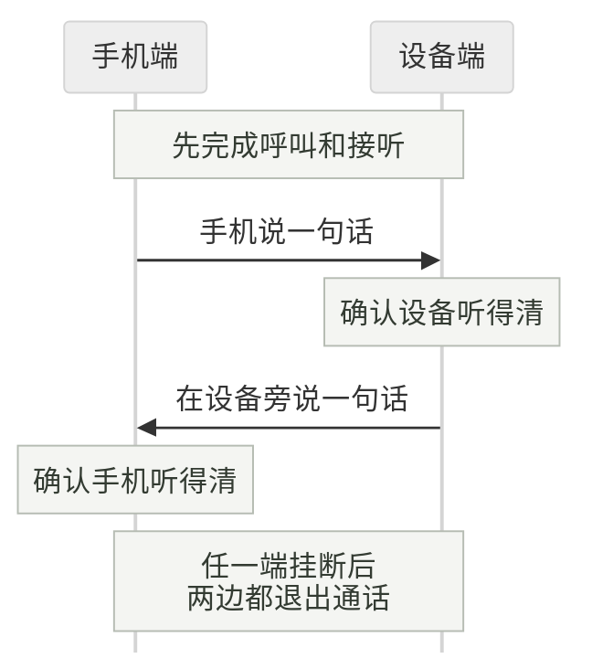

# 第一次使用小钛

[返回首页](../README.md) · [选板](../README.md#选板) · [开发文档](架构开发指南.md)

本指南配合 `codex/multi-chip-v2` 多芯片开发分支。使用公开固件时，还要核对该固件随包的板型和操作说明，不混用两个版本的配置、文件或验收结论。

先完成一次对话或通话。暂时不用读代码，也不用记住 SDK、分区表这些名字。

已经装好小钛的设备，可以直接从[连接 Wi-Fi](#4-连接-wi-fi)开始；已经联网并绑定，就去[试一个功能](#6-试一个功能)。

| 现在到哪一步了 | 接着做什么 |
| --- | --- |
| 还没选好板子或固件 | [认准板子](#1-认准板子)，找到完全匹配的固件和说明 |
| 设备已装好小钛，正在等配网 | [连接 Wi-Fi](#4-连接-wi-fi)，再[绑定设备](#5-绑定设备) |
| 已绑定，但还没试过声音 | [试一个功能](#6-试一个功能)，分别听两个方向的声音 |
| 某一步没有成功 | 看[排查表](#卡在哪一步就先查哪一步)，先保留现象，不急着重刷 |

## 1. 认准板子

查看板背面、包装或购买记录，确认完整型号、板卡版本和屏幕型号。只知道“ESP32-S3”还不够，它是芯片名称，不是完整板型。拍一张正反面照片留作核对，比凭外观猜更可靠。

本统一开发版适配的六块板见[首页选板表](../README.md#选板)。特别留意：

- 微雪 P4 **3.5 寸和 4.3 寸**不是同一板型，固件不能混用。
- 本分支两块 P4 的默认配置最低为 rev3.1，不用于 rev1.x；烧录前仍要核对具体固件的适用范围。板上印的 PCB 版本与芯片修订是两回事。
- M5Stack 要确认是 CoreS3-Lite，并核对所用固件要求的屏幕控制器；名称相近不代表固件通用。
- Xmini 和 MZ28 都用 C3，但屏幕、音频与操作方式不同，也不能互刷。

还没买板时，先核对是否有匹配的固件和说明，再决定硬件。不要只按“都是 S3”购买替代型号。

**这一步完成的标志：你能写出板子的完整型号，并找到完全匹配的说明。**

## 2. 准备设备和固件

准备好开发板、一根能传数据的 USB 线、一台电脑、一部手机，以及能上网的 2.4 GHz Wi-Fi。只供电的充电线无法用于烧录。微信通话还需要手机上的微信和相应授权。

固件是安装到开发板里的程序文件。这里分两种情况：

| 你的目的 | 到哪里拿程序 |
| --- | --- |
| 先体验已发布的小钛 | 打开[公开固件目录](https://github.com/tangeai/xiaotai/blob/main/docs/downloads.md)，找到完全匹配的板型，再进入对应烧录指南 |
| 验证这个统一开发版，或修改代码 | 按[本仓编译步骤](../README.md#从源码编译)生成固件；公开下载包不能代替本仓源码的验证 |

公开固件与本统一开发版分别维护，板型列表、版本和构建命令可能不同。公开目录中的微雪 4.3 寸包不能用于本仓的 3.5 寸板；找不到对应型号时，先停在这里，向维护者确认，不试刷相近型号。

下载页有 ZIP 和 BIN 时，按同一版本的指南选一种方式。不要把不同版本的文件凑在一起，也不要把源码 ZIP 当固件烧录。

**这一步完成的标志：板型、固件版本、文件与烧录指南能一一对应。**

## 3. 把固件装进开发板

“烧录”就是把固件写进设备。具体连接哪个 USB 口、按哪个键、选择哪些文件，都按第 2 步找到的**本板、本版本指南**操作；这里不提供六板通用的烧录地址。

1. 先备份需要保留的设备数据。写入完整镜像会覆盖原有 Wi-Fi、绑定等配置，不只是换一个应用。
2. 用数据线连接电脑，在烧录工具中确认选中的是这块板。多块设备同时连接时，先核对串口再继续。
3. 按指南添加文件和地址，等待写入及校验完成。进度条到 100% 不能代替成功校验。
4. 退出烧录工具，让设备正常重启，观察屏幕或本板的语音、灯光提示。

本仓单独生成的 `xiaotai.bin` 是应用文件，不是完整镜像，不能直接套用完整镜像的 `0x0` 地址。需要保留原配置时，必须先核对分区和配置兼容性，不能因为用了分文件包就默认安全。

**这一步完成的标志：写入校验成功，设备也能正常启动。** 黑屏、反复重启或一直没有启动提示时，先查板型、文件和供电，不急着配网，更不要反复全片擦除。

## 4. 连接 Wi-Fi

“配网”就是告诉设备要连接哪个 Wi-Fi、密码是什么。已经联网的设备跳过这一步，不必为了跟教程走而清除配置。

本仓的配网入口使用设备热点 `XiaoTai-XXXX` 和地址 `http://192.168.6.1`。`XXXX` 是每台设备不同的后缀；使用其他版本固件时，同时核对屏幕提示和配套说明。

手机在这里要换一次网络：先连设备热点，把家中 Wi-Fi 交给设备；设备连上后，手机再恢复正常上网。

图中是操作顺序；账号绑定需要外网，不能一直留在设备热点里操作。

1. 等设备进入配网状态，用手机在 Wi-Fi 列表中连接它的 `XiaoTai-XXXX` 热点。
2. 手机提示“无互联网”时，保持这次连接。此时是在设置设备，不是在用它上网。
3. 配网页没有自动打开，就在浏览器地址栏输入 `http://192.168.6.1`。这个地址只在连着设备热点时使用。
4. 选择家里或测试用的 2.4 GHz Wi-Fi，填入密码并提交，等待设备连接。
5. 设备连上网后，让手机恢复正常上网：切回路由器 Wi-Fi 或移动网络，再去绑定。

**这一步完成的标志：设备结束配网，开始获取绑定码；已绑定的设备恢复在线。** 热点页面能打开，只说明手机连到了设备，还不能说明设备已经连上外网。

## 5. 绑定设备

绑定是把设备加入你的账号，之后才能在手机或网页上找到它。连接 Wi-Fi 和绑定是两步，完成其中一步不会自动完成另一步。

1. 读取设备显示或播报的六位绑定码。
2. 按设备提示进入绑定入口：彩屏设备会给出网址；Xmini 提示在微信搜索“小钛”。无屏设备按该固件说明操作，MZ28 会播报绑定码。
3. 在相应入口登录账号，添加设备并输入**当前这次**的绑定码。验证码过期就使用新码，不继续填旧码。
4. 等待手机或网页中出现设备，确认设备本身也结束绑定提示。按界面要求补好设备名称，再发起通话。

**这一步完成的标志：你的设备列表里出现了这台设备，并且设备在线。** 仅有绑定码、仅显示 Wi-Fi 已连接，都不等于已经可以通话。

固件只负责设备这一端。在线功能还依赖绑定平台、TiRTC 实时音视频服务，以及所用的 AI 或微信服务。自己编译固件不会自动部署这些服务；接自建平台时，服务配置另见开发文档。

遇到“已经连上了，为什么还不能通话”，先分清看到的是哪种状态：

| 看到的状态 | 它能说明什么 | 还不能据此判断什么 |
| --- | --- | --- |
| Wi-Fi 已连接 | 设备连到了路由器 | 平台和音视频服务是否可达 |
| 账号里有这台设备 | 账号有这台设备的绑定记录 | 设备此刻是否在线 |
| 平台在线 | 平台连接已建立 | TiRTC 音视频服务是否就绪 |
| RTC 就绪，或已经开始通话计时 | 对应的服务或会话状态已建立 | 麦克风、上传、下行和扬声器是否都正常 |

这些是不同的检查项，不代表每块板都有同名提示。下一步用实际声音确认。开发者使用[诊断入口](本地诊断与AT指令.md)前，先核对支持的板型；本分支统一 AT 诊断构建目前仅接入立创 S3，不把该套指令当成六板通用接口。

## 6. 试一个功能

先试最简单的一项，成功后再试其他功能。按手上固件的实际支持范围操作，不要求每块板都完成下面所有项目。

### AI 聊天

在支持 AI 的设备上进入 AI 对话，说一句“你好，请介绍一下自己”。听到回复后再问一句，然后退出，观察设备能否回到待机。

算这次体验成功，要同时满足：它听懂了你的话、回复能听清、结束后能正常待机。只看到“正在聆听”还不够。MZ28 的默认产品只有微信语音，不做这一项。

### 手机和设备通话

确认手机端已登录、设备已命名并在线。完成小程序要求的通话授权后，从设备页发起呼叫，在设备上接听，两边各说一句，再挂断。

彩屏设备按来电界面接听。按本仓 MZ28 的当前按键逻辑，来电时短按 BOOT 接听，通话中双击挂断；其他固件以其按键说明为准，不拿一个板型的手势套所有板。

箭头表示这次要检查的声音方向，不是网络直连。某一边无声时，记清方向，例如“手机听不到设备”，排查时就不会把采集和播放混在一起。

算这次体验成功，要两边都能听到对方，挂断后也都退出通话。接通计时或音频计数增加，只能说明部分链路工作，不能代替实际听声音。

完成其中一项，就已经走通了首次体验。之后再按本板支持范围检查其他功能；开发者按[验证范围](VALIDATION.md)补齐重复操作、业务切换、弱网和长时间运行。一次成功不代表这些项目也已通过。

## 卡在哪一步，就先查哪一步

| 看到的情况 | 先检查什么 |
| --- | --- |
| 电脑找不到设备 | USB 线能否传数据、是否插在本板的烧录口、串口是否被其他程序占用 |
| 烧录后黑屏或反复重启 | 完整板型、屏幕版本、同版文件清单、写入地址和供电 |
| 手机连热点后显示无互联网 | 配网阶段正常；保持连接并打开设备配网页，不用因此重刷 |
| 打不开配网页 | 手机是否仍连着这台设备的热点，地址是否为 `http://192.168.6.1` |
| 有绑定码，但添加不了设备 | 手机是否已恢复上网，是否填了本台设备尚未过期的码 |
| 手机里有设备，但显示离线 | 先看设备当前网络和启动状态；有历史绑定记录不等于当前在线 |
| 显示正在聆听，但没有回复 | 记下发生时间、屏幕状态和说了什么，分别查采集、上传和服务回复；先保留现场 |
| 能接通，某一边听不到声音 | 写清“手机听不到设备”还是“设备听不到手机”，再检查对应方向，不笼统写成“没声音” |

需要帮忙时，提供板型、固件版本、卡住的步骤、原本期待的结果、实际提示和发生时间。照片或日志可以补充，但先遮住绑定码、Wi-Fi 密码、账号凭据和设备密钥。立创 S3 的串口检查方法见[本地诊断](本地诊断与AT指令.md)，其他板型不要照抄这套指令。

几个常见词，用到时再看

| 词 | 可以怎样理解 |
| --- | --- |
| 固件 | 安装在开发板里的程序 |
| 编译 | 从源码生成设备能运行的程序文件 |
| 烧录 | 把这些程序文件写进设备 |
| 配网 | 给设备设置 Wi-Fi 名称和密码 |
| 绑定 | 把设备加入你的账号 |
| ESP-IDF | 乐鑫提供的开发工具，自己编译 ESP32 程序时需要 |
| H5 | 网页端，不是另一种开发板 |
| RTC / TiRTC | 实时音视频通信，以及本项目使用的相关软件开发包与服务 |

## 想继续开发

先保留一份能运行的固件和它的版本记录，再从[架构开发指南](架构开发指南.md)选择加功能、接硬件或调整配置的路径。这里不要求你一口气学完所有模块。

本仓当前实测范围和待测项见[验证状态](VALIDATION.md)。本指南说明操作流程，不表示六块板已经完成全部真机验收。
