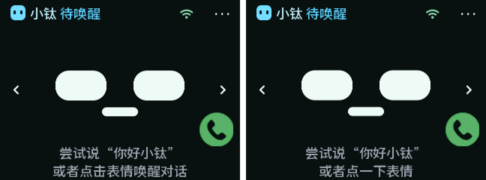

# 第一次编译

[文档地图](README.md) · [开发指南](开发指南.md) · [架构总览](架构总览.md) · [用 AI 助手开发](用AI助手开发.md)

**给谁看**：想改小钛的代码、编出自己固件的开发者。假定你会用命令行，装过或愿意装 ESP-IDF。

**读完能做到**：从源码编出一块板的固件，烧进去，在串口里看到它启动；然后改一行界面文字，在电脑上先看到效果。

**例子用的板**：立创实战派 S3。换别的板时，先在第 2 节的列表里找到它那一行，把后文的三样东西一起换掉：板参数（`lckfb/szpi-esp32s3`）、产品名（`xiaotai-szpi-s3`，应用文件名里连字符写成下划线）和芯片（`esp32s3`）。GUITION 7 寸屏要用 ESP-IDF 6.1，见[开发指南的“编译与烧录”](开发指南.md#编译与烧录)。

**对电脑的要求**：第 1 到 7 节在 Linux、macOS 和 Windows 上都能做。第 8 节（在电脑上预览界面、跑测试）需要 Linux 或 WSL，其他系统做到第 7 节就完成了编译和烧录。

除第 7 节的串口回答外，文中的输出取自一次真实的编译：Linux（WSL）、ESP-IDF 6.0.3、14 线程的电脑、全新的源码目录。你的路径和耗时会不同；随着代码更新，编译步数、固件大小和测试数量也会变。输出的样子和关键的几行应当一致。

## 1. 准备环境

| 需要 | 版本 | 说明 |
| --- | --- | --- |
| ESP-IDF | 6.0.3 | 按[乐鑫官方文档](https://docs.espressif.com/projects/esp-idf/zh_CN/v6.0.3/esp32s3/get-started/index.html)安装官方原版，不要修改它的源码。安装工具链时选上你那块板的芯片 |
| Python | 随 ESP-IDF | ESP-IDF 的安装过程会准备好 |
| Git | 任意较新的版本 | 用来取源码 |

装好之后，每次打开新的终端，先激活 ESP-IDF 环境（Linux 和 macOS 是 `. <ESP-IDF 目录>/export.sh`，Windows 用安装器建好的终端快捷方式），再做后面的步骤。

取源码：

```bash
git clone https://github.com/tangeai/xiaotai-esp32.git
cd xiaotai-esp32
```

确认环境对了：

```bash
python scripts/build.py --list-idf
```

**做对了会看到**：最后一行报告当前激活的 ESP-IDF，版本是 6.0.3。

```text
Active ESP-IDF: 6.0.3 at ~/esp/esp-idf-6.0.3
```

如果是 `Active ESP-IDF: none`，说明这个终端里还没有激活环境。

## 2. 看看有哪些板

```bash
python scripts/build.py --list-boards
```

```text
m5stack/core-s3                                  xiaotai-cores3-lite              esp32s3
guition/jc1060f570c                              xiaotai-jc1060f570c              esp32s31
lckfb/szpi-esp32s3                               xiaotai-szpi-s3                  esp32s3
waveshare/esp32-p4-wifi6-touch-lcd-3.5           xiaotai-waveshare-p4-rev3        esp32p4
wt/wt9932p4c61-tiny                              xiaotai-wt9932p4c61-tiny         esp32p4
wt99p461-s1                                      xiaotai-wt99p461-s1-1v1          esp32p4
```

三列依次是：编译时用的板参数、产品名、芯片。

## 3. 先预览，不编译

```bash
python scripts/build.py lckfb/szpi-esp32s3 --dry-run
```

`--dry-run` 只把这次构建会用到的东西列出来，不编译：

| 字段 | 意思 |
| --- | --- |
| `board` | 板参数，对应 `boards/` 下的一个板包 |
| `name` | 产品名，对应 `products/` 下的一份产品清单。一个产品 = 一块板 + 选定的功能 |
| `idf_line` | ESP-IDF 版本线，例如 `6.0` 指 6.0.x 这一系列 |
| `entry` | 构建入口，现在只有 `sdk` 一种 |
| `selection` | 这款产品选中的应用和模块 |
| `build_dir` | 输出目录 |

开头是这样的：

```json
{
  "entry": "sdk",
  "name": "xiaotai-szpi-s3",
  "board": "lckfb/szpi-esp32s3",
  "target": "esp32s3",
  "stage": "firmware",
  "idf_line": "6.0",
  "idf_environment": {
    "version": "6.0.3",
    "git_commit": "76f5dedd9950a3012fee8fb7d5586df21fc67802"
  },
```

**做对了会看到**：一份完整的 JSON，没有报错。板子缺少产品需要的硬件，或者当前的 ESP-IDF 版本不对，都会在这一步报出来。

## 4. 编译

第一次编译需要联网，要取两样东西：从乐鑫的组件仓库取依赖的组件，从 TiRTC 发布站下载通话库的官方包并核对 SHA-256。编译机连不上 TiRTC 发布站时，先按下面折叠的那一段导入离线包；完全不能上网的，还要按[开发指南的“离线编译”](开发指南.md#离线编译)准备组件缓存。

小钛用 `scripts/build.py` 编译，不直接运行 `idf.py build`。它在调用 ESP-IDF 之前，先按产品清单选出组件、核对环境和 TiRTC 包、生成配置。

```bash
python scripts/build.py lckfb/szpi-esp32s3
```

这次编译共 2478 步，用时 172 秒。结尾是这样的：

```text
[2476/2478] Generating binary image from built executable
esptool v5.6.0
Creating ESP32-S3 image...
Merged 3 ELF sections.
Successfully created ESP32-S3 image.
xiaotai_szpi_s3.bin binary size 0x541cc0 bytes. Smallest app partition is 0xd00000 bytes. 0x7be340 bytes (60%) free.

Project build complete.
```

**做对了会看到**：`Project build complete.`，以及应用大小和分区剩余空间那一行。这行后面 ESP-IDF 还会打印它默认的烧录命令，不用照着做，烧录按第 6 节来。

<details>
<summary>编译机不能上网时</summary>

在编译机上运行 `python scripts/fetch_tirtc.py`，它连不上网时会打印每个包的下载地址和 SHA-256。在别的机器上把这些 `.tgz` 包下载好，拷到编译机，再用同一个脚本导入：

```bash
python scripts/fetch_tirtc.py --from <放着 .tgz 的目录>
```

```text
ready  6.0/generic-esp32s3: TiRTC 2.6.3 in components/tirtc_sdk/packages/tirtc__espressif_esp32s3_idf6_0_3__esp-idf6.0.3-xtensa-esp15.2.0_20251204__v2.6.3__mini
ready  6.0/generic-esp32p4: TiRTC 2.6.3 in components/tirtc_sdk/packages/tirtc__espressif_esp32p4_idf6_0_3__esp-idf6.0.3-riscv32-esp15.2.0_20251204__v2.6.3__mini
```

看到自己芯片的那一行 `ready` 之后，回到上面运行编译命令。

</details>

## 5. 看产物

产物在 `build/xiaotai-szpi-s3/sdk-firmware/`：

| 文件 | 是什么 |
| --- | --- |
| `xiaotai_szpi_s3.bin` | 应用，这次是 5,512,384 字节 |
| `bootloader/bootloader.bin` | 启动程序 |
| `partition_table/partition-table.bin` | 分区表 |
| `flash_args` | 每个文件该写到哪个地址 |
| `build-record.json` | 这次构建用了哪些输入、产出了什么 |

`flash_args` 的内容：

```text
--flash-mode dio --flash-freq 80m --flash-size 16MB
0x0 bootloader/bootloader.bin
0x8000 partition_table/partition-table.bin
0x10000 xiaotai_szpi_s3.bin
```

这一步可以跳过。想在不接设备的情况下核对一次产物，运行：

```bash
python tests/verify_build.py --board lckfb/szpi-esp32s3 --entry sdk --require-flash-layout build/xiaotai-szpi-s3/sdk-firmware
```

**做对了会看到**：输出的 JSON 里有 `"flash_layout_verified": true`（各文件的烧录地址和分区表对得上）和 `"elf_image_identity_verified": true`（应用文件正是这次编出的那一个）。

## 6. 烧录

用 USB 数据线接上开发板（插哪个口见[这块板的页面](开发板/立创实战派-S3.md)），进入构建目录，把三个文件按 `flash_args` 写进去：

```bash
cd build/xiaotai-szpi-s3/sdk-firmware
python -m esptool --chip esp32s3 -p <串口> write-flash @flash_args
```

`<串口>` 在 Windows 上形如 `COM5`，在 Linux 上形如 `/dev/ttyACM0`，在 macOS 上形如 `/dev/cu.usbmodem101`。

WSL 默认访问不到 USB 串口。在 WSL 里编译的话，烧录和看串口放到 Windows 的终端里做：Windows 上装好 Python，运行 `pip install esptool`；串口用 `COM` 号；WSL 里的构建目录在 Windows 上通过 `\\wsl$` 这个网络位置打开。

**做对了会看到**：每个文件写完后都有一行 `Hash of data verified.`，最后设备重启，屏幕亮起。

### 只更新应用，保留配网和绑定

满足下面三条时，只写应用这一个文件就行，配网和绑定都会保留：设备里已经是小钛固件；只改了代码；没有换 ESP-IDF 版本线。有一条不满足，就按本节开头的做法把三个文件都写一遍。

在构建目录 `build/xiaotai-szpi-s3/sdk-firmware` 里，对照这次的 `flash_args` 确认应用的地址和文件名，再执行：

```bash
python -m esptool --chip esp32s3 -p <串口> write-flash 0x10000 xiaotai_szpi_s3.bin
```


## 7. 看日志，用串口命令检查设备

用任意串口终端打开开发板的串口。装了 ESP-IDF 的环境里可以直接用：

```bash
python -m serial.tools.miniterm <串口> 115200
```

设备启动时会打印启动日志，其中有固件版本和 ELF 的 SHA-256。烧录完设备已经启动过了，想重看启动日志就按一下板上的复位键。然后在终端里输入下面两条命令，各按一次回车：

```text
version
status
```

| 命令 | 回答什么 |
| --- | --- |
| `version` | 板型、固件版本，以及运行中这份固件的 ELF SHA-256 |
| `status` | 联网、平台连接、通话链路、当前活动和内存，一次列出 |
| `help` | 这份固件支持的全部命令 |

下面是在一台已经配网、绑定的 GUITION 7 寸屏（用 ESP-IDF 6.1 编译）上取到的真实回答，只隐去了网络地址，`>` 开头的行是输入的命令。立创实战派 S3 的格式相同，`board`、`chip`、`platform`、`elf_sha256`、内存和联网状态的数值会不同。

```text
> version
+VERSION: board=guition-jc1060f570c revision=1.0 version=0.3.2-dev platform=ESP-IDF_v6.1 chip=esp32s31 cores=2 at=1
+BUILD: elf_sha256=8005c16427f69a5d0d7bba4f0b1308017b1fab1a6f8356527ec9fe93e581c8bc
OK
```


```text
> status
+NET: state=up kind=wifi connected=1 provisioning=0 … rssi=-49 channel=11 … error=0
+PLATFORM: phase=6 online=1 clock=1 discovered=1 authorized=1 signaling=1 … error=0
+LINK: started=1 connected=0 kind=2 gen=0 send_buffer=262144 error=0 …
+STATE: started=1 app=companion activity=none id=0 uptime_ms=3111785
+MEM: kind=internal total=475763 free=161903 min_free=31980 largest=122880 …
+MEM: kind=bulk total=10542720 free=4675940 min_free=4526128 largest=4456448 …
OK
```

| 这一行 | 先看哪几项 |
| --- | --- |
| `+NET` | `connected=1` 表示连上了 Wi-Fi，`rssi` 是信号强度 |
| `+PLATFORM` | `online=1 authorized=1 signaling=1` 表示已经连上云端并通过鉴权 |
| `+LINK` | 通话链路：`started` 是否已启动，`connected` 此刻有没有通话在进行 |
| `+STATE` | `app` 是前台的应用，`activity=none` 表示此刻没有通话或对话 |
| `+MEM` | `internal` 是芯片内部内存，`bulk` 是外部内存；`min_free` 是开机以来的最低值 |

**做对了会看到**：两条命令都以单独一行 `OK` 结束；`+BUILD:` 里的 ELF SHA-256 和 `build-record.json` 里记的一致，说明设备上跑的正是你刚编的这一份。

刚烧好的新板子还没配网，`connected` 和 `online` 是 `0`，这是正常的；按[快速开始](快速开始.md#3-配网)配网、绑定之后再查，就会变成 `1`。

看完按 `Ctrl+]` 退出串口终端。不退出的话串口一直被占着，下次烧录会连不上。

`version`、`status` 这类是通用维护命令；设备另有一套以 `AT+` 开头、分得更细的指令。两套都在 [AT 指令](AT指令.md) 里。

## 8. 改一行，先在电脑上看效果

小钛的业务代码能在电脑上运行，改界面不用每次都烧板。下面把首页的提示语改短。

这一节需要 Linux 或 WSL，以及本机的 C/C++ 编译器、CMake 和 Ninja。先回到仓库根目录。

第一次先准备要用到的组件源码。它们在第 4 步编译时已经下载到本机缓存里，这条命令从缓存里取出来核对。缓存里缺的会列出来，加上 `--download` 再运行一次，让它从乐鑫的组件仓库下载：

```bash
python3 tests/fetch_components.py --set all
```

打开 `apps/xiaotai_app_companion/src/companion_home.c`，找到这一行，把 `或者点击表情唤醒对话` 改成 `或者点一下表情`：

```diff
-            else if (wake) view->text = tap ? "尝试说“你好小钛”\n或者点击表情唤醒对话" : "尝试说“你好小钛”";
+            else if (wake) view->text = tap ? "尝试说“你好小钛”\n或者点一下表情" : "尝试说“你好小钛”";
```

在电脑上把这款产品的每一页画出来：

```bash
python3 tools/ui_preview.py --product xiaotai-szpi-s3 --out build/ui-preview
```

```text
xiaotai-szpi-s3: 21 pictures
Overview: build/ui-preview/index.html
```

在浏览器里打开 `build/ui-preview/index.html`，找到首页那一张，提示语已经变短了。下图左边是改之前，右边是改之后：

<p align="center"></p>

再跑这款产品的主机测试，确认没有碰坏别的东西：

```bash
python3 -B tests/sdk/product/run.py --product xiaotai-szpi-s3
```

```text
PASS: xiaotai-szpi-s3/default: 81 tests
```

这次改动，出图用了 40 秒，测试用了 68 秒。

确认无误后，在仓库根目录再运行一次第 4 步的编译命令，然后进入构建目录，按第 6 节“只更新应用”的方式烧进去，在真机上再看一眼。

## 接下来

| 想做的事 | 看这里 |
| --- | --- |
| 给刚烧好的板子配网、绑定 | [快速开始](快速开始.md#3-配网) |
| 弄清一个需求该改哪一层 | [开发指南](开发指南.md) |
| 理解为什么这样分层 | [架构总览](架构总览.md) |
| 让 AI 编程助手帮你做上面这些 | [用 AI 助手开发](用AI助手开发.md) |
| 用 ESP-IDF 5.5 或 6.1 编译 | [开发指南的“编译与烧录”](开发指南.md#编译与烧录) |
| 接自己的板子 | [新板接入](新板接入.md) |
| 编译报错、开不了机 | [测试与诊断](测试与诊断.md) |
